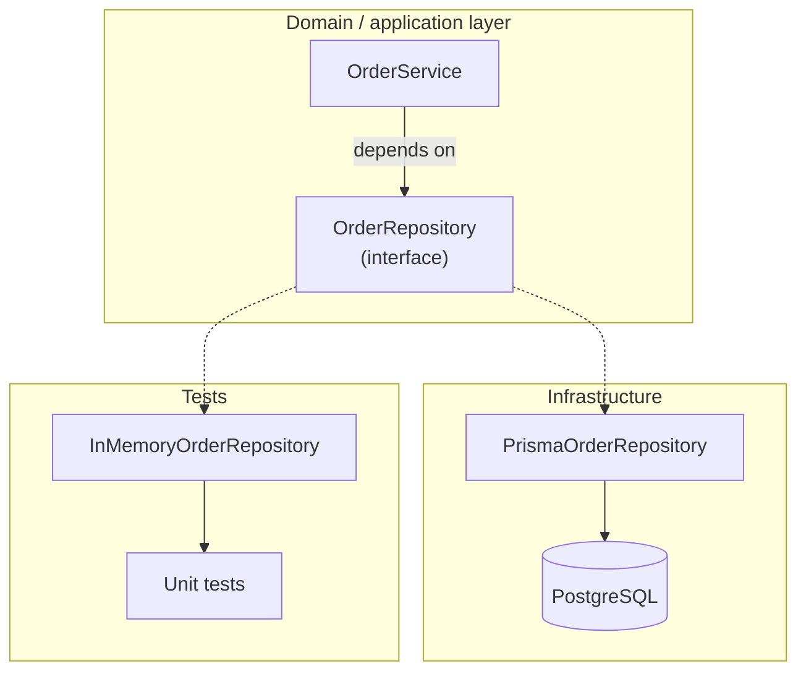

# Pattern 1 — Repository

**Category:** Data and object creation · Data access
**Stack used in examples:** TypeScript · Node.js · Express · PostgreSQL · Prisma

> 📚 **Deep dive:** [chapter-wise notes](notes/README.md) — ten chapters that expand every section below with code, tests, and production guidance.

---

## 1. What problem does it solve?

Without a repository, database queries spread across controllers, route handlers, and business services.

```ts
// A tightly coupled service
async function getOrder(id: string) {
  return prisma.order.findUnique({
    where: { id },
    include: { items: true },
  });
}
```

This is **not automatically bad** in a small application. The problem appears later, when all of the following get mixed into one place:

- Business rules (is this order allowed to be cancelled?)
- Database queries (`where`, `include`, `select`, joins)
- Transformations (DB row → API response)
- Transaction handling

Once that happens, changing the data access implementation forces changes in many parts of the application, and unit testing business logic requires a real database.

## 2. What the pattern actually is

A repository is an **interface** that describes the persistence operations the domain needs, plus **one or more implementations** that talk to a specific storage technology.

The service knows *what* operations exist. It does not know *how* they are executed.



Dotted arrows point from the interface to its implementations: PostgreSQL in production, an in-memory fake in tests.

Key rule: **the interface belongs to the domain, the implementation belongs to infrastructure.** Dependencies point inward, never outward.

## 3. Practical TypeScript implementation

### 3.1 Domain type and interface

```ts
export type OrderStatus = "pending" | "paid" | "cancelled";

export type Order = {
  id: string;
  userId: string;
  total: number;
  status: OrderStatus;
};

export interface OrderRepository {
  findById(id: string): Promise<Order | null>;
  findByUser(userId: string): Promise<Order[]>;
  save(order: Order): Promise<void>;
}
```

The interface is expressed in **domain language** (`Order`), not in ORM language (`Prisma.OrderGetPayload<...>`).

### 3.2 PostgreSQL implementation with Prisma

```ts
import { PrismaClient } from "@prisma/client";

export class PrismaOrderRepository implements OrderRepository {
  constructor(private readonly prisma: PrismaClient) {}

  async findById(id: string): Promise<Order | null> {
    return this.prisma.order.findUnique({
      where: { id },
      select: { id: true, userId: true, total: true, status: true },
    });
  }

  async findByUser(userId: string): Promise<Order[]> {
    return this.prisma.order.findMany({
      where: { userId },
      select: { id: true, userId: true, total: true, status: true },
      orderBy: { createdAt: "desc" },
    });
  }

  async save(order: Order): Promise<void> {
    await this.prisma.order.upsert({
      where: { id: order.id },
      create: order,
      update: { total: order.total, status: order.status },
    });
  }
}
```

`select` is deliberate: an endpoint rarely needs the full object graph. Selecting only what the domain type declares also keeps the mapping honest.

> In the original notes the Prisma client was typed as `any` as a placeholder. In real code, always use the generated `PrismaClient` type.

### 3.3 Service depends on the abstraction

```ts
export class OrderService {
  constructor(private readonly orders: OrderRepository) {}

  async getOrder(id: string): Promise<Order> {
    const order = await this.orders.findById(id);
    if (!order) throw new Error("Order not found");
    return order;
  }

  async cancel(id: string): Promise<void> {
    const order = await this.orders.findById(id);
    if (!order) throw new Error("Order not found");
    if (order.status === "paid") {
      throw new Error("Paid orders must be refunded, not cancelled");
    }
    await this.orders.save({ ...order, status: "cancelled" });
  }
}
```

`OrderService` now has zero knowledge of Prisma, SQL, or table names.

### 3.4 Express wiring

Express has no built-in DI container, so wiring happens in one **composition root**:

```ts
// composition-root.ts
import { PrismaClient } from "@prisma/client";
import { PrismaOrderRepository } from "./prisma-order.repository";
import { OrderService } from "./order.service";

const prisma = new PrismaClient();

export const orderRepository: OrderRepository =
  new PrismaOrderRepository(prisma);

export const orderService = new OrderService(orderRepository);
```

```ts
// orders.routes.ts
import { Router } from "express";
import { asyncHandler } from "./async-handler";
import { orderService } from "./composition-root";

export const ordersRouter = Router();

ordersRouter.get(
  "/:id",
  asyncHandler(async (req, res) => {
    const order = await orderService.getOrder(req.params.id);
    res.json(order);
  }),
);
```

The route translates HTTP into a service call and nothing more. `asyncHandler` forwards rejected promises to Express error middleware; without it (or Express 5's native promise handling) a failed `await` can leave the request hanging.

```ts
// async-handler.ts
import type { NextFunction, Request, Response } from "express";

type AsyncRoute = (
  req: Request,
  res: Response,
  next: NextFunction,
) => Promise<unknown>;

export const asyncHandler =
  (fn: AsyncRoute) => (req: Request, res: Response, next: NextFunction) =>
    Promise.resolve(fn(req, res, next)).catch(next);
```

If the object graph grows large, add a lightweight container (tsyringe, Awilix, typedi) — but keep the domain interface unchanged either way.

### 3.5 Test double

```ts
export class InMemoryOrderRepository implements OrderRepository {
  private readonly rows = new Map<string, Order>();

  async findById(id: string) {
    return this.rows.get(id) ?? null;
  }

  async findByUser(userId: string) {
    return [...this.rows.values()].filter((o) => o.userId === userId);
  }

  async save(order: Order) {
    this.rows.set(order.id, { ...order });
  }
}
```

Unit tests of `OrderService` are now fast and deterministic. The real repository gets its own integration tests against a test database.

## 4. What the repository should NOT be

- ❌ A 1:1 mirror of every ORM method (`findMany`, `findFirst`, `count`, `aggregate`, …) — that is a wrapper, not an abstraction.
- ❌ A place for business rules. `cancelPaidOrder()` belongs to the service/domain, not the repository.
- ❌ A generic `BaseRepository<T>` with `any` everywhere — it pushes type safety and query knowledge back into services.

## 5. Production considerations

| Concern | Guidance |
| --- | --- |
| **Transactions** | Several repository calls are **not** atomic by default. Pass a transaction handle (unit of work) or accept a `tx` argument so multiple writes share one transaction. |
| **Query efficiency** | Avoid loading full object graphs; project only needed fields. Watch for N+1 queries when mapping relations. |
| **Pagination** | Prefer cursor pagination for large or frequently changing sets; offset for small admin tables. Return `{ items, nextCursor }`, not a bare array. |
| **Consistency** | Enforce invariants with DB constraints too — the database is the last line of defence under concurrency. |
| **Testing** | Fake repository for unit tests, real repository against a disposable PostgreSQL container for integration tests. |
| **Over-abstraction** | If a repository only forwards calls, it adds indirection without value. Introduce it where a meaningful boundary exists. |

### Transaction sketch

```ts
await prisma.$transaction(async (tx) => {
  await orderRepo.save(order, tx);
  await outboxRepo.add(event, tx);
});
```

## 6. When to use / when not to

**Use it when**
- Data access is non-trivial or repeated.
- Multiple services must follow the same persistence rules.
- You want to unit test business logic without a database.
- You may swap ORM/storage or support more than one store.
- You want a clear place to enforce query-level policies (soft delete, tenancy filters).

**Avoid it when**
- The app is a small CRUD service and the ORM already gives a clean boundary.
- The abstraction would just duplicate every ORM method.
- You need highly dynamic, ad-hoc reporting queries — use a dedicated read/query layer instead.

## 7. Common mistakes

1. Returning ORM entities directly from the repository and leaking ORM types into services.
2. Throwing database-specific errors (`PrismaClientKnownRequestError`) out of the repository instead of domain errors.
3. Assuming two `save()` calls equal a transaction.
4. Adding `findAll(): Promise<any[]>` “just in case” — unbounded queries in production.
5. Putting authorization inside the repository (it belongs to the application layer) **and** forgetting to scope queries by tenant.

## 8. Relationship to other patterns

- **Adapter** — a repository is essentially an adapter between domain language and a database API.
- **Factory** — used to construct the right repository implementation per environment.
- **Singleton / DI** — the Prisma client and repository instances are process-level singletons wired once in the Express composition root.
- **CQRS** — command-side repositories enforce invariants; query-side repositories return purpose-built read models.
- **Decorator** — caching/logging repositories can wrap a real repository behind the same interface.

## 9. Practice checklist

- [ ] Write the interface first, in domain terms.
- [ ] Implement it against PostgreSQL with explicit field selection.
- [ ] Write a fake implementation and unit-test the service.
- [ ] Add one integration test that proves the SQL behaves as expected.
- [ ] Define the transaction boundary for any multi-write use case.
- [ ] Add pagination to every list method before shipping.

## 10. One-line takeaway

> A repository is worth its weight only when it hides a *meaningful* boundary — not when it merely renames the ORM.

