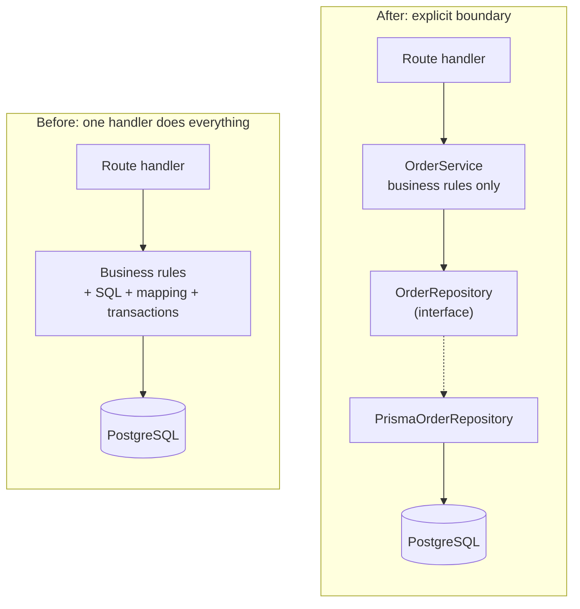

# Chapter 1 — Why Data Access Needs a Boundary

> Companion to [`../notes.md`](../notes.md) · Section 1
> **Learning goals:** recognise the symptoms of mixed responsibilities, and decide
> honestly whether your application has the problem yet.

## 1.1 The starting point is not wrong

A small Express service that calls Prisma directly is easy to read and fast to
change. This is a legitimate design:

```ts
app.get("/orders/:id", async (req, res) => {
  const order = await prisma.order.findUnique({
    where: { id: req.params.id },
    include: { items: true },
  });
  if (!order) return res.status(404).json({ error: "Not found" });
  res.json(order);
});
```

The pattern is not a moral obligation. It earns its keep when the code around
that query starts to carry several unrelated responsibilities at once.

## 1.2 Four responsibilities that get mixed

| Responsibility | Typical code | Where it belongs |
| --- | --- | --- |
| Business rule | `if (order.status === "paid") throw ...` | Service / domain |
| Query shape | `where`, `include`, `select`, joins, index hints | Repository |
| Mapping | DB row → API response, dates, enums, money | Mapper / repository |
| Transaction | `$transaction`, retries, outbox writes | Service + unit of work |

When all four live in a route handler, every change touches the same file and
every test needs a database.

## 1.3 Symptoms that justify the pattern

| Symptom | What you notice | Root cause |
| --- | --- | --- |
| Query duplication | The same `include: { items: true }` appears in five files | No single query owner |
| Test friction | Service tests need Docker, migrations, and seed data | Persistence leaks into logic |
| Ripple changes | Renaming a column breaks controllers | ORM types used everywhere |
| Inconsistent rules | One endpoint checks `paid`, another forgets | Business rules scattered |
| Partial writes | Order saved but the audit row is missing | No transaction boundary |
| Ownership gaps | Nobody knows which query is slow | Queries have no home |

Two or more of these together are a strong signal. One duplicated query in a
CRUD endpoint is not.

## 1.4 Before and after



The number of boxes is not the point. The point is that the arrow from the
service points at an **interface**, so the service can be tested and reasoned
about without a database.

## 1.5 A realistic "before" service

```ts
export async function cancelOrder(id: string) {
  const row = await prisma.order.findUnique({
    where: { id },
    include: { items: true, payments: true },
  });

  if (!row) throw new Error("Order not found");
  if (row.status === "paid") throw new Error("Refund instead");

  await prisma.$transaction([
    prisma.order.update({ where: { id }, data: { status: "cancelled" } }),
    prisma.auditLog.create({
      data: { entity: "order", entityId: id, action: "cancelled" },
    }),
  ]);

  return { ...row, status: "cancelled", items: row.items.map(/* ... */) };
}
```

Everything works — until you need a second caller, a different storage for
tests, or a change to how cancellations are persisted. The function has become
the only place that knows the schema, the rule, the transaction, and the API
shape.

## 1.6 When direct ORM access is still the right call

- The endpoint is a thin CRUD pass-through with no invariants.
- The query is genuinely ad-hoc reporting and will never be reused.
- The team is small, the schema is stable, and the abstraction would only
  forward calls.
- You are prototyping and will delete the code afterwards.

The pattern is a boundary, not a layer cake. Add it where a boundary exists.

## Exercise

1. Pick one route in your application. List every responsibility from the table
   in §1.2 that it performs.
2. Count the files that contain the same `include`/`where` fragment.
3. Decide: extract a repository, or leave it and document why.

---

**Next:** [Chapter 2 — The repository concept and its boundaries →](02-concept-and-boundaries.md)
**Index:** [Repository notes](README.md) · **Source:** [`../notes.md`](../notes.md)
