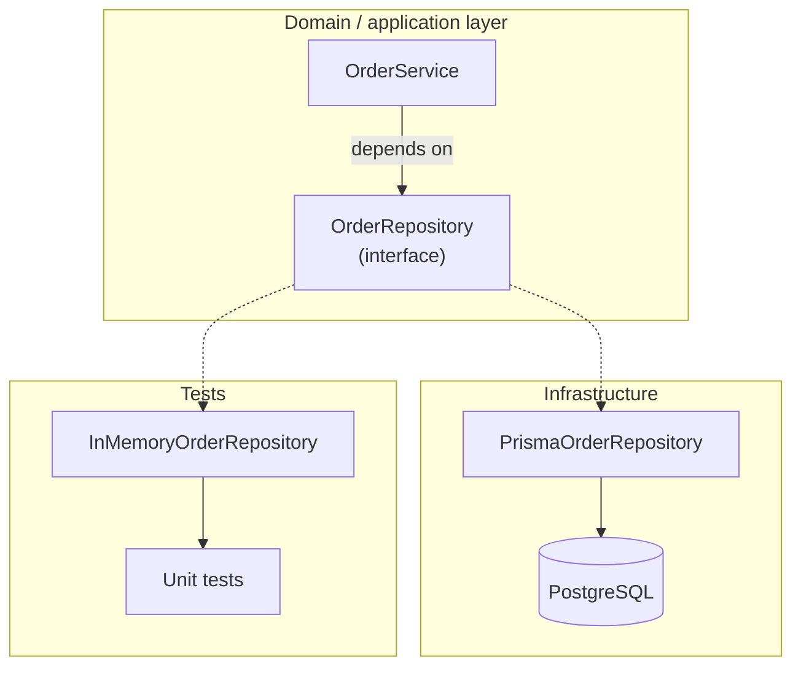

# Chapter 2 — The Repository Concept and Its Boundaries

> Companion to [`../notes.md`](../notes.md) · Section 2
> **Learning goals:** define a repository precisely, place it in the dependency
> graph, and avoid confusing it with a DAO or an ORM wrapper.

## 2.1 Definition

A repository is **an interface in domain language** that exposes the persistence
operations a use case needs, plus **one or more implementations** that talk to a
specific storage technology.

Two parts, two owners:

| Part | Lives in | Knows about |
| --- | --- | --- |
| Interface (`OrderRepository`) | Domain / application | `Order`, pagination, domain errors |
| Implementation (`PrismaOrderRepository`) | Infrastructure | Prisma, SQL, table and column names |

The service knows *what* operations exist. It does not know *how* they run.



Dotted arrows point from the interface to its implementations. The dependency
arrow (`-->`) always points **toward** the interface, never from the domain to
Prisma.

## 2.2 What belongs inside

| Inside the repository | Outside the repository |
| --- | --- |
| `findById`, `findByUser`, `save` | `cancelOrder` business rules |
| `where`, `select`, joins, locks | HTTP status codes and DTOs |
| Row ↔ domain mapping | Authorization decisions |
| Pagination and ordering | Sending emails or events |
| Tenant and soft-delete filters | Cross-aggregate workflows |
| Translating driver errors | Transaction orchestration across repositories |

If a method name contains a business verb ("approve", "refund", "cancel"), it
probably belongs to the service, not the repository.

## 2.3 Repository vs DAO vs ORM vs Active Record

| Concept | Unit of abstraction | Typical API | Knows domain rules? |
| --- | --- | --- | --- |
| **ORM** | Table / model | `prisma.order.findMany` | No |
| **DAO** | Table / record | `insert`, `update`, `findById` | No |
| **Active Record** | Row object that saves itself | `order.save()` | Sometimes |
| **Repository** | Aggregate / domain concept | `findById`, `save` | No, but speaks domain |
| **Service** | Use case | `cancelOrder` | Yes |

A DAO mirrors storage. A repository expresses intent. The difference shows up in
the method names and return types.

## 2.4 One repository per aggregate root

Model the boundary around the **aggregate root**, not around every table.

```text
Order  (aggregate root)
  ├── OrderItem
  └── Payment
```

- `OrderRepository` loads and saves the order together with its items.
- There is no `OrderItemRepository` used by the order workflow — items are
  reached through the aggregate.
- `Payment` may be its own aggregate if it has an independent lifecycle
  (refunds, reconciliation). Otherwise it stays inside `Order`.

Consequences:

- `save(order)` must persist the aggregate atomically.
- Repositories should not return partial graphs that violate invariants.
- Loading strategies (`include` vs separate queries) are an implementation
  detail hidden behind the interface.

## 2.5 Ownership and dependency inversion

The interface is declared by the consumer, not by the database layer:

```ts
// domain/order.repository.ts
import type { Order } from "./order";

export interface OrderRepository {
  findById(id: string): Promise<Order | null>;
  save(order: Order): Promise<void>;
}
```

```ts
// infrastructure/prisma-order.repository.ts
import type { OrderRepository } from "../domain/order.repository";

export class PrismaOrderRepository implements OrderRepository {
  // ...
}
```

This is the dependency-inversion principle in practice: both the service and the
Prisma adapter depend on the interface, and the interface depends on nothing.

## 2.6 Naming

| Good | Avoid | Why |
| --- | --- | --- |
| `OrderRepository` | `OrderDao`, `OrderDb` | Domain language |
| `findById` | `selectOne` | Intent, not SQL |
| `findByUser` | `findManyByUserId` | Domain concept |
| `save` | `upsertRow` | Storage detail |
| `OrderRepository` (singular aggregate) | `OrdersRepository` | One aggregate type |

Consistency matters more than the exact verb. Pick `find`/`save` and apply it
everywhere.

## 2.7 What the repository is not

- Not a 1:1 mirror of the ORM API.
- Not a place for business rules or authorization.
- Not a generic `BaseRepository<T>` with `any` in the signature.
- Not a transaction manager — it participates in transactions owned by the
  service (chapter 7).
- Not a DTO factory — it returns domain objects, and the HTTP layer maps them.

## Exercise

1. Draw your aggregate boundaries. Which tables are roots, and which are
   internal parts?
2. For one repository, list every method and mark whether it is domain language
   or ORM language.
3. Move one business-verb method out of the repository into a service.

---

**Previous:** [Chapter 1 ←](01-why-repository.md)
**Next:** [Chapter 3 — Domain model and interface design →](03-domain-model-and-interface.md)
**Index:** [Repository notes](README.md) · **Source:** [`../notes.md`](../notes.md)
