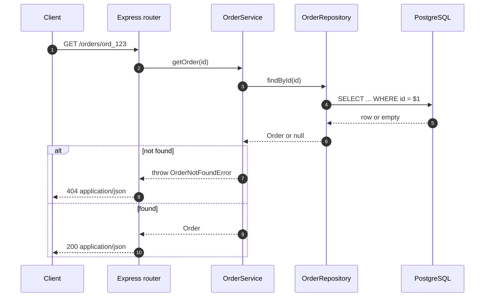

# Chapter 5 — Service and Express Wiring

> Companion to [`../notes.md`](../notes.md) · Sections 3.3–3.4
> **Learning goals:** keep business rules in the service, wire implementations
> once, and translate HTTP concerns at the edge.

## 5.1 The service owns the rules

```ts
// application/order.service.ts
import { OrderNotFoundError, OrderStateError } from "../domain/errors";
import type { Order } from "../domain/order";
import type { OrderRepository, Page, PageRequest } from "../domain/order.repository";

export class OrderService {
  constructor(private readonly orders: OrderRepository) {}

  async getOrder(id: string): Promise<Order> {
    const order = await this.orders.findById(id);
    if (!order) throw new OrderNotFoundError(id);
    return order;
  }

  async listOrders(userId: string, page: PageRequest): Promise<Page<Order>> {
    return this.orders.findByUser(userId, page);
  }

  async cancel(id: string): Promise<void> {
    const order = await this.getOrder(id);

    if (order.status === "paid") {
      throw new OrderStateError("Paid orders must be refunded, not cancelled");
    }
    if (order.status === "cancelled") return; // idempotent

    await this.orders.save({ ...order, status: "cancelled" });
  }
}
```

`OrderService` has no Prisma import, no SQL, no table names, and no Express
types. It can be unit-tested with the fake from chapter 6.

Add the state error to `domain/errors.ts`:

```ts
export class OrderStateError extends Error {
  constructor(message: string) {
    super(message);
    this.name = "OrderStateError";
  }
}
```

## 5.2 One composition root

Express has no built-in container. Wire everything once at startup:

```ts
// composition-root.ts
import { PrismaClient } from "@prisma/client";
import { OrderService } from "./application/order.service";
import { PrismaOrderRepository } from "./infrastructure/prisma-order.repository";

export const prisma = new PrismaClient();
const orderRepository = new PrismaOrderRepository(prisma);

export const orderService = new OrderService(orderRepository);
```

Rules:

- Construct the `PrismaClient` exactly once (pattern 3, Singleton).
- Choose the implementation in one place; tests can call the same factory with
  a different adapter.
- If the graph grows, add `tsyringe`, `Awilix`, or `typedi` — the domain
  interface does not change.
- Never instantiate a repository inside a route handler; that hides dependencies
  and defeats testing.

## 5.3 Routes translate HTTP, nothing else

```ts
// http/orders.routes.ts
import { Router } from "express";
import { z } from "zod";
import { orderService } from "../composition-root";
import { asyncHandler } from "./async-handler";
import { toOrderResponse } from "./order-response";

const listQuery = z.object({
  limit: z.coerce.number().int().min(1).max(100).default(20),
  cursor: z.string().optional(),
});

export const ordersRouter = Router();

ordersRouter.get(
  "/:id",
  asyncHandler(async (req, res) => {
    const order = await orderService.getOrder(req.params.id);
    res.json(toOrderResponse(order));
  }),
);

ordersRouter.get(
  "/",
  asyncHandler(async (req, res) => {
    const page = listQuery.parse(req.query);
    const result = await orderService.listOrders(req.user!.id, page);
    res.json({
      data: result.items.map(toOrderResponse),
      nextCursor: result.nextCursor,
    });
  }),
);

ordersRouter.post(
  "/:id/cancel",
  asyncHandler(async (req, res) => {
    await orderService.cancel(req.params.id);
    res.status(204).end();
  }),
);
```

The route does three things: validate input, call one service method, shape the
response. No `where`, no `include`, no status rules.

`req.user` comes from authentication middleware; declare it once:

```ts
// types/express.d.ts
declare global {
  namespace Express {
    interface Request {
      user?: { id: string };
    }
  }
}

export {};
```

Response mapping stays in HTTP, so the domain type can evolve independently:

```ts
// http/order-response.ts
import type { Order } from "../domain/order";

export const toOrderResponse = (order: Order) => ({
  id: order.id,
  status: order.status,
  totalCents: order.totalCents,
  createdAt: order.createdAt.toISOString(),
});
```


## 5.4 Async errors and error middleware

```ts
// http/async-handler.ts
import type { NextFunction, Request, Response } from "express";

type AsyncRoute = (
  req: Request,
  res: Response,
  next: NextFunction,
) => Promise<unknown>;

export const asyncHandler =
  (fn: AsyncRoute) => (req: Request, res: Response, next: NextFunction) =>
    Promise.resolve(fn(req, res, next)).catch(next);
```

Express 4 does not catch rejected promises; without this wrapper the request
hangs. Express 5 forwards them natively.

```ts
// http/error-handler.ts
import type { ErrorRequestHandler } from "express";
import { ZodError } from "zod";
import { OrderNotFoundError, OrderStateError } from "../domain/errors";

export const errorHandler: ErrorRequestHandler = (err, _req, res, _next) => {
  if (err instanceof ZodError) {
    return res.status(400).json({ error: "Invalid request", details: err.issues });
  }
  if (err instanceof OrderNotFoundError) {
    return res.status(404).json({ error: err.message });
  }
  if (err instanceof OrderStateError) {
    return res.status(409).json({ error: err.message });
  }

  console.error(err);
  res.status(500).json({ error: "Internal server error" });
};
```

| Situation | Status |
| --- | --- |
| Read succeeded | `200` |
| Created a resource | `201` |
| Command succeeded, no body | `204` |
| Validation failed | `400` |
| Unknown order | `404` |
| Illegal state transition | `409` |
| Unhandled / infrastructure failure | `500` |
| Dependency unavailable (circuit open) | `503` |

## 5.5 Request flow



## 5.6 App and graceful shutdown

```ts
// server.ts
import express from "express";
import { ordersRouter } from "./http/orders.routes";
import { errorHandler } from "./http/error-handler";
import { prisma } from "./composition-root";

export const app = express();
app.use(express.json());
app.use("/orders", ordersRouter);
app.use(errorHandler);

const server = app.listen(3000, () => console.log("listening on :3000"));

for (const signal of ["SIGINT", "SIGTERM"] as const) {
  process.on(signal, () => {
    server.close(async () => {
      await prisma.$disconnect();
      process.exit(0);
    });
  });
}
```

`server.close()` stops accepting connections and waits for in-flight requests;
`$disconnect()` releases the pool. Without this, deploys drop requests.

## Exercise

Add `POST /orders/:id/cancel`, then make `OrderService` throw
`OrderNotFoundError` and `OrderStateError` in tests. Verify the HTTP layer
returns `404` and `409` without any `try/catch` in the route.

---

**Previous:** [Chapter 4 ←](04-prisma-adapter.md)
**Next:** [Chapter 6 — Testing repositories →](06-testing.md)
**Index:** [Repository notes](README.md) · **Source:** [`../notes.md`](../notes.md)


