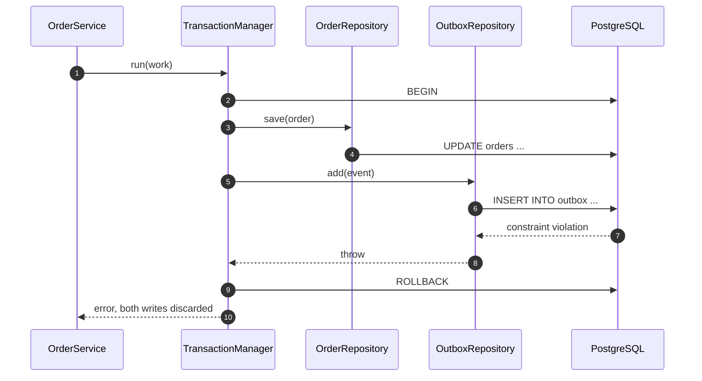

# Chapter 7 — Transactions and Consistency

> Companion to [`../notes.md`](../notes.md) · Section 5
> **Learning goals:** make multi-write use cases atomic without leaking Prisma
> into the service, and understand what transactions do **not** protect you from.

## 7.1 Two saves are not a transaction

```ts
await orderRepo.save(order);      // commits
await outboxRepo.add(event);      // commits separately — can fail
```

If the second call fails, the order is cancelled but no event is published.
Every repository method that opens its own transaction cannot participate in a
larger one. Atomicity has to be owned by the **use case**, not by each write.

## 7.2 Unit of work

Keep Prisma out of the application layer by exposing a transaction-scoped unit
of work:

```ts
// application/unit-of-work.ts
import type { OrderRepository } from "../domain/order.repository";
import type { OutboxRepository } from "../domain/outbox.repository";

export interface UnitOfWork {
  readonly orders: OrderRepository;
  readonly outbox: OutboxRepository;
}

export interface TransactionManager {
  run<T>(work: (uow: UnitOfWork) => Promise<T>): Promise<T>;
}
```

```ts
// infrastructure/prisma-unit-of-work.ts
import { Prisma, PrismaClient } from "@prisma/client";
import type {
  TransactionManager,
  UnitOfWork,
} from "../application/unit-of-work";
import { PrismaOrderRepository } from "./prisma-order.repository";
import { PrismaOutboxRepository } from "./prisma-outbox.repository";

class PrismaUnitOfWork implements UnitOfWork {
  readonly orders: PrismaOrderRepository;
  readonly outbox: PrismaOutboxRepository;

  constructor(tx: Prisma.TransactionClient) {
    this.orders = new PrismaOrderRepository(tx);
    this.outbox = new PrismaOutboxRepository(tx);
  }
}

export class PrismaTransactionManager implements TransactionManager {
  constructor(private readonly prisma: PrismaClient) {}

  run<T>(work: (uow: UnitOfWork) => Promise<T>): Promise<T> {
    return this.prisma.$transaction((tx) => work(new PrismaUnitOfWork(tx)));
  }
}
```

The repositories accept a `PrismaClient | Prisma.TransactionClient`; when they
are constructed inside `run`, every query joins the same transaction. Throwing
inside `work` rolls everything back.

```ts
// application/order.service.ts (transactional variant)
async cancel(id: string): Promise<void> {
  await this.transactions.run(async (uow) => {
    const order = await uow.orders.findById(id);
    if (!order) throw new OrderNotFoundError(id);
    if (order.status === "paid") throw new OrderStateError("Refund instead");

    await uow.orders.save({ ...order, status: "cancelled" });
    await uow.outbox.add({
      type: "order.cancelled",
      aggregateId: order.id,
      payload: { orderId: order.id },
    });
  });
}
```

The service receives a `TransactionManager` through its constructor:

```ts
constructor(
  private readonly transactions: TransactionManager,
) {}
```

Keep transactions **short**: no HTTP calls, no email sending, no file I/O inside
`run`. In Postgres a long transaction holds locks and blocks vacuum.

## 7.3 Failure behaviour



## 7.4 Concurrency: the last writer wins

A transaction gives atomicity, not mutual exclusion. Two concurrent cancels can
both read `pending` and both write `cancelled`. Add optimistic locking:

```ts
const result = await tx.order.updateMany({
  where: { id: order.id, version: order.version },
  data: { status: "cancelled", version: { increment: 1 } },
});

if (result.count === 0) {
  throw new OrderStateError("Order changed concurrently; retry");
}
```

Alternatives:

- `SELECT ... FOR UPDATE` (`$queryRaw`) for short critical sections.
- Unique constraints for "only one active subscription per user".
- Serializable isolation for multi-row invariants, with retry on `40001`.

Prefer database constraints over application checks: under concurrency the
database is the only arbiter.

## 7.5 Consistency beyond one database

- **Outbox** — write the event in the same transaction as the state change, then
  publish asynchronously (pattern 5). Never publish inside the request before
  commit.
- **Idempotency keys** — make retried commands safe; store the key with the
  result and return the stored response.
- **Sagas** — when a workflow spans services, compensate instead of pretending
  there is a distributed transaction.
- **Read-your-writes** — a replica may lag; route critical reads to the primary
  or accept staleness explicitly.

## 7.6 Transaction anti-patterns

1. Starting a transaction inside every repository method.
2. Calling a payment API inside `run` and holding locks for seconds.
3. Catching an error inside `run` and continuing, then committing partial work.
4. Retrying the whole transaction without checking whether the failure is
   retryable.
5. Using a transaction to hide a missing unique constraint.

## Exercise

Add an `outbox` table and make `cancel` write the order update and the
`order.cancelled` event in one transaction. Then force the event insert to fail
and verify the order status did not change.

---

**Previous:** [Chapter 6 ←](06-testing.md)
**Next:** [Chapter 8 — Production checklist →](08-production-checklist.md)
**Index:** [Repository notes](README.md) · **Source:** [`../notes.md`](../notes.md)
