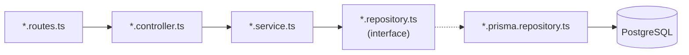

# Repository Pattern — Chapter Notes

Companion deep-dive to [`../notes.md`](../notes.md). The main notes are the one-page
reference; these chapters expand every section with reasoning, copy-ready
TypeScript/Express code, tests, and production guidance.

**Pattern 1 of 10** · TypeScript · Node.js · Express · PostgreSQL · Prisma

## Chapters

| # | Chapter | Focus | Source |
| --- | --- | --- | --- |
| 1 | [Why data access needs a boundary](01-why-repository.md) | Symptoms of mixed responsibilities; when direct ORM use is fine | §1 |
| 2 | [The repository concept and its boundaries](02-concept-and-boundaries.md) | Interface + implementation, aggregate roots, repository vs DAO/ORM | §2 |
| 3 | [Domain model and interface design](03-domain-model-and-interface.md) | Domain types, method naming, pagination, errors | §3.1 |
| 4 | [The Prisma adapter](04-prisma-adapter.md) | Mapping rows, `select`, upserts, error translation, indexes | §3.2 |
| 5 | [Service and Express wiring](05-service-and-express-wiring.md) | Business rules, composition root, routes, error middleware | §3.3–3.4 |
| 6 | [Testing repositories](06-testing.md) | Fakes, contract tests, integration tests | §3.5 |
| 7 | [Transactions and consistency](07-transactions-and-consistency.md) | Unit of work, isolation, optimistic locking, outbox | §5 |
| 8 | [Production checklist](08-production-checklist.md) | Pagination, tenancy, observability, resilience, security | §5 |
| 9 | [Anti-patterns and refactoring](09-anti-patterns.md) | Leaky abstractions, generic base repositories, god objects | §4, §7 |
| 10 | [Decision guide and summary](10-decision-guide-and-summary.md) | When to use it, alternatives, relationship to other patterns | §6, §8–10 |

## Suggested reading paths

- **New to the pattern:** 1 → 2 → 3 → 4 → 5. Stop and build the service.
- **About to ship:** 7 → 8 → 9. These cover the failures that appear in production.
- **Reviewing a design:** 2 → 9 → 10. Use the anti-pattern and decision tables as a checklist.
- **Interview preparation:** 2 → 10, then explain the diagram in chapter 2 from memory.

## Prerequisites

- Node.js 20+ and TypeScript 5+
- Express 4.19+ (or Express 5, which forwards rejected promises natively)
- PostgreSQL 15+ and Prisma 5/6
- Familiarity with `async`/`await` and dependency injection by constructor

## Folder structure

Organise by **feature first**, not by technical layer: everything that changes
together for "orders" lives in `modules/orders/`. The technical folders
(`routes`, `controllers`, `services`, `repositories`) still exist — they are just
scoped to the module instead of being global dumping grounds.

```text
01-repository/
├── notes.md
├── notes/
│   ├── README.md
│   └── 01-...10-....md
└── code/
    ├── prisma/
    │   ├── schema.prisma
    │   └── migrations/
    ├── src/
    │   ├── config/
    │   │   └── env.ts
    │   ├── modules/
    │   │   └── orders/
    │   │       ├── order.routes.ts            # URL -> controller
    │   │       ├── order.controller.ts        # HTTP in/out
    │   │       ├── order.service.ts           # business rules
    │   │       ├── order.repository.ts        # interface (port)
    │   │       ├── order.prisma.repository.ts # adapter (Prisma)
    │   │       ├── order.mapper.ts            # row <-> domain
    │   │       ├── order.dto.ts               # request/response schemas
    │   │       └── order.errors.ts            # domain errors
    │   ├── middlewares/
    │   │   ├── async-handler.ts
    │   │   ├── authenticate.ts
    │   │   └── error-handler.ts
    │   ├── infrastructure/
    │   │   ├── prisma.ts                      # one PrismaClient
    │   │   └── logger.ts
    │   ├── composition-root.ts                # wires interface -> adapter
    │   ├── app.ts                             # express app + middleware
    │   └── server.ts                          # listen + graceful shutdown
    └── tests/
        ├── unit/                              # service + fake repository
        ├── integration/                       # Prisma adapter + PostgreSQL
        ├── contract/                          # shared repository suite
        ├── fakes/                             # InMemoryOrderRepository
        └── builders/                          # anOrder(...) factories
```

### Layer-first alternative

For a small service, or to match the short paths used in the chapters, the same
files can live in top-level technical folders:

```text
src/
├── routes/orders.routes.ts
├── controllers/orders.controller.ts
├── services/order.service.ts
├── repositories/
│   ├── order.repository.ts           # interface
│   └── prisma-order.repository.ts    # adapter
├── mappers/order.mapper.ts
├── dtos/order.dto.ts
├── middlewares/
│   ├── async-handler.ts
│   ├── authenticate.ts
│   └── error-handler.ts
├── errors/order.errors.ts
├── config/env.ts
├── db/prisma.ts
├── composition-root.ts
├── app.ts
└── server.ts
```

Both layouts are valid. Feature-first scales better: adding "refunds" touches one
folder instead of five. Layer-first is easier to navigate while the app is small.

### What lives where

| Folder | Responsibility | May import |
| --- | --- | --- |
| `order.ts` (entity) | Aggregate/domain type, invariants that need no I/O | nothing |
| `*.routes.ts` | Map URL + method to a controller, attach middleware | controller, middleware |
| `*.controller.ts` | Parse/validate HTTP input, call **one** service method, shape the response | service, DTO, mapper |
| `*.service.ts` | Business rules, invariants, transaction boundary | repository interface, domain, errors |
| `*.repository.ts` | Persistence contract in domain language (no SQL) | domain entities/errors only |
| `*.prisma.repository.ts` | Queries, row mapping, driver-error translation | Prisma, mapper, repository interface |
| `*.mapper.ts` | Row ↔ domain persistence mapping | domain, Prisma types |
| `*.dto.ts` | Zod schemas and inferred request/response types | zod |
| `middlewares/` | Cross-cutting HTTP: auth, async errors, error mapping | express |
| `errors/` | Domain error classes shared by service and HTTP | nothing |
| `composition-root.ts` | Construct clients/adapters, wire interface → implementation | everything (the only place allowed to) |
| `config/` | Environment parsing and typed config | zod/env libs |
| `infrastructure/` | Database client, logger, external clients | vendor SDKs |
| `tests/` | Mirrors the layers above; one folder per test level | src |


### How the chapter snippets map

The chapters use the compact four-folder layout (`domain/`, `application/`,
`infrastructure/`, `http/`) to keep imports short. The same files in the two
trees above:

| Chapter snippet | Feature-first | Layer-first |
| --- | --- | --- |
| `domain/order.ts` | `modules/orders/order.ts` | `domain/order.ts` |
| `domain/order.repository.ts` | `modules/orders/order.repository.ts` | `repositories/order.repository.ts` |
| `domain/errors.ts` | `modules/orders/order.errors.ts` | `errors/order.errors.ts` |
| `application/order.service.ts` | `modules/orders/order.service.ts` | `services/order.service.ts` |
| `infrastructure/prisma-order.repository.ts` | `modules/orders/order.prisma.repository.ts` | `repositories/prisma-order.repository.ts` |
| `infrastructure/order.mapper.ts` | `modules/orders/order.mapper.ts` | `mappers/order.mapper.ts` |
| `http/orders.routes.ts` | `modules/orders/order.routes.ts` | `routes/orders.routes.ts` |
| `http/order-response.ts` | `modules/orders/order.dto.ts` | `dtos/order.dto.ts` |
| `http/async-handler.ts` | `middlewares/async-handler.ts` | `middlewares/async-handler.ts` |
| `http/error-handler.ts` | `middlewares/error-handler.ts` | `middlewares/error-handler.ts` |
| `composition-root.ts` | `src/composition-root.ts` | `src/composition-root.ts` |
| `server.ts` | `src/server.ts` | `src/server.ts` |
| `tests/fakes/...` | `tests/fakes/...` | `tests/fakes/...` |

### Dependency rule



- Routes never import Prisma or a concrete repository.
- Controllers never import Prisma; they call a service and map the result.
- Services depend on the **interface**, never on the adapter.
- The interface file imports domain types only — no Prisma, Express, or `pg`.
- The adapter is the only file allowed to contain queries and `PrismaClient`.
- `composition-root.ts` is the only place that constructs concrete classes.
- A module owns one aggregate; do not add `order-item.repository.ts` unless
  items have an independent lifecycle.

### Naming rules

| File | Convention | Example |
| --- | --- | --- |
| Router | `<resource>.routes.ts` | `order.routes.ts` |
| Controller | `<resource>.controller.ts` | `order.controller.ts` |
| Service | `<resource>.service.ts` | `order.service.ts` |
| Interface | `<resource>.repository.ts` | `order.repository.ts` |
| Adapter | `<resource>.<tech>.repository.ts` | `order.prisma.repository.ts` |
| Fake | `<resource>.in-memory.repository.ts` | `order.in-memory.repository.ts` |
| Mapper | `<resource>.mapper.ts` | `order.mapper.ts` |
| DTO | `<resource>.dto.ts` | `order.dto.ts` |
| Errors | `<resource>.errors.ts` | `order.errors.ts` |

One exported class per file, named exports only (no default exports). Keep the
module folder flat until it exceeds roughly ten files; then split by use case
(`cancel/`, `refund/`) rather than by technical layer.

## Conventions in these chapters

- IDs look like `ord_123`; money is shown as `number` for brevity, but store
  integer minor units (cents) in real systems.
- The [`../code`](../code) folder contains a runnable demo implementing these
  chapters: an Express API with in-memory and Prisma adapters (see
  [`../code/README.md`](../code/README.md)).
- Every diagram is Mermaid and renders on GitHub, GitLab, and VS Code.
- Each chapter ends with an exercise and links to the next one.

## Source mapping

`../notes.md` remains the canonical summary. If a chapter and the summary ever
disagree, treat the chapter as the detailed explanation and update both.
