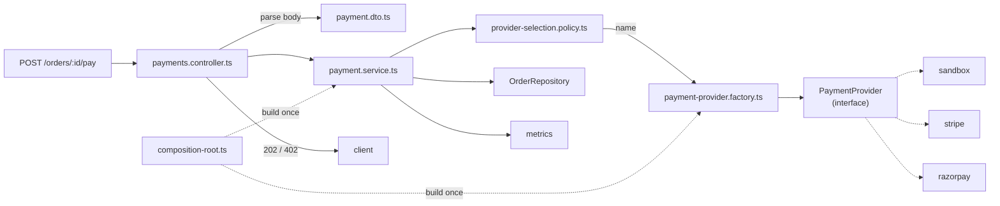

# Factory Pattern — Demo API

A runnable Express + TypeScript implementation of the pattern described in
[`../notes.md`](../notes.md) and the [five chapter notes](../notes/README.md).

The demo is built around one question: **which payment provider should serve
this order, and who is allowed to know that?**

```text
PaymentService ──> ProviderSelectionPolicy   (business choice)
      │
      ├──────────> PaymentProviderFactory    (name -> instance registry)
      │                    │
      │                    ▼
      │            PaymentProvider (interface)
      │              ▲          ▲          ▲
      │        Sandbox      Stripe     Razorpay
      │        (no keys)    (SDK)      (SDK)
      │
      └──────────> OrderRepository (pattern 1)
```

The service never imports a vendor SDK. The factory never reads `process.env`.
Adapters never see Express. Swapping or adding a provider touches exactly two
places: a new adapter file and one registration in the composition root.

## Quick start (no credentials required)

Requires Node.js 20+.

```bash
cd 02-factory/code
npm install
npm run dev
```

Defaults:

| Setting | Value |
| --- | --- |
| Port | `3200` |
| Provider | `sandbox` (deterministic, in-process, no network) |
| Demo orders | 5 seeded orders |
| Retries | 2 additional attempts for retryable failures |
| Storage | in-memory `OrderRepository` |

Open <http://localhost:3200/health> or run the walkthrough below.

## Walkthrough

```bash
# 1. What is wired?
curl -s http://localhost:3200/health | jq
curl -s http://localhost:3200/providers | jq

# 2. List the seeded orders
curl -s http://localhost:3200/orders | jq '.data[] | {id, status, totalCents, currency}'

# 3. Charge a pending order -> 202
curl -i -X POST http://localhost:3200/orders/ord_demo_inr/pay \
  -H 'content-type: application/json' -d '{"provider":"sandbox"}'

# 4. Read the order and the payment record
curl -s http://localhost:3200/orders/ord_demo_inr | jq
curl -s http://localhost:3200/orders/ord_demo_inr/payment | jq

# 5. Charging a paid order -> 409
curl -i -X POST http://localhost:3200/orders/ord_demo_paid/pay \
  -H 'content-type: application/json' -d '{}'

# 6. A declined card -> 402
curl -i -X POST http://localhost:3200/orders/ord_demo_declined/pay \
  -H 'content-type: application/json' -d '{}'

# 7. A flaky provider: first attempt fails, the retry decorator succeeds -> 202
curl -i -X POST http://localhost:3200/orders/ord_demo_flaky/pay \
  -H 'content-type: application/json' -d '{}'

# 8. Partial refund, then the remainder
curl -i -X POST http://localhost:3200/orders/ord_demo_paid/refund \
  -H 'content-type: application/json' -d '{"amountCents":400}'
curl -i -X POST http://localhost:3200/orders/ord_demo_paid/refund \
  -H 'content-type: application/json' -d '{}'

# 9. Metrics
curl -s http://localhost:3200/metrics | grep '^payment_'
```

### Seeded orders

| Order | Amount | Status | What it demonstrates |
| --- | --- | --- | --- |
| `ord_demo_inr` | 1999 INR | pending | Successful charge, order → paid |
| `ord_demo_usd` | 4500 USD | pending | Currency is taken from the order |
| `ord_demo_paid` | 899 INR | paid | 409 on pay, refunds through the stored provider |
| `ord_demo_declined` | 999 INR | pending | `PaymentDeclinedError` → 402 |
| `ord_demo_flaky` | 2500 INR | pending | Retry decorator: one retryable failure, then success |

The sandbox provider triggers failures from the order id (`decline`, `flaky`,
`outage`, `terminal`) so every failure path is reproducible without a vendor
account. See `src/providers/sandbox-payment.provider.ts`.

## API

| Method | Path | Success | Errors |
| --- | --- | --- | --- |
| `GET` | `/health` | `200` status + provider state | — |
| `GET` | `/providers` | `200` registry, enabled list, defaults | — |
| `GET` | `/metrics` | `200` Prometheus text | — |
| `GET` | `/orders` | `200` `{ data: Order[] }` | — |
| `GET` | `/orders/:orderId` | `200` order | `404` |
| `GET` | `/orders/:orderId/payment` | `200` payment record | `404` |
| `POST` | `/orders/:orderId/pay` | `202` charge result | `400`, `402`, `404`, `409`, `422`, `502`, `503` |
| `POST` | `/orders/:orderId/refund` | `202` refund result | `400`, `404`, `409` |

Pay body: `{ "provider"?: "sandbox" | "stripe" | "razorpay" }` (optional; the
policy falls back to the currency default, then the deployment default).
Refund body: `{ "amountCents"?: number }` (optional; defaults to the remaining
refundable amount).

Both schemas are `.strict()`: unknown fields are rejected with `400` so a client
cannot smuggle an `amountCents` into a charge.

### Error codes

| `code` | HTTP | Meaning |
| --- | --- | --- |
| `validation_error` | 400 | Zod rejected the body/query |
| `order_not_found` | 404 | Unknown order id |
| `payment_not_found` | 404 | Order has no successful payment |
| `order_not_payable` | 409 | Order is paid/refunded/cancelled |
| `refund_exceeds_payment` | 409 | Refund > remaining refundable amount |
| `payment_declined` | 402 | Vendor declined the card |
| `unsupported_provider` | 422 | Name not in the enabled allow-list |
| `provider_error` (retryable) | 503 + `Retry-After` | Vendor 5xx/429/timeout |
| `provider_error` (terminal) | 502 | Vendor rejected the request |
| `internal_error` | 500 | Unexpected failure |

## Folder structure

Layer-first, matching the chapters. Each folder has one reason to change.

```text
02-factory/code/
├── package.json
├── tsconfig.json
├── tsconfig.build.json
├── vitest.config.ts
├── .env.example
├── src/
│   ├── config/
│   │   └── env.ts                     # parse + validate env once
│   ├── lib/
│   │   ├── logger.ts                  # JSON logger (swappable)
│   │   └── metrics.ts                 # Prometheus registry (no deps)
│   ├── models/
│   │   └── order.model.ts             # Order, PaymentRecord
│   ├── repositories/
│   │   ├── order.repository.ts        # persistence port (pattern 1)
│   │   └── in-memory-order.repository.ts
│   ├── providers/
│   │   ├── payment-provider.ts        # product contract + types
│   │   ├── provider-info.ts           # registry/enabled metadata
│   │   ├── sandbox-payment.provider.ts
│   │   ├── stripe-payment.provider.ts
│   │   ├── razorpay-payment.provider.ts
│   │   └── retrying-payment.provider.ts  # decorator
│   ├── factories/
│   │   └── payment-provider.factory.ts   # registry + validation
│   ├── services/
│   │   ├── payment.service.ts         # use cases: pay, refund
│   │   └── provider-selection.policy.ts  # which provider?
│   ├── mappers/
│   │   ├── payment.mapper.ts          # vendor statuses -> domain
│   │   └── order.mapper.ts            # domain -> API responses
│   ├── dtos/
│   │   └── payment.dto.ts             # strict zod schemas
│   ├── errors/
│   │   └── payment.errors.ts          # domain errors + HTTP mapping
│   ├── middlewares/
│   │   ├── async-handler.ts
│   │   └── error-handler.ts
│   ├── controllers/
│   │   └── payments.controller.ts
│   ├── routes/
│   │   └── payments.routes.ts
│   ├── composition-root.ts            # THE only place with SDKs/secrets
│   ├── app.ts                         # Express app factory
│   └── server.ts                      # process lifecycle
└── tests/
    ├── unit/                          # 58 tests
    ├── contract/                      # shared provider suite, 12 tests
    ├── integration/                   # 19 HTTP tests
    ├── fakes/                         # FakePaymentProvider
    ├── builders/                      # anOrder / aPaidOrder
    └── support/                       # testConfig
```

Two placement rules that keep the seam intact:

1. `providers/*.provider.ts` are the only files importing `stripe` or `razorpay`.
2. `services/payment.service.ts` imports the **interface**, the **factory**, and
   the **policy** — never a concrete provider.

## Request flow



Sequence for a successful charge:

1. Controller validates `{ provider? }` with zod.
2. Service loads the order and rejects anything not `pending` (409).
3. Policy resolves a provider name: request → currency default → deployment default.
4. Factory returns the registered instance, or throws `UnsupportedProviderError` (422).
5. Adapter charges the order amount in minor units with a deterministic idempotency key.
6. On `succeeded`, the service stores a `PaymentRecord` and marks the order `paid`.
7. Metrics and one structured log line are emitted; the controller returns `202`.

## Design decisions

### 1. Registry factory, not a `switch` per request

The factory owns a `Map<name, instance>` built once. Duplicate names, empty
registries, and missing names fail at **boot**. Unknown names throw a typed 422
instead of returning `undefined` and crashing later.

### 2. Selection policy is separate from the registry

The factory answers *"is this name registered?"*. The policy answers *"which name
should this order use?"*. Keeping them separate means currency rules, merchant
contracts, and feature flags never leak into the registry.

### 3. One composition root

`createContainer()` is the only code that reads env, constructs SDK clients, wraps
decorators, seeds demo data, and names concrete classes. `createPaymentModule()` is
exported as the seam tests use to build an isolated graph with fakes.

### 4. Adapters translate; mappers centralise vocabulary

Each adapter maps domain → vendor → domain, including errors. Vendor statuses
(`requires_action`, `created`, `captured`) map to three domain statuses in
`mappers/payment.mapper.ts`, which is unit-tested without any SDK.

### 5. Resilience is a decorator

`RetryingPaymentProvider` implements `PaymentProvider` and wraps another provider.
It retries only `ProviderError` instances marked `retryable`, with exponential
backoff and **the same idempotency key**. The service and factory do not know it
exists. A circuit breaker (pattern 10) can be added the same way.

### 6. Idempotency is part of the contract

`PaymentRequest.idempotencyKey` is required. The service derives
`order:<id>:pay:v1`; adapters forward it (Stripe `Idempotency-Key`, Razorpay
`receipt`/`notes`). The sandbox stores results per key, so retries and duplicate
requests return the same transaction.

### 7. Refunds use the provider stored on the payment

`PaymentRecord.provider` is persisted at charge time. A refund calls
`factory.get(payment.provider)` — not the request's provider, not the deployment
default. Money must go back through the vendor that captured it.

### 8. Domain errors carry their HTTP mapping

`AppError` subclasses define `code` and `httpStatus`. One middleware maps them;
controllers contain no vendor or status-code branches. Retryable provider errors
set `Retry-After`.

### 9. Observability at the service level

The service emits `payment_charge_total{provider,status}`,
`payment_charge_duration_seconds{provider}`, `payment_refund_total{provider,status}`,
and `payment_provider_unknown_total{requested}`. Swapping the in-house registry
for `prom-client` changes one file.

### 10. Fail fast, and refuse unsafe defaults

`loadConfig()` rejects unknown providers, disabled defaults, missing credentials,
invalid currency maps, and the **sandbox provider in production**. A bad deploy
fails at boot, not at the first checkout.

## Configuration

| Variable | Default | Notes |
| --- | --- | --- |
| `PORT` | `3200` | HTTP port |
| `LOG_LEVEL` | `info` | `debug`, `info`, `warn`, `error` |
| `PAYMENTS_ENABLED` | `sandbox` | Comma-separated: `sandbox`, `stripe`, `razorpay` |
| `PAYMENTS_DEFAULT` | first enabled | Used when the request names no provider |
| `PAYMENTS_CURRENCY_DEFAULTS` | `{}` | JSON map, e.g. `{"USD":"stripe"}` |
| `PAYMENT_TIMEOUT_MS` | `5000` | Stripe SDK timeout |
| `PAYMENT_MAX_RETRIES` | `2` | Additional attempts; `0` disables the decorator |
| `PAYMENT_RETRY_BASE_DELAY_MS` | `50` | Exponential backoff base |
| `SANDBOX_LATENCY_MS` | `40` | Simulated vendor latency |
| `SANDBOX_SEED` | `42` | Makes sandbox transaction ids deterministic |
| `SEED_DEMO` | `true` | Seed the five demo orders |
| `NODE_ENV` | `development` | `production` forbids the sandbox provider |
| `STRIPE_SECRET_KEY` | — | Required iff Stripe is enabled |
| `RAZORPAY_KEY_ID` / `RAZORPAY_KEY_SECRET` | — | Required iff Razorpay is enabled |

Copy `.env.example` to `.env` to change defaults. The demo runs **without** a
`.env` file.

## Metrics

| Metric | Type | Labels |
| --- | --- | --- |
| `payment_charge_total` | counter | `provider`, `status` (`succeeded`, `pending`, `failed`, `declined`, `error`) |
| `payment_charge_duration_seconds` | histogram | `provider` |
| `payment_refund_total` | counter | `provider`, `status` |
| `payment_provider_unknown_total` | counter | `requested` |

```bash
curl -s http://localhost:3200/metrics | grep '^payment_'
```

## Using real providers

```bash
cp .env.example .env
PAYMENTS_ENABLED=sandbox,stripe \
STRIPE_SECRET_KEY=sk_test_... \
npm run dev
```

```bash
curl -X POST http://localhost:3200/orders/ord_demo_inr/pay \
  -H 'content-type: application/json' \
  -d '{"provider":"stripe"}'
```

Notes:

- The Stripe adapter creates a PaymentIntent without confirming it. With a real
  test key you will usually get `requires_payment_method` → mapped to `pending`;
  complete the payment client-side and via webhook in a real integration.
- The Razorpay adapter creates an order and returns `pending`; capture/webhooks
  are out of scope for this demo.
- Credentials are only required for providers that are **enabled**.
- Real-provider code paths are **not** exercised by `npm test`; adapter unit tests
  use stubbed SDK clients, so the default suite never touches the network.

## Testing

```bash
npm test           # 89 tests, no network, no credentials
npm run typecheck  # tsc --noEmit
npm run build      # dist/
```

| Suite | Files | Proves |
| --- | --- | --- |
| Unit — factory | `payment-provider.factory.test.ts` | registry, normalisation, duplicates, unknown names |
| Unit — policy | `provider-selection.policy.test.ts` | request/currency/default precedence, config guards |
| Unit — service | `payment.service.test.ts` | charge payload, idempotency key, state transitions, refund lookup by stored provider, partial refunds |
| Unit — decorator | `retrying-payment.provider.test.ts` | backoff, attempt cap, no retry on decline/terminal |
| Unit — adapters | `stripe-*.test.ts`, `razorpay-*.test.ts` | status mapping, idempotency options, error translation |
| Unit — config | `config.test.ts` | fail-fast validation |
| Contract | `payment-provider.contract.ts` | the same semantics for sandbox and fake |
| HTTP | `payments.api.test.ts` | status codes, validation, retries, refunds, metrics |

The contract suite is the important one: **new providers are accepted by passing
the same tests**, not by matching a code review checklist.

## Deliberate simplifications

This is a teaching demo, not a payment system. What is intentionally missing:

- **In-memory orders.** Swap `InMemoryOrderRepository` for a Postgres adapter; the
  service depends only on the interface.
- **No authentication or merchant scoping.** Add auth before any policy that
  depends on the caller.
- **No database transaction/outbox.** A real service must persist the charge and
  the order update atomically or with an outbox + reconciliation job.
- **No webhooks.** Razorpay `pending` payments never complete in this demo.
- **Refund idempotency is simplified.** The order ledger prevents over-refunds;
  true retry safety needs a client-supplied refund key and vendor idempotency.
- **Sandbox is forbidden in production** by config validation.
- **No circuit breaker.** Pattern 10 shows how to wrap the same interface.


