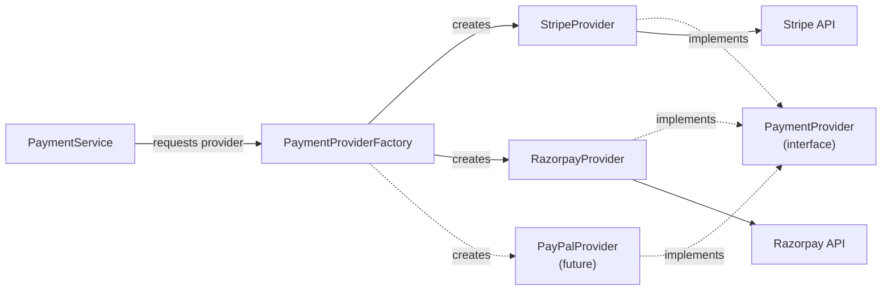

# Pattern 2 — Factory

**Category:** Object creation
**Stack used in examples:** TypeScript · Node.js · Express · Stripe · Razorpay

> 📚 **Deep dive:** [chapter-wise notes](notes/README.md) — five chapters that expand every section below with code, tests, and production guidance.

---

## 1. What problem does it solve?

Suppose the application supports multiple payment providers and construction logic is duplicated:

```ts
if (provider === "stripe") {
  const client = new StripeClient(process.env.STRIPE_KEY!);
  // ... configure and use
} else if (provider === "razorpay") {
  const client = new RazorpayClient(process.env.RAZORPAY_KEY!);
  // ... configure and use
} else if (provider === "paypal") {
  // ...
}
```

A conditional is perfectly reasonable with one or two options. The problem is **duplication and coupling**:

- Every new provider requires edits in several places.
- Credentials, timeouts, retries, and base URLs get configured inconsistently.
- Business services end up importing vendor SDKs directly, so tests need real SDK objects.
- Validation of the requested provider is easily forgotten in one of the branches.

A factory **centralizes the decision** about which implementation to create or return.

## 2. The core idea



The factory is the **only** place that knows which concrete class maps to which name. The caller receives the shared interface.

> Factory answers: *“Which object should I create or return?”*
> Strategy answers: *“Which algorithm should I execute?”*
> They are often combined: a factory selects the strategy.

## 3. Practical TypeScript implementation

### 3.1 Contract and input types

```ts
export type PaymentRequest = {
  orderId: string;
  amount: number;   // smallest currency unit (e.g. paise/cents)
  currency: string;
};

export type PaymentResult = {
  transactionId: string;
  status: "succeeded" | "pending" | "failed";
};

export interface PaymentProvider {
  readonly name: string;
  charge(input: PaymentRequest): Promise<PaymentResult>;
  refund(transactionId: string, amount: number): Promise<void>;
}
```

### 3.2 Provider implementations

```ts
export class StripeProvider implements PaymentProvider {
  readonly name = "stripe";

  constructor(private readonly client: Stripe) {}

  async charge(input: PaymentRequest): Promise<PaymentResult> {
    const intent = await this.client.paymentIntents.create({
      amount: input.amount,
      currency: input.currency.toLowerCase(),
      metadata: { orderId: input.orderId },
      idempotencyKey: `order:${input.orderId}`,
    });

    return { transactionId: intent.id, status: "pending" };
  }

  async refund(transactionId: string, amount: number): Promise<void> {
    await this.client.refunds.create({ payment_intent: transactionId, amount });
  }
}

export class RazorpayProvider implements PaymentProvider {
  readonly name = "razorpay";

  constructor(private readonly client: Razorpay) {}

  async charge(input: PaymentRequest): Promise<PaymentResult> {
    const order = await this.client.orders.create({
      amount: input.amount,
      currency: input.currency,
      receipt: input.orderId,
    });

    return { transactionId: order.id, status: "pending" };
  }

  async refund(transactionId: string, amount: number): Promise<void> {
    await this.client.payments.refund(transactionId, { amount });
  }
}
```

### 3.3 The factory

```ts
export type ProviderName = "stripe" | "razorpay";

export class PaymentProviderFactory {
  private readonly providers: Map<ProviderName, PaymentProvider>;

  constructor(stripe: PaymentProvider, razorpay: PaymentProvider) {
    this.providers = new Map<ProviderName, PaymentProvider>([
      ["stripe", stripe],
      ["razorpay", razorpay],
    ]);
  }

  get(name: ProviderName): PaymentProvider {
    const provider = this.providers.get(name);
    if (!provider) {
      // Defensive: also guards against unvalidated input at runtime.
      throw new Error(`Unsupported payment provider: ${name}`);
    }
    return provider;
  }

  names(): ProviderName[] {
    return [...this.providers.keys()];
  }
}
```

A `Map` beats a `switch` here: adding a provider means registering it once, and the factory does not grow a new branch each time.

### 3.4 Usage in the service

```ts
export class PaymentService {
  constructor(
    private readonly factory: PaymentProviderFactory,
    private readonly orders: OrderRepository,
  ) {}

  async pay(orderId: string, requested: string) {
    const order = await this.orders.findById(orderId);
    if (!order) throw new Error("Order not found");

    // Validate untrusted input against the supported set before using it.
    const name = this.parseProvider(requested);
    const provider = this.factory.get(name);

    // Provider choice can also depend on currency/region:
    // const provider = this.factory.get(this.pickFor(order));

    return provider.charge({
      orderId: order.id,
      amount: Math.round(order.total * 100),
      currency: "INR",
    });
  }

  private parseProvider(value: string): ProviderName {
    if (value === "stripe" || value === "razorpay") return value;
    throw new Error(`Unsupported provider: ${value}`);
  }
}
```

Notice the service never constructs an SDK client and never imports a vendor class.

### 3.5 Express wiring

Construct the factory and service once at startup and export them from the composition root:

```ts
// composition-root.ts
export const paymentProviderFactory = new PaymentProviderFactory(
  new StripeProvider(stripeClient),
  new RazorpayProvider(razorpayClient),
);

export const paymentService = new PaymentService(
  paymentProviderFactory,
  orderRepository,
);
```

```ts
// payments.routes.ts
paymentsRouter.post(
  "/:orderId/pay",
  asyncHandler(async (req, res) => {
    const result = await paymentService.pay(
      req.params.orderId,
      req.body.provider,
    );

    res.status(202).json(result);
  }),
);
```

SDK clients and provider instances are created once at startup, not per request. Tests can build a `PaymentService` with fake providers without starting an HTTP server.

## 4. Factory variants

| Variant | Shape | Good for |
| --- | --- | --- |
| **Simple factory** | One function/class returning a product | Selecting among a few implementations |
| **Factory method** | Subclass decides which product to create | Framework extension points |
| **Abstract factory** | Creates a *family* of related objects | Multi-vendor suites (payments + refunds + webhooks) |
| **Registry / map factory** | `Map<Key, Provider>` populated at startup | Plugin architecture, many providers |
| **Composition-root factory** | Wired once at startup and exported | Express apps, environment-specific wiring |

## 5. Production considerations

- **Configure clients centrally.** Credentials, timeouts, retries, and base URLs belong to the provider's construction, not to call sites.
- **Never trust arbitrary user input** when choosing a provider. Validate against an allow-list and check authorization (a merchant may be enabled for only one provider).
- **Selection may need business rules**: currency, region, payment method, merchant contract. Keep that policy explicit and testable.
- **Fail fast and observably** for unknown providers — a typed error plus a metric, not a silent fallback to a default provider.
- **Avoid the god factory.** One factory per domain concept. A single `ServiceFactory` that creates everything becomes the switch statement you were trying to remove.
- **Idempotency**: the factory returns a provider; idempotency keys must still be passed for retries.

## 6. When to use / when not to

**Use it when**
- Object creation varies by configuration, environment, provider, or business rule.
- Construction involves non-trivial setup (credentials, SDK config, instrumentation).
- You need a single place to register new implementations.

**Avoid it when**
- A direct `new Foo()` is already clear and stable.
- There is exactly one implementation and no realistic second one.
- The “factory” would only wrap a constructor call with no policy.

## 7. Common mistakes

1. Letting the factory perform the payment work as well as construct the provider (mixing creation and behaviour).
2. Reading `process.env` inside the factory for every call instead of configuring once.
3. Returning `undefined` for an unknown provider and letting `provider.charge` crash later.
4. Duplicating fallback logic in every caller instead of centralizing selection policy.
5. Registering providers in the composition root but instantiating SDK clients per request.

## 8. Relationship to other patterns

- **Strategy** — providers usually *are* strategies; the factory chooses which one.
- **Adapter** — each provider is typically an adapter around a vendor API.
- **Singleton / DI** — SDK clients and the factory itself are shared instances.
- **Circuit breaker** — each provider can be wrapped by its own breaker.

## 9. Practice checklist

- [ ] Define the product interface first.
- [ ] Keep provider construction in one registration point.
- [ ] Validate provider names from requests against an allow-list.
- [ ] Add a test that every registered name returns a working implementation.
- [ ] Add a metric/log for unknown-provider attempts.
- [ ] Decide (and document) the selection policy: currency? region? merchant?

## 10. One-line takeaway

> A factory centralizes *which* implementation to use, so the rest of the code only depends on *what* the implementation does.

