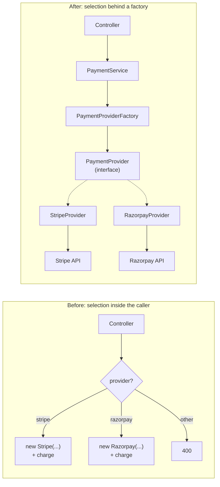

# Chapter 1 — Why Object Creation Needs a Boundary

> Companion to [`../notes.md`](../notes.md) · Section 1
> **Learning goals:** recognise construction logic that has escaped its home, and
> judge honestly whether a factory would remove real friction in your service.

## 1.1 Direct `new` is fine

A service that constructs one dependency and uses it once is readable:

```ts
const provider = new StripeProvider(new Stripe(process.env.STRIPE_KEY!));
const result = await provider.charge(request);
```

There is nothing to fix here. A factory is a **policy object**: it exists to own a
decision that would otherwise be repeated. With one implementation, no
configuration, and one call site, there is no decision to own.

The pattern earns its keep when the same *which implementation?* question is
answered in several places, or when the answer depends on configuration that a
business service should not read.

## 1.2 The branch that multiplies

The typical starting point looks like this:

```ts
// payments.controller.ts
if (req.body.provider === "stripe") {
  const stripe = new Stripe(process.env.STRIPE_KEY!);
  const intent = await stripe.paymentIntents.create({ amount, currency });
  return res.status(202).json({ transactionId: intent.id });
}

if (req.body.provider === "razorpay") {
  const razorpay = new Razorpay({
    key_id: process.env.RAZORPAY_KEY_ID!,
    key_secret: process.env.RAZORPAY_KEY_SECRET!,
  });
  const order = await razorpay.orders.create({ amount, currency });
  return res.status(202).json({ transactionId: order.id });
}

return res.status(400).json({ error: "Unknown provider" });
```

The first version is not wrong. The second version is the same code in the refund
endpoint. The third version is the same code again in the webhook handler, with a
slightly different timeout and one missing validation.

That is the moment the pattern becomes useful — when construction is **duplicated**
and the copies drift.

## 1.3 What actually goes wrong

| Cost | What it looks like | Why it hurts |
| --- | --- | --- |
| Duplicated configuration | Timeouts, base URLs, retry counts set per call site | Providers behave differently per endpoint |
| Vendor coupling | `import Stripe from "stripe"` inside a service or controller | Tests need SDK objects; swapping vendors touches business code |
| Forgotten validation | One branch accepts any string as a provider | Unknown values reach `.charge()` and crash at runtime |
| Inconsistent credentials | One path reads `STRIPE_KEY`, another `STRIPE_SECRET` | Misconfiguration is discovered in production |
| No single registration point | Adding PayPal means editing five files | The fifth file is usually missed |
| Construction in tests | Tests build real clients to test business rules | Slow, flaky, and network-dependent |

None of these are caused by `new` itself. They are caused by **`new` appearing in
places that also contain business decisions**.

## 1.4 Symptoms that justify a factory

| Symptom | What you notice | Root cause |
| --- | --- | --- |
| Branch duplication | The same `if (provider === ...)` in three files | Selection policy has no owner |
| Credential drift | Different env vars used for the same vendor | Construction is per call site |
| Untestable services | Service tests need API keys | Vendor classes are imported by business code |
| Slow provider additions | A new vendor touches controllers, services, tests, docs | No registry |
| Runtime crashes | `Cannot read properties of undefined (reading 'charge')` | Factory returns `undefined` for unknown input |
| Inconsistent policy | One endpoint allows PayPal for EUR, another does not | Policy is implicit in branches |

Two or more of these together justify extracting a factory. A single `if` in a
single endpoint does not.

## 1.5 Before and after



In the "after" picture the controller knows one method, the service knows one
interface, and only the factory knows the mapping from a name to a class.

## 1.6 Three questions a factory answers

1. **Which** implementation should be used for this request or this deployment?
2. **How** is it configured (credentials, timeouts, retries, base URL)?
3. **When** is it created (once at startup, or per request when it is cheap and
   stateless)?

A useful factory answers all three in one place. A "factory" that only forwards
arguments to a constructor answers none of them and adds a layer for free.

## 1.7 What a factory is not

- Not a business-rule engine. `charge`, `refund`, and `authorize` belong to the
  provider implementation, not to the factory.
- Not a service locator. Callers should receive the factory explicitly, not reach
  into a global container from anywhere.
- Not a cache. Caching providers is a lifetime decision made in the composition
  root (chapter 4), not a side effect of `get()`.
- Not a place to read `process.env` on every call. Configuration is parsed once at
  boot.
- Not a wrapper that hides a single `new` with no selection logic.

## Exercise

1. Run `grep -rn "new .*Client\|new .*Provider" src/` and list every construction
   site.
2. For each site, note whether it contains a *decision* (branch, config lookup,
   policy) or just a construction.
3. Pick one file with two or more construction sites and sketch the interface the
   caller should depend on instead.
4. Write down the selection policy in one sentence. If you cannot, the factory is
   not ready to be extracted yet.

---

**Next:** [Chapter 2 — The factory concept and its boundaries →](02-concept-and-boundaries.md)
**Index:** [Factory notes](README.md) · **Source:** [`../notes.md`](../notes.md)
