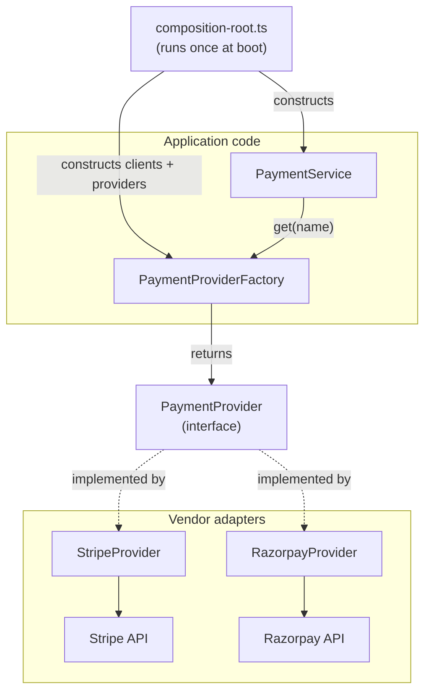

# Chapter 2 — The Factory Concept and Its Boundaries

> Companion to [`../notes.md`](../notes.md) · Sections 2–4
> **Learning goals:** name the moving parts precisely, choose the right factory
> variant, and keep creation separate from behaviour.

## 2.1 Vocabulary

| Term | Role | Example |
| --- | --- | --- |
| **Product** | The interface every caller depends on | `PaymentProvider` |
| **Concrete product** | A vendor-specific implementation | `StripeProvider`, `RazorpayProvider` |
| **Creator / factory** | Decides which product to return | `PaymentProviderFactory` |
| **Client** | Code that uses a product through the interface | `PaymentService` |
| **Registry** | The name → product map held by the factory | `Map<ProviderName, PaymentProvider>` |
| **Composition root** | Builds clients and registers products once at boot | `composition-root.ts` |

Two rules follow from this vocabulary:

1. Clients depend on the **product interface**, never on a concrete product.
2. Only the factory and the composition root know the vendor names.

## 2.2 One decision point



Read the arrows as *depends on*. `PaymentService` depends on the factory and the
interface. It does not depend on Stripe, Razorpay, or their SDK types. The
composition root is the only node that depends on everything.

## 2.3 Factory vs Strategy vs Adapter vs DI container

These four are frequently confused because they often appear together.

| Concern | Question it answers | Typical shape | Changes when |
| --- | --- | --- | --- |
| **Factory** | *Which object do I create or return?* | `factory.get("stripe")` | A new implementation is registered |
| **Strategy** | *Which algorithm should run?* | `pricingStrategy.calculate(order)` | Business rules change |
| **Adapter** | *How do I translate a foreign API?* | `StripeProvider implements PaymentProvider` | A vendor API changes |
| **DI container** | *How is the object graph wired?* | `container.resolve(PaymentService)` | Lifetimes or bindings change |

Relationships worth remembering:

- A provider is usually an **adapter** around a vendor SDK.
- Providers are usually **strategies**: interchangeable algorithms behind one
  interface.
- The factory **selects** a strategy; it does not implement one.
- A DI container can replace the factory's registration step, but it does not
  replace runtime selection driven by a request (currency, merchant, feature
  flag). Most Express apps use constructor injection plus a small factory, not a
  container.

```ts
// Strategy: the behaviour
interface PaymentProvider {
  charge(input: PaymentRequest): Promise<PaymentResult>;
}

// Adapter: the translation layer
class StripeProvider implements PaymentProvider {
  constructor(private readonly client: Stripe) {}
  async charge(input: PaymentRequest) {
    /* Stripe-specific mapping */
  }
}

// Factory: the selection policy
class PaymentProviderFactory {
  get(name: string): PaymentProvider {
    /* lookup + validation */
  }
}
```

## 2.4 The five variants

| Variant | Shape | Good for | Cost |
| --- | --- | --- | --- |
| **Simple factory** | One function returning a product | Two or three implementations, no state | Grows a `switch` per new product |
| **Factory method** | Subclass decides which product to create | Framework extension points | Inheritance-heavy; rare in Express apps |
| **Abstract factory** | Creates a *family* of related objects | Multi-vendor suites (payments + webhooks + refunds) | More interfaces to maintain |
| **Registry / map factory** | `Map<Name, Product>` filled at startup | Plugin architectures, many providers | Needs duplicate/empty validation |
| **Composition-root factory** | Builds and registers everything once | Express, environment-specific wiring | Must be kept free of business rules |

### Simple factory

```ts
export function createPaymentProvider(name: string): PaymentProvider {
  switch (name) {
    case "stripe":
      return new StripeProvider(stripeClient);
    case "razorpay":
      return new RazorpayProvider(razorpayClient);
    default:
      throw new UnsupportedProviderError(name, ["stripe", "razorpay"]);
  }
}
```

Use it when construction is cheap and there are very few products. Keep the SDK
clients module-level singletons, otherwise every request creates a new HTTP
connection pool.

### Factory method

```ts
export abstract class PaymentGateway {
  protected abstract createProvider(): PaymentProvider;

  async pay(input: PaymentRequest): Promise<PaymentResult> {
    return this.createProvider().charge(input);
  }
}

export class StripeGateway extends PaymentGateway {
  protected createProvider(): PaymentProvider {
    return new StripeProvider(this.stripeClient);
  }
}
```

This is the classic GoF shape. It is useful in frameworks that let you subclass a
base class, but TypeScript services usually prefer composition: pass the provider
in instead of inheriting the decision.

### Abstract factory

When a vendor ships several related products that must be used together, create
the family in one place:

```ts
export interface PaymentSuite {
  provider(): PaymentProvider;
  refunds(): RefundService;
  webhooks(): WebhookVerifier;
}

export class StripeSuite implements PaymentSuite {
  provider() { return new StripeProvider(this.client); }
  refunds() { return new StripeRefundService(this.client); }
  webhooks() { return new StripeWebhookVerifier(this.webhookSecret); }
}
```

The rule: **never mix families**. A `StripeProvider` must not be paired with a
`RazorpayWebhookVerifier`, because their identifiers and signatures differ.

### Registry factory (used in these chapters)

```ts
export class PaymentProviderFactory {
  private readonly providers: ReadonlyMap<string, PaymentProvider>;

  constructor(providers: readonly PaymentProvider[]) {
    const registry = new Map<string, PaymentProvider>();

    for (const provider of providers) {
      if (!provider.name) throw new Error("Provider name is required");
      if (registry.has(provider.name)) {
        throw new Error(`Duplicate payment provider: ${provider.name}`);
      }
      registry.set(provider.name, provider);
    }

    if (registry.size === 0) {
      throw new Error("At least one payment provider must be registered");
    }

    this.providers = registry;
  }

  get(name: string): PaymentProvider {
    const provider = this.providers.get(name);
    if (!provider) {
      throw new UnsupportedProviderError(name, this.names());
    }
    return provider;
  }

  names(): string[] {
    return [...this.providers.keys()];
  }
}
```

`../notes.md` shows the two-argument constructor for brevity. The array form above
adds three production checks for free: duplicate names, an empty registry, and
missing names.

### Composition-root factory

```ts
// composition-root.ts
const config = loadPaymentConfig();
const providers = buildPaymentProviders(config); // env read once, clients built once

export const paymentProviderFactory = new PaymentProviderFactory(providers);
export const paymentService = new PaymentService(paymentProviderFactory, orderRepository);
```

This is not a GoF variant; it is the **single place** allowed to know concrete
classes and secrets. Chapter 4 covers it in detail.

### Choosing a variant

| Situation | Choose |
| --- | --- |
| Two providers, cheap construction | Simple factory function |
| Many providers, plugins, runtime registration | Registry factory |
| Vendor ships several coupled products | Abstract factory |
| Framework requires subclassing | Factory method |
| Express app with env-driven adapters | Composition-root factory + registry |

## 2.5 Where the factory lives

```text
src/
├── factories/
│   └── payment-provider.factory.ts   # selection policy + registry
├── providers/
│   ├── payment-provider.ts           # product interface + request/result types
│   ├── stripe-payment.provider.ts    # adapter
│   └── razorpay-payment.provider.ts  # adapter
├── services/
│   └── payment.service.ts            # business rules, calls factory.get()
└── composition-root.ts               # builds clients, registers providers
```

Dependency rules:

- `payment-provider.ts` imports **nothing** from vendors, Express, or Prisma.
- `*-payment.provider.ts` imports its vendor SDK, the interface, and the mapper.
- `payment-provider.factory.ts` imports only the interface and the error types.
- `payment.service.ts` imports the factory, the interface, the order repository,
  and domain errors — never a vendor SDK.
- `composition-root.ts` imports everything and is evaluated once.

## 2.6 Inside vs outside the factory

| Inside the factory | Outside the factory |
| --- | --- |
| Name → implementation mapping | `charge` / `refund` behaviour |
| Allow-list and default-selection policy | Authorization (who may use which provider) |
| Duplicate/empty registration checks | HTTP status codes and DTO shapes |
| Typed `UnsupportedProviderError` | Retries, timeouts, circuit breaking (decorators) |
| Feature-flag and credential availability checks | Database writes and outbox events |
| Emitting a metric for unknown names | Logging business outcomes |

If a method on the factory contains the word `charge`, `refund`, `capture`, or
`authorize`, the behaviour leaked into the creator.

## 2.7 Lifetime and state

- **Build once, share everywhere.** Providers wrap SDK clients that hold
  connection pools; constructing them per request is a performance bug.
- **`get()` is a lookup, not a factory call.** It returns an existing instance.
  Document this so nobody expects a fresh object.
- **Optional providers can be lazy.** If a vendor is disabled or unconfigured,
  do not construct its client at boot; register it only when enabled.
- **No request state in providers.** If a call needs a tenant or idempotency key,
  pass it in the request object, not in the constructor.
- **No mutable maps after boot.** `ReadonlyMap` plus a private field prevents
  accidental registration from request handlers.

## 2.8 Failure contract

```ts
export class UnsupportedProviderError extends Error {
  readonly code = "unsupported_provider";

  constructor(
    readonly requested: string,
    readonly supported: readonly string[],
  ) {
    super(`Unsupported payment provider: ${requested}`);
    this.name = "UnsupportedProviderError";
  }
}
```

Rules:

1. Never return `undefined` or `null` for an unknown name. Throw.
2. Include the supported names in the error so the caller can log or expose them.
3. Validate at the boundary (`zod`) **and** in the factory. The schema rejects
   obviously bad input; the factory is defence in depth for internal callers.
4. Fail at boot, not at request time, when a configured provider is missing
   credentials.
5. Map the error to `422 Unprocessable Entity`, not `500`: the request is
   well-formed but asks for something the service does not offer.

## 2.9 Testability contract

The factory is easy to test because it has no I/O:

```ts
it("returns the provider registered under a name", () => {
  const stripe = new FakePaymentProvider("stripe");
  const factory = new PaymentProviderFactory([stripe]);

  expect(factory.get("stripe")).toBe(stripe);
});

it("lists every registered name", () => {
  const factory = new PaymentProviderFactory([
    new FakePaymentProvider("stripe"),
    new FakePaymentProvider("razorpay"),
  ]);

  expect(factory.names()).toEqual(["stripe", "razorpay"]);
});

it("throws for unknown names instead of returning undefined", () => {
  const factory = new PaymentProviderFactory([new FakePaymentProvider("stripe")]);

  expect(() => factory.get("paypal")).toThrow(UnsupportedProviderError);
});

it("rejects duplicate registrations", () => {
  expect(
    () =>
      new PaymentProviderFactory([
        new FakePaymentProvider("stripe"),
        new FakePaymentProvider("stripe"),
      ]),
  ).toThrow(/Duplicate payment provider/);
});
```

## Exercise

1. Take the provider `if/else` you found in chapter 1 and write the product
   interface first, before the factory.
2. Decide which variant you need and justify it in one sentence.
3. List the checks the factory must perform (unknown name, duplicate, empty,
   disabled provider).
4. Write the error type and its HTTP mapping, then implement the factory without
   any vendor imports.

---

**Previous:** [Chapter 1 ←](01-why-factory.md)
**Next:** [Chapter 3 — Building the payment provider example →](03-payment-provider-example.md)
**Index:** [Factory notes](README.md) · **Source:** [`../notes.md`](../notes.md)
