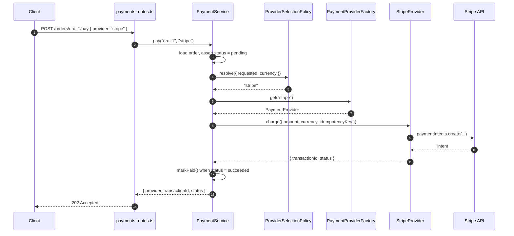

# Chapter 3 — Building the Payment Provider Example

> Companion to [`../notes.md`](../notes.md) · Section 3
> **Learning goals:** implement the product contract, two vendor adapters, the
> registry factory, and the selection policy, then wire them through Express.

## 3.1 Files and responsibilities

```text
src/
├── providers/
│   ├── payment-provider.ts            # contract + request/result types
│   ├── stripe-payment.provider.ts     # adapter: Stripe SDK
│   └── razorpay-payment.provider.ts   # adapter: Razorpay SDK
├── factories/
│   └── payment-provider.factory.ts    # registry + lookup
├── services/
│   ├── provider-selection.policy.ts   # business choice: which provider
│   └── payment.service.ts             # use case: pay an order
├── errors/payment.errors.ts
├── mappers/payment.mapper.ts          # vendor statuses -> domain statuses
├── dtos/payment.dto.ts
├── controllers/payments.controller.ts
├── routes/payments.routes.ts
└── composition-root.ts                # env -> clients -> providers -> services
```

| File | Knows about | Must not know about |
| --- | --- | --- |
| `payment-provider.ts` | domain types only | Stripe, Razorpay, Express |
| `stripe-payment.provider.ts` | Stripe SDK, contract, mapper | HTTP, database, selection policy |
| `razorpay-payment.provider.ts` | Razorpay SDK, contract, mapper | HTTP, database, selection policy |
| `payment-provider.factory.ts` | contract, error types | vendor SDKs, Express, env |
| `provider-selection.policy.ts` | enabled list, currency defaults | SDKs, HTTP |
| `payment.service.ts` | order repository, policy, factory | vendor SDKs |
| `composition-root.ts` | everything | request data |

## 3.2 The product contract

```ts
// providers/payment-provider.ts
export type PaymentRequest = {
  orderId: string;
  amount: number; // smallest currency unit: cents, paise, ...
  currency: string; // ISO-4217, uppercase
  idempotencyKey: string;
};

export type PaymentResult = {
  transactionId: string;
  status: "succeeded" | "pending" | "failed";
};

export interface PaymentProvider {
  readonly name: string;
  charge(input: PaymentRequest): Promise<PaymentResult>;
  refund(transactionId: string, amount: number): Promise<void>;
}
```

Design decisions worth defending in review:

- **`amount` is an integer in minor units.** Floating point money produces
  rounding bugs and provider rejections. Convert once, at the edge.
- **`currency` is required.** Even single-currency products eventually add one.
- **`idempotencyKey` is part of the request contract**, not an optional
  afterthought. A retried `charge` must not create a second payment.
- **`name` is a `string`, not a closed union.** A closed union (`"stripe" |
  "razorpay"`) gives compile-time safety for a fixed set, but blocks plugins and
  test fakes. Validate against `SUPPORTED_PROVIDERS` at the boundary instead.
- **`refund` takes the provider transaction id**, not the order id. The provider
  does not know your order model.

```ts
// providers/payment-provider.ts (continued)
export const SUPPORTED_PROVIDERS = ["stripe", "razorpay"] as const;
export type SupportedProvider = (typeof SUPPORTED_PROVIDERS)[number];
```

## 3.3 The Stripe adapter

```ts
// providers/stripe-payment.provider.ts
import Stripe from "stripe";
import type {
  PaymentProvider,
  PaymentRequest,
  PaymentResult,
} from "./payment-provider";
import { ProviderError } from "../errors/payment.errors";

export class StripeProvider implements PaymentProvider {
  readonly name = "stripe";

  constructor(private readonly client: Stripe) {}

  async charge(input: PaymentRequest): Promise<PaymentResult> {
    try {
      const intent = await this.client.paymentIntents.create(
        {
          amount: input.amount,
          currency: input.currency.toLowerCase(),
          metadata: { orderId: input.orderId },
        },
        { idempotencyKey: input.idempotencyKey },
      );

      return { transactionId: intent.id, status: toStatus(intent.status) };
    } catch (error) {
      throw new ProviderError(this.name, "charge", isRetryable(error), error);
    }
  }

  async refund(transactionId: string, amount: number): Promise<void> {
    try {
      await this.client.refunds.create({
        payment_intent: transactionId,
        amount,
      });
    } catch (error) {
      throw new ProviderError(this.name, "refund", isRetryable(error), error);
    }
  }
}

function toStatus(status: Stripe.PaymentIntent.Status): PaymentResult["status"] {
  if (status === "succeeded") return "succeeded";
  if (status === "processing" || status === "requires_action") return "pending";
  return "failed";
}

function isRetryable(error: unknown): boolean {
  const status = (error as { statusCode?: number }).statusCode;
  return status === undefined || status === 429 || status >= 500;
}
```

The adapter's job is translation in both directions: domain request → vendor
call, vendor response → domain result, vendor error → domain error. Nothing else.

## 3.4 The Razorpay adapter

Razorpay charges are two-step: create an order, then capture the payment after
the client confirms it. The adapter therefore returns `pending` for a freshly
created order and lets a webhook move the order to `paid`.

```ts
// providers/razorpay-payment.provider.ts
import Razorpay from "razorpay";
import type {
  PaymentProvider,
  PaymentRequest,
  PaymentResult,
} from "./payment-provider";
import { ProviderError } from "../errors/payment.errors";
import { fromRazorpayStatus } from "../mappers/payment.mapper";

export class RazorpayProvider implements PaymentProvider {
  readonly name = "razorpay";

  constructor(private readonly client: Razorpay) {}

  async charge(input: PaymentRequest): Promise<PaymentResult> {
    try {
      const order = await this.client.orders.create({
        amount: input.amount,
        currency: input.currency,
        receipt: input.orderId,
        notes: { idempotencyKey: input.idempotencyKey },
      });

      return { transactionId: order.id, status: fromRazorpayStatus(order.status) };
    } catch (error) {
      throw new ProviderError(this.name, "charge", isRetryable(error), error);
    }
  }

  async refund(transactionId: string, amount: number): Promise<void> {
    try {
      await this.client.payments.refund(transactionId, { amount });
    } catch (error) {
      throw new ProviderError(this.name, "refund", isRetryable(error), error);
    }
  }
}
```

Differences that must **not** leak to callers:

| Concern | Stripe | Razorpay |
| --- | --- | --- |
| Amount unit | minor units | minor units |
| Currency case | lowercase | uppercase |
| Idempotency | `Idempotency-Key` option | `receipt` / `notes` |
| Immediate outcome | `succeeded`, `processing`, `requires_action` | `created`, `authorized`, `captured` |
| Refund target | payment intent id | payment id |

The service sees one `charge()` and three statuses. That is the adapter paying
for itself.

## 3.5 Shared status mapping

One vendor's `toStatus` is fine; two vendors mean the translation belongs in the
mapper so it can be tested without SDK objects.

```ts
// mappers/payment.mapper.ts
import type { PaymentResult } from "../providers/payment-provider";

export function fromStripeStatus(status: string): PaymentResult["status"] {
  switch (status) {
    case "succeeded":
      return "succeeded";
    case "processing":
    case "requires_action":
    case "requires_confirmation":
      return "pending";
    default:
      return "failed";
  }
}

export function fromRazorpayStatus(status: string): PaymentResult["status"] {
  switch (status) {
    case "captured":
      return "succeeded";
    case "created":
    case "authorized":
      return "pending";
    default:
      return "failed";
  }
}
```

| Vendor signal | Domain error | Retryable | HTTP |
| --- | --- | --- | --- |
| HTTP 5xx, connection reset, timeout | `ProviderError` | yes | `503` |
| HTTP 429 | `ProviderError` (+ `Retry-After`) | yes | `503` |
| `card_declined`, insufficient funds | `PaymentDeclinedError` | no | `402` |
| Invalid request (bad currency, amount) | `ProviderError` | no | `502` |
| Unknown provider name | `UnsupportedProviderError` | no | `422` |

```ts
// errors/payment.errors.ts
export class UnsupportedProviderError extends Error {
  readonly code = "unsupported_provider";

  constructor(
    readonly requested: string,
    readonly supported: readonly string[],
  ) {
    super(`Unsupported payment provider: ${requested}`);
    this.name = "UnsupportedProviderError";
  }
}

export class PaymentDeclinedError extends Error {
  readonly code = "payment_declined";

  constructor(
    readonly provider: string,
    readonly declineCode: string,
  ) {
    super(`Payment declined by ${provider}: ${declineCode}`);
    this.name = "PaymentDeclinedError";
  }
}

export class ProviderError extends Error {
  readonly code = "provider_error";

  constructor(
    readonly provider: string,
    readonly operation: "charge" | "refund",
    readonly retryable: boolean,
    readonly reason?: unknown,
  ) {
    super(`${provider} failed during ${operation}`);
    this.name = "ProviderError";
  }
}
```

Adapters throw these; the HTTP layer maps them (3.9). Neither the service nor the
controller inspects vendor error shapes.

Replace the local `toStatus` helper in the Stripe adapter with the shared
`fromStripeStatus` from the mapper, so both adapters translate statuses the same
way and the mapping can be unit-tested without an SDK.


## 3.6 The factory file

```ts
// factories/payment-provider.factory.ts
import type { PaymentProvider } from "../providers/payment-provider";
import { UnsupportedProviderError } from "../errors/payment.errors";

export class PaymentProviderFactory {
  private readonly providers: ReadonlyMap<string, PaymentProvider>;

  constructor(providers: readonly PaymentProvider[]) {
    const registry = new Map<string, PaymentProvider>();

    for (const provider of providers) {
      if (!provider.name) throw new Error("Provider name is required");
      if (registry.has(provider.name)) {
        throw new Error(`Duplicate payment provider: ${provider.name}`);
      }
      registry.set(provider.name, provider);
    }

    if (registry.size === 0) {
      throw new Error("At least one payment provider must be registered");
    }

    this.providers = registry;
  }

  get(name: string): PaymentProvider {
    const provider = this.providers.get(name);
    if (!provider) throw new UnsupportedProviderError(name, this.names());
    return provider;
  }

  names(): string[] {
    return [...this.providers.keys()];
  }

  has(name: string): boolean {
    return this.providers.has(name);
  }
}
```

The factory has **no** vendor imports, no `process.env`, and no behaviour. It is a
registry with validation — which is exactly why it is trivial to unit test.

## 3.7 Selection policy and service

The factory answers *"is this name registered?"*. The policy answers *"which name
should this order use?"*. Keeping them separate means business rules (currency,
merchant contract, feature flags) never contaminate the registry.

```ts
// services/provider-selection.policy.ts
import { UnsupportedProviderError } from "../errors/payment.errors";

export type ProviderSelectionInput = {
  requested?: string;
  currency: string;
};

export class ProviderSelectionPolicy {
  constructor(
    private readonly enabled: readonly string[],
    private readonly defaultProvider: string,
    private readonly byCurrency: Readonly<Record<string, string>> = {},
  ) {}

  resolve(input: ProviderSelectionInput): string {
    const requested = input.requested?.trim().toLowerCase();

    if (requested) {
      if (!this.enabled.includes(requested)) {
        throw new UnsupportedProviderError(requested, this.enabled);
      }
      return requested;
    }

    const currencyDefault = this.byCurrency[input.currency.toUpperCase()];
    const name = currencyDefault ?? this.defaultProvider;

    if (!this.enabled.includes(name)) {
      throw new Error(`Configured provider is not enabled: ${name}`);
    }

    return name;
  }
}
```

```ts
// services/payment.service.ts
import type { PaymentProviderFactory } from "../factories/payment-provider.factory";
import type { ProviderSelectionPolicy } from "./provider-selection.policy";
import type { OrderRepository } from "../repositories/order.repository";
import type { PaymentResult } from "../providers/payment-provider";
import { OrderNotFoundError, OrderNotPayableError } from "../errors/order.errors";

export type PayOrderResult = PaymentResult & { provider: string };

export class PaymentService {
  constructor(
    private readonly providers: PaymentProviderFactory,
    private readonly policy: ProviderSelectionPolicy,
    private readonly orders: OrderRepository,
  ) {}

  async pay(orderId: string, requested?: string): Promise<PayOrderResult> {
    const order = await this.orders.findById(orderId);
    if (!order) throw new OrderNotFoundError(orderId);
    if (order.status !== "pending") {
      throw new OrderNotPayableError(order.id, order.status);
    }

    const name = this.policy.resolve({ requested, currency: order.currency });
    const provider = this.providers.get(name);

    const result = await provider.charge({
      orderId: order.id,
      amount: order.totalCents,
      currency: order.currency,
      idempotencyKey: `order:${order.id}:pay`,
    });

    if (result.status === "succeeded") {
      await this.orders.save(order.markPaid(provider.name, result.transactionId));
    }

    return { ...result, provider: provider.name };
  }
}
```

Three observations:

- The service never mentions `Stripe`, `Razorpay`, or an SDK type.
- The policy is pure and synchronous, so it is tested with a table of cases.
- Only a `succeeded` result mutates the order. `pending` waits for the webhook;
  `failed` leaves the order payable so the customer can retry.

## 3.8 Composition root

Everything vendor-specific and secret-bearing is constructed here, once:

```ts
// composition-root.ts
import Stripe from "stripe";
import Razorpay from "razorpay";
import { loadPaymentConfig } from "./config/env";
import { PaymentProviderFactory } from "./factories/payment-provider.factory";
import { ProviderSelectionPolicy } from "./services/provider-selection.policy";
import { PaymentService } from "./services/payment.service";
import { StripeProvider } from "./providers/stripe-payment.provider";
import { RazorpayProvider } from "./providers/razorpay-payment.provider";
import type { PaymentProvider } from "./providers/payment-provider";
import { prismaOrderRepository } from "./repositories/prisma-order.repository";

const config = loadPaymentConfig();

function buildProviders(): PaymentProvider[] {
  return config.enabledProviders.map((name) => {
    switch (name) {
      case "stripe": {
        const client = new Stripe(config.stripeSecretKey, {
          timeout: config.timeoutMs,
          maxNetworkRetries: 2,
        });
        return new StripeProvider(client);
      }

      case "razorpay": {
        const client = new Razorpay({
          key_id: config.razorpayKeyId,
          key_secret: config.razorpayKeySecret,
        });
        return new RazorpayProvider(client);
      }

      default: {
        const unreachable: never = name;
        throw new Error(`Unhandled payment provider: ${unreachable}`);
      }
    }
  });
}

export const paymentProviderFactory = new PaymentProviderFactory(buildProviders());

export const paymentService = new PaymentService(
  paymentProviderFactory,
  new ProviderSelectionPolicy(
    config.enabledProviders,
    config.defaultProvider,
    config.currencyDefaults,
  ),
  prismaOrderRepository,
);
```

The `switch` here is acceptable — and preferable — because it runs **once**, is
exhaustive over a typed union, and is the only place that names SDK classes. A
`switch` per request is the anti-pattern (chapter 5).

## 3.9 The HTTP layer

```ts
// dtos/payment.dto.ts
import { z } from "zod";
import { SUPPORTED_PROVIDERS } from "../providers/payment-provider";

export const payOrderSchema = z.object({
  provider: z.enum(SUPPORTED_PROVIDERS).optional(),
});

export type PayOrderBody = z.infer<typeof payOrderSchema>;
```

```ts
// controllers/payments.controller.ts
import type { RequestHandler } from "express";
import { payOrderSchema } from "../dtos/payment.dto";
import { paymentService } from "../composition-root";
import { asyncHandler } from "../middlewares/async-handler";

export const payOrder: RequestHandler = asyncHandler(async (req, res) => {
  const body = payOrderSchema.parse(req.body ?? {});
  const result = await paymentService.pay(req.params.orderId, body.provider);

  res.status(202).json(result);
});
```

```ts
// routes/payments.routes.ts
import { Router } from "express";
import { payOrder } from "../controllers/payments.controller";
import { requireAuth } from "../middlewares/authenticate";

export const paymentsRouter = Router();

paymentsRouter.post("/orders/:orderId/pay", requireAuth, payOrder);
```

`202 Accepted` is deliberate: for Razorpay the charge is not final at this point,
and even Stripe can return `processing`. A `201` would promise a payment that may
not exist yet.

Error mapping belongs in one middleware, not in the controller:

| Error | Status | Body |
| --- | --- | --- |
| `ZodError` | `400` | `{ error: "Invalid request", issues }` |
| `OrderNotFoundError` | `404` | `{ error: "Order not found" }` |
| `OrderNotPayableError` | `409` | `{ error: "Order is already paid" }` |
| `UnsupportedProviderError` | `422` | `{ error, code, supported }` |
| `PaymentDeclinedError` | `402` | `{ error, code, declineCode }` |
| `ProviderError` (retryable) | `503` | `{ error, code, provider }` + `Retry-After` |
| `ProviderError` (terminal) | `502` | `{ error, code, provider }` |

```ts
// middlewares/error-handler.ts (excerpt)
import { ZodError } from "zod";
import {
  PaymentDeclinedError,
  ProviderError,
  UnsupportedProviderError,
} from "../errors/payment.errors";
import { OrderNotFoundError, OrderNotPayableError } from "../errors/order.errors";

export function errorHandler(err: unknown, _req: Request, res: Response, next: NextFunction) {
  if (err instanceof ZodError) {
    return res.status(400).json({ error: "Invalid request", issues: err.issues });
  }
  if (err instanceof UnsupportedProviderError) {
    return res.status(422).json({
      error: err.message,
      code: err.code,
      supported: err.supported,
    });
  }
  if (err instanceof PaymentDeclinedError) {
    return res.status(402).json({ error: err.message, code: err.code });
  }
  if (err instanceof ProviderError) {
    if (err.retryable) res.setHeader("Retry-After", "5");
    return res.status(err.retryable ? 503 : 502).json({
      error: err.message,
      code: err.code,
      provider: err.provider,
    });
  }
  if (err instanceof OrderNotFoundError) {
    return res.status(404).json({ error: err.message });
  }
  if (err instanceof OrderNotPayableError) {
    return res.status(409).json({ error: err.message });
  }
  next(err); // unexpected -> the generic 500 handler
}
```

Register it **last**, after routes, and keep the four-argument signature so
Express recognises it as an error handler.

## 3.10 Request sequence



## 3.11 What changed compared with the `if/else`

| Concern | Before | After |
| --- | --- | --- |
| Adding a provider | Edit every endpoint + tests | One provider file + one registration |
| Credentials | Read at call sites | Parsed once in `config/env.ts` |
| Validation | Repeated per branch, sometimes forgotten | `zod` at the boundary + factory check |
| Endpoint code | Knows vendor SDKs | Calls `paymentService.pay()` |
| Tests | Need SDK objects or live keys | Fake provider behind the interface |
| Selection rules | Implicit in branches | Explicit in `ProviderSelectionPolicy` |
| Observability | Ad-hoc logs per branch | One metric labelled by `provider.name` |

The service, controller, and route did not gain a single vendor import. That is
the measurable outcome of the pattern.

## Exercise

Add a third provider (`paypal`) without touching `payment.service.ts`,
`payments.controller.ts`, or `payments.routes.ts`:

1. Create `providers/paypal-payment.provider.ts` implementing `PaymentProvider`.
2. Add `PAYPAL_CLIENT_ID` / `PAYPAL_CLIENT_SECRET` to `config/env.ts` and extend
   `loadPaymentConfig()`.
3. Add a `case "paypal"` to `buildProviders()` in the composition root.
4. Add `"paypal"` to `SUPPORTED_PROVIDERS` and to the policy's enabled list.
5. Add `tests/contract/paypal.provider.contract.test.ts` using the shared suite
   from chapter 4.

Then answer: how many existing files changed? If the list includes the service,
the controller, or the route, the boundary is leaking.

---

**Previous:** [Chapter 2 ←](02-concept-and-boundaries.md)
**Next:** [Chapter 4 — Wiring, testing, and failure modes →](04-wiring-and-testing.md)
**Index:** [Factory notes](README.md) · **Source:** [`../notes.md`](../notes.md)
