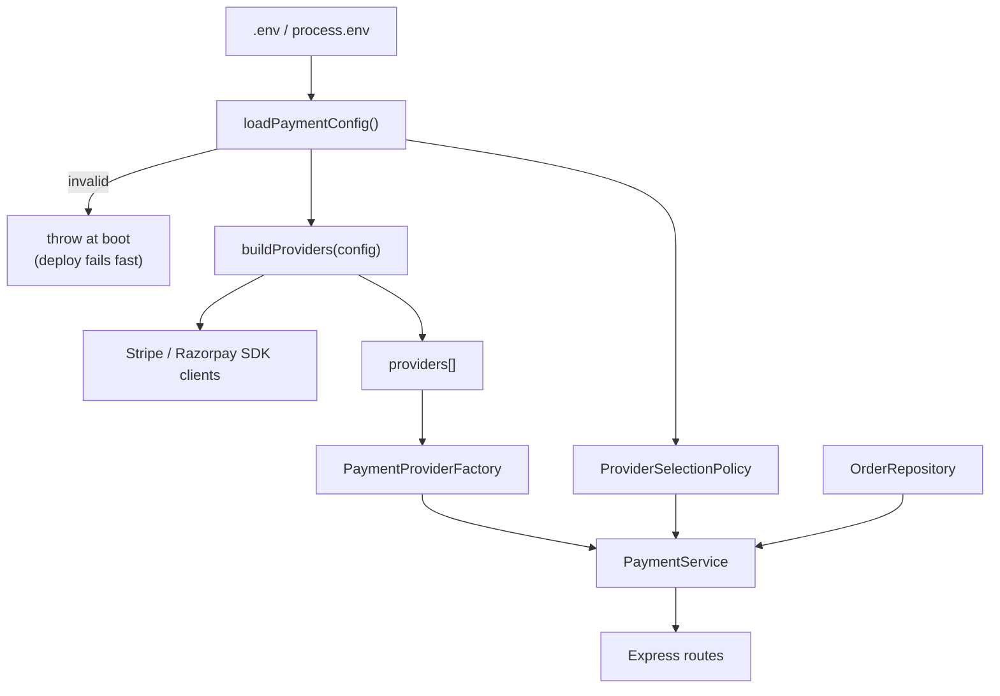

# Chapter 4 — Wiring, Testing, and Failure Modes

> Companion to [`../notes.md`](../notes.md) · Sections 3.5 and 5
> **Learning goals:** build the object graph once, test every provider through
> one contract, and turn vendor failures into predictable HTTP responses.

## 4.1 Composition root rules

The composition root is the only module allowed to know concrete classes. Treat
these as invariants:

| Rule | Why |
| --- | --- |
| Read `process.env` exactly once | Configuration cannot drift between providers |
| Validate configuration at boot | A missing key fails the deploy, not the first payment |
| Construct SDK clients once | Connection pools and instrumentation are reused |
| Export **built** singletons | Handlers import a ready service, not a factory function |
| Never accept request data | A composition root is not a factory method per request |
| Expose a `create...` function for tests | Tests build an isolated graph with fakes |

```ts
// composition-root.ts
export function createPaymentModule(config: PaymentConfig, orders: OrderRepository) {
  const factory = new PaymentProviderFactory(buildProviders(config));
  const policy = new ProviderSelectionPolicy(
    config.enabledProviders,
    config.defaultProvider,
    config.currencyDefaults,
  );

  return {
    factory,
    policy,
    service: new PaymentService(factory, policy, orders),
  };
}

// Production graph: built once when the process starts.
export const paymentModule = createPaymentModule(loadPaymentConfig(), prismaOrderRepository);
export const paymentService = paymentModule.service;
```

The exported `createPaymentModule` is the seam that chapter 4.3 relies on. Without
it, tests either boot the whole app or reach into module state.



The graph is built once, top to bottom. Nothing below the config node reads the
environment, and nothing above it knows about HTTP.

## 4.2 Environment configuration

```ts
// config/env.ts
import { z } from "zod";
import { SUPPORTED_PROVIDERS, type SupportedProvider } from "../providers/payment-provider";

const paymentEnvSchema = z.object({
  PAYMENTS_ENABLED: z.string().default("stripe"),
  PAYMENTS_DEFAULT: z.string().min(1).optional(),
  PAYMENTS_CURRENCY_DEFAULTS: z.string().default("{}"),
  STRIPE_SECRET_KEY: z.string().min(1).optional(),
  RAZORPAY_KEY_ID: z.string().min(1).optional(),
  RAZORPAY_KEY_SECRET: z.string().min(1).optional(),
  PAYMENT_TIMEOUT_MS: z.coerce.number().int().min(500).max(30_000).default(5_000),
});

export type PaymentConfig = {
  enabledProviders: SupportedProvider[];
  defaultProvider: SupportedProvider;
  currencyDefaults: Record<string, SupportedProvider>;
  stripeSecretKey: string;
  razorpayKeyId: string;
  razorpayKeySecret: string;
  timeoutMs: number;
};

export function loadPaymentConfig(env: NodeJS.ProcessEnv = process.env): PaymentConfig {
  const parsed = paymentEnvSchema.safeParse(env);
  if (!parsed.success) {
    throw new Error(`Invalid payment configuration: ${parsed.error.message}`);
  }

  const enabled = parsed.data.PAYMENTS_ENABLED.split(",")
    .map((name) => name.trim().toLowerCase())
    .filter(Boolean) as SupportedProvider[];

  if (enabled.length === 0) {
    throw new Error("PAYMENTS_ENABLED must list at least one provider");
  }

  const unknown = enabled.filter((name) => !SUPPORTED_PROVIDERS.includes(name));
  if (unknown.length > 0) {
    throw new Error(`Unknown payment providers: ${unknown.join(", ")}`);
  }

  const defaultProvider = (parsed.data.PAYMENTS_DEFAULT ?? enabled[0]).toLowerCase();
  if (!enabled.includes(defaultProvider as SupportedProvider)) {
    throw new Error(`Default provider is not enabled: ${defaultProvider}`);
  }

  if (enabled.includes("stripe") && !parsed.data.STRIPE_SECRET_KEY) {
    throw new Error("STRIPE_SECRET_KEY is required when stripe is enabled");
  }
  if (
    enabled.includes("razorpay") &&
    (!parsed.data.RAZORPAY_KEY_ID || !parsed.data.RAZORPAY_KEY_SECRET)
  ) {
    throw new Error("RAZORPAY_KEY_ID and RAZORPAY_KEY_SECRET are required when razorpay is enabled");
  }

  return {
    enabledProviders: enabled,
    defaultProvider: defaultProvider as SupportedProvider,
    currencyDefaults: parseCurrencyDefaults(parsed.data.PAYMENTS_CURRENCY_DEFAULTS, enabled),
    stripeSecretKey: parsed.data.STRIPE_SECRET_KEY ?? "",
    razorpayKeyId: parsed.data.RAZORPAY_KEY_ID ?? "",
    razorpayKeySecret: parsed.data.RAZORPAY_KEY_SECRET ?? "",
    timeoutMs: parsed.data.PAYMENT_TIMEOUT_MS,
  };
}
```

| Misconfiguration | Detected at |
| --- | --- |
| Unknown provider in `PAYMENTS_ENABLED` | Boot |
| Empty enabled list | Boot |
| Default provider not enabled | Boot |
| Enabled provider without credentials | Boot |
| Currency mapped to a disabled provider | Boot |
| Provider disabled later at runtime | Request (`UnsupportedProviderError`) |

`parseCurrencyDefaults` validates that every value is an enabled provider; an
invalid default is a configuration error, not something to discover at checkout.

```ts
function parseCurrencyDefaults(
  raw: string,
  enabled: SupportedProvider[],
): Record<string, SupportedProvider> {
  let value: unknown;

  try {
    value = JSON.parse(raw);
  } catch {
    throw new Error("PAYMENTS_CURRENCY_DEFAULTS must be valid JSON");
  }

  const parsed = z.record(z.string(), z.string()).safeParse(value);
  if (!parsed.success) {
    throw new Error(`Invalid PAYMENTS_CURRENCY_DEFAULTS: ${parsed.error.message}`);
  }

  const result: Record<string, SupportedProvider> = {};
  for (const [currency, provider] of Object.entries(parsed.data)) {
    if (!enabled.includes(provider as SupportedProvider)) {
      throw new Error(`Currency ${currency} maps to a disabled provider: ${provider}`);
    }
    result[currency.toUpperCase()] = provider as SupportedProvider;
  }

  return result;
}
```

## 4.3 Unit tests with a fake provider

A fake implements the product interface and records calls. It needs no SDK, no
network, and no database.

```ts
// tests/fakes/fake-payment.provider.ts
import type {
  PaymentProvider,
  PaymentRequest,
  PaymentResult,
} from "../../src/providers/payment-provider";

export class FakePaymentProvider implements PaymentProvider {
  readonly charges: PaymentRequest[] = [];
  readonly refunds: Array<{ transactionId: string; amount: number }> = [];

  constructor(
    readonly name: string,
    private result: PaymentResult = {
      transactionId: `tx_${name}_1`,
      status: "succeeded",
    },
  ) {}

  async charge(input: PaymentRequest): Promise<PaymentResult> {
    this.charges.push(input);
    return this.result;
  }

  async refund(transactionId: string, amount: number): Promise<void> {
    this.refunds.push({ transactionId, amount });
  }

  willReturn(result: PaymentResult): void {
    this.result = result;
  }
}
```

```ts
// tests/unit/payment.service.test.ts
import { describe, it, expect } from "vitest";
import { createPaymentModule } from "../../src/composition-root";
import { FakePaymentProvider } from "../fakes/fake-payment.provider";
import { InMemoryOrderRepository } from "../../src/repositories/in-memory-order.repository";
import { anOrder } from "../builders/order.builder";
import { OrderNotPayableError } from "../../src/errors/order.errors";

function setup(result?: "succeeded" | "pending" | "failed") {
  const stripe = new FakePaymentProvider("stripe");
  if (result) stripe.willReturn({ transactionId: "tx_1", status: result });

  const orders = new InMemoryOrderRepository([
    anOrder({ id: "ord_1", status: "pending", totalCents: 1_999, currency: "INR" }),
  ]);

  const module = createPaymentModule(
    {
      enabledProviders: ["stripe"],
      defaultProvider: "stripe",
      currencyDefaults: {},
      stripeSecretKey: "sk_test",
      razorpayKeyId: "",
      razorpayKeySecret: "",
      timeoutMs: 5_000,
    },
    orders,
  );

  return { stripe, orders, module };
}

it("charges through the selected provider with the order amount", async () => {
  const { stripe, module } = setup();

  const result = await module.service.pay("ord_1", "stripe");

  expect(result).toEqual({
    provider: "stripe",
    transactionId: "tx_stripe_1",
    status: "succeeded",
  });
  expect(stripe.charges).toEqual([
    {
      orderId: "ord_1",
      amount: 1_999,
      currency: "INR",
      idempotencyKey: "order:ord_1:pay",
    },
  ]);
});

it("marks the order paid only when the charge succeeded", async () => {
  const { module, orders } = setup("pending");

  await module.service.pay("ord_1");

  expect((await orders.findById("ord_1"))?.status).toBe("pending");
});

it("refuses to charge a paid order", async () => {
  const { module } = setup();
  await module.service.pay("ord_1");

  await expect(module.service.pay("ord_1")).rejects.toBeInstanceOf(OrderNotPayableError);
});
```

What these tests prove:

- The service passes the order's currency and amount, not values from the request.
- The idempotency key is derived deterministically from the order.
- State transitions are guarded by the service, not by the provider.

## 4.4 The contract every provider must pass

Unit tests cover the service with one fake. A **contract suite** covers the
interface itself and runs against every implementation.

```ts
// tests/contract/payment-provider.contract.ts
import { describe, it, expect } from "vitest";
import type { PaymentProvider } from "../../src/providers/payment-provider";

export function describePaymentProviderContract(
  label: string,
  createProvider: () => PaymentProvider,
) {
  describe(`PaymentProvider contract: ${label}`, () => {
    it("exposes a stable, non-empty name", () => {
      expect(createProvider().name).toMatch(/^[a-z][a-z0-9_-]{1,30}$/);
    });

    it("returns a transaction id and a known status", async () => {
      const result = await createProvider().charge({
        orderId: "ord_contract",
        amount: 500,
        currency: "INR",
        idempotencyKey: "contract:ord_contract:1",
      });

      expect(result.transactionId).toBeTruthy();
      expect(["succeeded", "pending", "failed"]).toContain(result.status);
    });

    it("returns the same transaction for a repeated idempotency key", async () => {
      const provider = createProvider();
      const request = {
        orderId: "ord_contract",
        amount: 500,
        currency: "INR",
        idempotencyKey: "contract:ord_contract:2",
      };

      const [first, second] = await Promise.all([
        provider.charge(request),
        provider.charge(request),
      ]);

      expect(second.transactionId).toBe(first.transactionId);
    });

    it("rejects a refund larger than the captured amount", async () => {
      const provider = createProvider();
      const { transactionId } = await provider.charge({
        orderId: "ord_contract",
        amount: 500,
        currency: "INR",
        idempotencyKey: "contract:ord_contract:3",
      });

      await expect(provider.refund(transactionId, 501)).rejects.toThrow();
    });
  });
}
```

```ts
// tests/contract/in-memory.provider.test.ts
import { describePaymentProviderContract } from "./payment-provider.contract";
import { FakePaymentProvider } from "../fakes/fake-payment.provider";

describePaymentProviderContract("fake", () => new FakePaymentProvider("fake"));
```

```ts
// tests/contract/stripe.provider.test.ts  (integration job only)
import { describePaymentProviderContract } from "./payment-provider.contract";
import { StripeProvider } from "../../src/providers/stripe-payment.provider";
import { stripeSandboxClient } from "../support/stripe";

describePaymentProviderContract("stripe (sandbox)", () => new StripeProvider(stripeSandboxClient));
```

Rules for a useful contract suite:

- Test **semantics**, not implementation details (no assertions on SDK payloads).
- Keep it runnable against fakes in the default `npm test` run.
- Gate real-provider runs behind `STRIPE_SECRET_KEY` so CI without secrets skips
  them instead of failing.
- When a provider cannot satisfy a clause (for example currencies it does not
  support), document the exception in the provider file — do not weaken the suite
  for everyone.

## 4.5 Testing the selection policy

Policy tests are table-driven because the policy is a pure function of
configuration and request data.

```ts
describe("ProviderSelectionPolicy", () => {
  const policy = new ProviderSelectionPolicy(["stripe", "razorpay"], "stripe", {
    USD: "razorpay",
  });

  it.each([
    [{ requested: "stripe", currency: "INR" }, "stripe"],
    [{ requested: "STRIPE", currency: "INR" }, "stripe"],
    [{ currency: "INR" }, "stripe"],
    [{ currency: "USD" }, "razorpay"],
    [{ requested: "razorpay", currency: "INR" }, "razorpay"],
  ])("resolves %o to %s", (input, expected) => {
    expect(policy.resolve(input)).toBe(expected);
  });

  it("rejects a provider that is not enabled", () => {
    expect(() => policy.resolve({ requested: "paypal", currency: "INR" })).toThrow(
      UnsupportedProviderError,
    );
  });

  it("rejects a currency mapped to a disabled provider", () => {
    const misconfigured = new ProviderSelectionPolicy(["stripe"], "stripe", {
      USD: "razorpay",
    });

    expect(() => misconfigured.resolve({ currency: "USD" })).toThrow(/not enabled/);
  });
});
```

## 4.6 HTTP tests

Route tests verify the mapping from domain errors to status codes. They should
not hit a vendor; build the app with the fake-backed module.

```ts
// tests/support/payment.ts exports testConfig (PaymentConfig) and inMemoryOrders
// so every test builds the same fake-backed graph.
```

```ts
// tests/integration/payments.api.test.ts
import request from "supertest";
import { createApp } from "../../src/app";

const app = createApp({
  paymentModule: createPaymentModule(testConfig, inMemoryOrders),
});

it("returns 422 for a provider that is not enabled", async () => {
  const response = await request(app)
    .post("/orders/ord_1/pay")
    .send({ provider: "paypal" });

  expect(response.status).toBe(422);
  expect(response.body.supported).toEqual(["stripe"]);
});

it("returns 409 when the order is already paid", async () => {
  await request(app).post("/orders/ord_1/pay").send({});

  const response = await request(app).post("/orders/ord_1/pay").send({});

  expect(response.status).toBe(409);
});

it("returns 400 for a malformed body", async () => {
  const response = await request(app)
    .post("/orders/ord_1/pay")
    .send({ provider: 42 });

  expect(response.status).toBe(400);
});
```

## 4.7 Failure modes

| Failure | Detected in | Domain error | HTTP | Action |
| --- | --- | --- | --- | --- |
| Unknown or disabled provider | policy / factory | `UnsupportedProviderError` | `422` | Count it; never retry |
| Missing credentials | composition root | config error | process exits | Fix the deploy |
| Card declined | adapter | `PaymentDeclinedError` | `402` | Ask for another method |
| Provider 5xx | adapter | `ProviderError` (`retryable`) | `503` + `Retry-After` | Retry with the same idempotency key |
| Timeout | SDK / adapter | `ProviderError` (`retryable`) | `503` | Retry only when the key is stable |
| Rate limited (`429`) | adapter | `ProviderError` (`retryable`) | `503` | Backoff with jitter |
| Client retries a pay request | idempotency check | none | same `202` | Return the existing transaction |
| Duplicate refund | service / ledger | `RefundAlreadyProcessedError` | `409` | Reconcile, do not retry |
| Partial refund unsupported | adapter / domain | `ProviderError` (terminal) | `502` | Fall back to full refund policy |

Two rules keep this table honest:

1. **Never map a vendor error to `500`.** A provider outage is not a bug in your
   service; `502`/`503` tells the caller (and the load balancer) the truth.
2. **Never retry a `charge` without an idempotency key.** A retry without one is a
   second payment.

## 4.8 Timeouts, retries, and circuit breaking

The factory should not implement resilience. Wrap the product instead, so every
provider gets the same behaviour and the factory stays a registry.

```ts
// providers/retrying-payment.provider.ts
import type { PaymentProvider, PaymentRequest, PaymentResult } from "./payment-provider";
import { ProviderError } from "../errors/payment.errors";

export class RetryingPaymentProvider implements PaymentProvider {
  constructor(
    private readonly inner: PaymentProvider,
    private readonly maxAttempts = 3,
  ) {}

  get name(): string {
    return this.inner.name;
  }

  async charge(input: PaymentRequest): Promise<PaymentResult> {
    for (let attempt = 1; ; attempt += 1) {
      try {
        return await this.inner.charge(input);
      } catch (error) {
        const retryable = error instanceof ProviderError && error.retryable;
        if (!retryable || attempt >= this.maxAttempts) throw error;

        const backoffMs = 2 ** attempt * 100 + Math.random() * 100;
        await new Promise((resolve) => setTimeout(resolve, backoffMs));
      }
    }
  }

  refund(transactionId: string, amount: number): Promise<void> {
    return this.inner.refund(transactionId, amount);
  }
}
```

Because it implements `PaymentProvider`, it composes:

```ts
const providers = [
  new RetryingPaymentProvider(new StripeProvider(stripeClient)),
  new RetryingPaymentProvider(new RazorpayProvider(razorpayClient)),
];
```

Checklist for resilience:

- Set an SDK timeout (or `AbortSignal`) per provider; no unbounded calls.
- Retry only `retryable` errors, with exponential backoff and jitter, capped.
- Keep the `idempotencyKey` identical across attempts.
- Put one circuit breaker per provider (pattern 10) so a failing vendor does not
  consume the whole request budget.
- Isolate thread/connection pools per vendor (bulkhead) when traffic is high.
- Treat webhooks as the source of truth for `pending` → `succeeded`.

## 4.9 Observability

Instrument the service, not each adapter, so every provider reports identically:

| Signal | Type | Labels | Use |
| --- | --- | --- | --- |
| `payment_charge_total` | counter | `provider`, `status` | Success rate per vendor |
| `payment_charge_duration_ms` | histogram | `provider` | p95/p99 latency, timeout tuning |
| `payment_provider_unknown_total` | counter | `requested` | Detect attacks or stale clients |
| `payment_refund_total` | counter | `provider`, `status` | Refund reconciliation |
| `payment_provider_errors_total` | counter | `provider`, `code` | Alert on breaker trips |

Log fields: `orderId`, `provider`, `transactionId`, `status`, `durationMs`,
`requestId`. Never log card data, secrets, or full provider payloads.

A structured log line is enough for most teams:

```ts
logger.info(
  { orderId: order.id, provider: provider.name, status: result.status, durationMs },
  "payment charged",
);
```

## Exercise

1. Point the Stripe adapter at an unreachable base URL and confirm the API returns
   `503` with `Retry-After` rather than `500`.
2. Wrap it in `RetryingPaymentProvider` and verify (with a fake that fails twice)
   that exactly three attempts are made and the idempotency key is unchanged.
3. Add `payment_charge_total{provider,status}` and assert it increments in an
   integration test.
4. Write the contract test for a provider that returns `failed`; confirm the order
   remains payable.

---

**Previous:** [Chapter 3 ←](03-payment-provider-example.md)
**Next:** [Chapter 5 — Production checklist, anti-patterns, and decision guide →](05-production-and-decision-guide.md)
**Index:** [Factory notes](README.md) · **Source:** [`../notes.md`](../notes.md)
