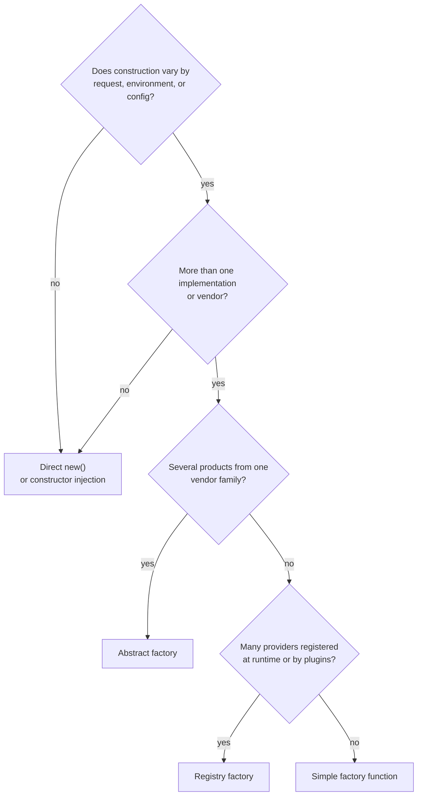

# Chapter 5 — Production Checklist, Anti-Patterns, and Decision Guide

> Companion to [`../notes.md`](../notes.md) · Sections 5–10
> **Learning goals:** ship the factory safely, recognise the shapes that pretend
> to be factories, and decide when the pattern is not worth it.

## 5.1 Production checklist

### Construction and configuration

- [ ] Exactly one composition root constructs SDK clients and providers.
- [ ] Environment variables are parsed and validated once, at boot.
- [ ] Credentials are required for every **enabled** provider.
- [ ] Disabled providers are not constructed at all.
- [ ] Duplicate provider names fail the boot, not the request.
- [ ] The default provider is guaranteed to be in the enabled list.
- [ ] No request handler calls `new SomeSdkClient()`.

### Security

- [ ] Provider names from requests are validated against an allow-list.
- [ ] Merchant/tenant authorization is checked before selecting a provider.
- [ ] Secrets never appear in logs, errors, metrics, or responses.
- [ ] Idempotency keys are derived server-side from the order, not accepted from
      the client.
- [ ] Amounts are validated against the order total; never trust the request body.

### Reliability

- [ ] Every provider call has a timeout.
- [ ] Retries apply only to `retryable` errors and reuse the idempotency key.
- [ ] A circuit breaker exists per provider (pattern 10).
- [ ] `pending` payments are completed by webhooks, with signature verification.
- [ ] Refunds are recorded in a ledger so a retry cannot refund twice.
- [ ] Provider errors map to `502`/`503`, never to `500`.

### Observability

- [ ] `payment_charge_total{provider,status}` and a duration histogram exist.
- [ ] Unknown-provider attempts are counted and alerted on.
- [ ] Every charge log line carries `orderId`, `provider`, `transactionId`, and
      `durationMs`.
- [ ] A trace span wraps the provider call.

### Testing

- [ ] Service tests use a fake provider and assert the request payload.
- [ ] Factory tests cover unknown, duplicate, and empty registration.
- [ ] Policy tests are table-driven and cover currency/default/disabled cases.
- [ ] Every provider passes the shared contract suite.
- [ ] HTTP tests cover `400`, `402`, `409`, `422`, `502`, `503`.

## 5.2 Anti-patterns

| # | Anti-pattern | Symptom | Fix |
| --- | --- | --- | --- |
| 1 | **God factory** | `createService(type)` builds everything | One factory per domain concept |
| 2 | **Factory that does the work** | `factory.charge()` contains vendor logic | Factory returns a product; product charges |
| 3 | **Env read per call** | `process.env` inside `get()` | Parse config once at boot |
| 4 | **Undefined return** | `get(name)` → `undefined`, crash later | Throw `UnsupportedProviderError` |
| 5 | **Per-request SDK client** | New `Stripe(...)` in every handler | Construct once in the composition root |
| 6 | **Silent fallback** | Unknown name quietly uses the default | Fail with `422` and a metric |
| 7 | **Switch in callers** | `if (provider.name === ...)` after `get()` | Move behaviour behind the interface |
| 8 | **Service locator** | Import a global container inside the service | Inject the factory explicitly |
| 9 | **Hidden dependencies** | Factory constructs a repository or logger | Pass dependencies in |
| 10 | **Stringly-typed API** | Any string accepted as a provider | Validate with `zod` + registry |

### Wrong and right: silent fallback

```ts
// Wrong: a typo in the request silently charges through the default provider
get(name: string): PaymentProvider {
  return this.providers.get(name) ?? this.providers.get(this.defaultName)!;
}

// Right: reject the request and record it
get(name: string): PaymentProvider {
  const provider = this.providers.get(name);
  if (!provider) {
    metrics.increment("payment_provider_unknown_total", { requested: name });
    throw new UnsupportedProviderError(name, this.names());
  }
  return provider;
}
```

### Wrong and right: selection leaking into the caller

```ts
// Wrong: the service knows vendor-specific behaviour
const provider = factory.get(name);
if (provider.name === "stripe") {
  await (provider as StripeProvider).captureIntent(id);
} else {
  await provider.charge(input);
}

// Right: the interface expresses the capability
interface PaymentProvider {
  charge(input: PaymentRequest): Promise<PaymentResult>;
  capture?(transactionId: string): Promise<PaymentResult>;
}
```

If a capability is genuinely vendor-specific, model it explicitly with a
capability interface (`SupportsCapture`) and check for it — do not branch on the
class name.

### Wrong and right: factory as a construction site

```ts
// Wrong: every get() creates a new client and a new connection pool
get(name: string) {
  if (name === "stripe") return new StripeProvider(new Stripe(key));
}

// Right: the factory holds instances built at boot
constructor(providers: readonly PaymentProvider[]) {
  this.providers = new Map(providers.map((p) => [p.name, p]));
}
```

## 5.3 Refactoring a `switch` into a factory

Starting point:

```ts
router.post("/orders/:id/pay", async (req, res) => {
  const order = await prisma.order.findUnique({ where: { id: req.params.id } });
  if (!order) return res.status(404).json({ error: "Not found" });

  if (req.body.provider === "stripe") {
    const stripe = new Stripe(process.env.STRIPE_KEY!);
    const intent = await stripe.paymentIntents.create({
      amount: order.totalCents,
      currency: order.currency.toLowerCase(),
    });
    return res.status(202).json({ transactionId: intent.id });
  }

  if (req.body.provider === "razorpay") {
    const razorpay = new Razorpay({
      key_id: process.env.RAZORPAY_KEY_ID!,
      key_secret: process.env.RAZORPAY_KEY_SECRET!,
    });
    const created = await razorpay.orders.create({
      amount: order.totalCents,
      currency: order.currency,
    });
    return res.status(202).json({ transactionId: created.id });
  }

  return res.status(400).json({ error: "Unknown provider" });
});
```

Refactor in six moves, running tests after each:

1. **Extract the contract.** Create `PaymentProvider` with `charge` and `refund`,
   plus `PaymentRequest` / `PaymentResult`. Keep it vendor-free.
2. **Move each branch into an adapter.** `StripeProvider` and `RazorpayProvider`
   translate the request, call the SDK, and map the result and errors.
3. **Add the registry.** `PaymentProviderFactory` maps names to instances and
   throws `UnsupportedProviderError`.
4. **Extract the choice.** Move currency/default/request logic into
   `ProviderSelectionPolicy`; the service calls `policy.resolve()` then
   `factory.get()`.
5. **Move construction to the composition root.** Build clients and providers once,
   validate env at boot, export the wired service.
6. **Shrink the route.** The handler parses the body, calls one service method,
   and maps the result. Vendor imports disappear.

After:

```ts
router.post(
  "/orders/:orderId/pay",
  requireAuth,
  asyncHandler(async (req, res) => {
    const body = payOrderSchema.parse(req.body ?? {});
    const result = await paymentService.pay(req.params.orderId, body.provider);
    res.status(202).json(result);
  }),
);
```

The diff is large, but every step is mechanical and independently testable. That
is the sign of a healthy refactor: no step requires rewriting the domain.

## 5.4 Decision guide



### Use a factory when

- Creation varies by **configuration, environment, provider, or business rule**.
- Construction has non-trivial setup: credentials, timeouts, retries, base URLs,
  instrumentation.
- Several call sites ask the same *which implementation?* question.
- You need one registration point for plugins or vendor adapters.
- Tests need to substitute implementations without touching business code.

### Avoid a factory when

- There is one implementation and no realistic second one.
- A direct `new Foo()` is clear, local, and stable.
- The factory would only forward arguments to a constructor.
- The "selection" is a compile-time constant.
- A dependency-injection container already owns the wiring and no runtime choice
  exists.

### Alternatives

| Alternative | Use instead when | Trade-off |
| --- | --- | --- |
| **Direct `new`** | One implementation, one call site | No indirection, no seam |
| **Constructor injection** | The caller always receives one implementation | No runtime selection |
| **DI container binding** | Wiring is static and graph is large | Container coupling; runtime choice still needs a policy |
| **Strategy without a factory** | The caller already knows which strategy it needs | Selection logic spreads if callers multiply |
| **Plugin loader (`import()`)** | Providers are deployed independently | Dynamic paths, versioning, and sandboxing complexity |
| **Abstract factory** | Several products must come from one vendor family | More interfaces, family discipline required |

A useful rule of thumb: **inject what is stable, factory what varies per request
or per deployment.**

## 5.5 Relationship to other patterns

| Pattern | Relationship to factory |
| --- | --- |
| **Strategy** | Providers are strategies; the factory selects one. The factory does not implement the algorithm. |
| **Adapter** | Each provider adapts a vendor SDK to the shared contract. |
| **Singleton** | SDK clients and providers are process-wide instances held by the composition root. Prefer injection over a global `getInstance()`. |
| **Decorator** | Retry, metrics, and circuit breaking wrap a provider while implementing the same interface (chapter 4.8). |
| **Circuit breaker** (pattern 10) | One breaker per provider, usually applied as a decorator around `charge`. |
| **Repository** (pattern 1) | Same shape applied to persistence: one interface, several adapters, chosen at composition time. |
| **Abstract factory** | When the vendor ships a family (payments + refunds + webhooks), create the family together to avoid mixing vendors. |

The composition that appears most often in production:

```text
RetryingProvider(
  CircuitBreakerProvider(
    MetricsProvider(
      StripeProvider(client)
    )
  )
)
```

Every layer implements `PaymentProvider`, so the service cannot tell the
difference. The factory registers the outermost object.

## 5.6 Interview questions

**1. Is a factory just a `switch` with extra steps?**
A registry is a `switch` that lives in one place and validates its input. If the
selection never varies, the factory is extra steps; if it varies in five call
sites, the switch is already the problem.

**2. Where should selection happen — middleware, controller, or service?**
In the service or a policy it calls. The controller parses and validates input;
middleware handles cross-cutting concerns; neither should know vendor rules.

**3. Why not construct the provider inside the service?**
Because the service would import an SDK, read configuration, and require real
credentials in tests. Construction is a separate concern with a separate lifetime.

**4. Should the factory be a singleton?**
One instance per process, created at the composition root and injected. Avoid a
global `PaymentProviderFactory.getInstance()` — it hides dependencies and makes
tests order-dependent.

**5. Does a factory satisfy the open/closed principle?**
Partially. Adding a provider means a new file plus one registration and one config
entry; existing callers stay closed. Claiming "zero changes" requires a plugin
loader, which trades simplicity for dynamism.

**6. Factory or DI container?**
A container wires the graph; a factory makes a runtime decision. Most Express
services need constructor injection plus a small registry, not a container.

## 5.7 Summary

- A factory owns **one decision**: which implementation to create or return.
- It returns a **product interface**; callers never see vendor types.
- The **registry** variant is the default for backend services: explicit,
  testable, and cheap.
- Construction belongs in the **composition root**, once per process.
- Selection **policy** (currency, merchant, flags) is separate from the registry.
- Validate untrusted names, throw typed errors, and never return `undefined`.
- Add resilience with **decorators**, not inside the factory.
- Test the factory, the policy, and every provider through a **shared contract**.
- If only one implementation exists and none is planned, skip the pattern.

> A factory centralizes *which* implementation to use, so the rest of the code
> only depends on *what* the implementation does.

---

**Previous:** [Chapter 4 ←](04-wiring-and-testing.md)
**Index:** [Factory notes](README.md) · **Source:** [`../notes.md`](../notes.md)
