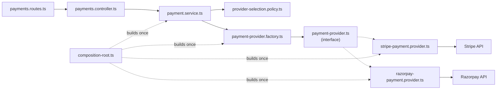

# Factory Pattern — Chapter Notes

Companion deep-dive to [`../notes.md`](../notes.md). The main notes are the
one-page reference; these chapters expand every section with reasoning,
copy-ready TypeScript/Express code, tests, and production guidance.

**Pattern 2 of 10** · TypeScript · Node.js · Express · Stripe · Razorpay

## Chapters

| # | Chapter | Focus | Source |
| --- | --- | --- | --- |
| 1 | [Why object creation needs a boundary](01-why-factory.md) | Duplicated `new`, drift, symptoms, when `new` is fine | §1 |
| 2 | [The factory concept and its boundaries](02-concept-and-boundaries.md) | Product/creator/client, variants, factory vs strategy vs DI | §2–4 |
| 3 | [Building the payment provider example](03-payment-provider-example.md) | Contract, Stripe/Razorpay adapters, registry, policy, HTTP | §3 |
| 4 | [Wiring, testing, and failure modes](04-wiring-and-testing.md) | Composition root, env validation, fakes, contract tests, 4xx/5xx | §3.5, §5 |
| 5 | [Production checklist, anti-patterns, and decision guide](05-production-and-decision-guide.md) | Ship checklist, ten anti-patterns, refactor, when to skip | §5–10 |

## Suggested reading paths

- **New to the pattern:** 1 → 2 → 3. Stop after the sequence diagram and build it.
- **Wiring an existing service:** 2 → 3 → 4. Focus on the composition root and
  the contract suite.
- **Reviewing a design:** 2 → 5. Use the anti-pattern table and decision guide as
  a checklist.
- **Interview preparation:** 2 → 5, then explain the diagram in 2.2 from memory.

## Prerequisites

- Node.js 20+ and TypeScript 5+
- Express 4.19+ (Express 5 forwards rejected promises natively)
- `zod` for boundary validation, `vitest` + `supertest` for tests
- Stripe and Razorpay SDKs (sandbox keys are enough; chapters 4–5 never require
  live credentials)
- Familiarity with constructor injection and the repository pattern
  ([`../../01-repository/notes`](../../01-repository/notes/README.md))

## Folder structure

Two layouts are shown. Both keep the same rule: **creation code is separate from
behaviour code**. Only the physical nesting differs.

The `code/` folder in this pattern is reserved for a runnable demo. Until it
lands, treat the trees below as the contract for where each file belongs; the
reference implementation of the same layering is
[`../../01-repository/code`](../../01-repository/code/README.md).

### Feature-first (recommended once there are several domains)

```text
02-factory/
├── notes.md
├── notes/
│   ├── README.md
│   └── 01-...05-....md
└── code/            # reserved for the runnable demo
    ├── prisma/
    │   └── schema.prisma
    ├── src/
    │   ├── config/
    │   │   └── env.ts                  # env parsed + validated once
    │   ├── modules/
    │   │   ├── orders/                 # from pattern 1
    │   │   │   ├── order.routes.ts
    │   │   │   ├── order.controller.ts
    │   │   │   ├── order.service.ts
    │   │   │   ├── order.repository.ts
    │   │   │   └── order.errors.ts
    │   │   └── payments/
    │   │       ├── payment.routes.ts
    │   │       ├── payment.controller.ts
    │   │       ├── payment.service.ts
    │   │       ├── provider-selection.policy.ts
    │   │       ├── payment-provider.factory.ts
    │   │       ├── payment-provider.ts          # product interface
    │   │       ├── stripe-payment.provider.ts   # adapter
    │   │       ├── razorpay-payment.provider.ts # adapter
    │   │       ├── payment.mapper.ts
    │   │       ├── payment.dto.ts
    │   │       └── payment.errors.ts
    │   ├── middlewares/
    │   │   ├── async-handler.ts
    │   │   ├── authenticate.ts
    │   │   └── error-handler.ts
    │   ├── db/
    │   │   └── prisma.ts
    │   ├── composition-root.ts          # builds clients + factory + service
    │   ├── app.ts
    │   └── server.ts
    └── tests/
        ├── unit/                        # service + fake provider
        ├── contract/                    # shared provider suite
        ├── integration/                 # HTTP + sandbox adapters
        ├── fakes/                       # FakePaymentProvider
        └── builders/                    # anOrder(...)
```

### Layer-first (used in the chapter snippets)

```text
src/
├── routes/
│   └── payments.routes.ts               # URL + method -> controller
├── controllers/
│   └── payments.controller.ts           # parse input, one service call
├── services/
│   ├── payment.service.ts               # use case: pay an order
│   └── provider-selection.policy.ts     # which provider for this order
├── factories/
│   └── payment-provider.factory.ts      # name -> instance registry
├── providers/
│   ├── payment-provider.ts              # product interface + types
│   ├── stripe-payment.provider.ts       # adapter (Stripe)
│   ├── razorpay-payment.provider.ts     # adapter (Razorpay)
│   └── retrying-payment.provider.ts     # decorator (optional)
├── repositories/
│   ├── order.repository.ts              # persistence port (pattern 1)
│   └── prisma-order.repository.ts       # persistence adapter
├── models/
│   └── order.model.ts
├── mappers/
│   └── payment.mapper.ts                # vendor status -> domain status
├── dtos/
│   └── payment.dto.ts                   # zod schemas
├── middlewares/
│   ├── async-handler.ts
│   ├── authenticate.ts
│   └── error-handler.ts                 # domain error -> HTTP status
├── errors/
│   └── payment.errors.ts
├── config/
│   └── env.ts
├── db/
│   └── prisma.ts
├── composition-root.ts
├── app.ts
└── server.ts
```

### What lives where

| Path | Responsibility | May import |
| --- | --- | --- |
| `*.routes.ts` | Map URL + method to a controller and middleware | controller, middleware |
| `*.controller.ts` | Parse/validate HTTP input, call **one** service method, shape the response | service, DTO |
| `*.service.ts` | Use case, invariants, policy call, `factory.get()`, repository writes | policy, factory, product interface, repository, errors |
| `*selection.policy.ts` | Pure decision: requested / currency / merchant → provider name | product contract constants, errors |
| `*factory.ts` | Registry of ready instances, duplicate/unknown checks | product interface, errors |
| `payment-provider.ts` | Product contract and request/result types | nothing |
| `*-payment.provider.ts` | Adapt one vendor SDK to the contract; translate errors | vendor SDK, contract, mapper, errors |
| `retrying-*.provider.ts` | Decorator: retries/breaker/metrics around a provider | contract, errors |
| `*.mapper.ts` | Vendor status/payload → domain types | contract types |
| `*.dto.ts` | Zod schemas and inferred request/response types | zod |
| `repositories/` | Persistence port + adapter (pattern 1) | models, Prisma |
| `middlewares/` | Auth, async error forwarding, error → HTTP mapping | express, errors |
| `config/env.ts` | Env parsing, credential checks, enabled list | zod, contract constants |
| `composition-root.ts` | Construct SDK clients, providers, factory, policy, service | everything (only place allowed to) |
| `tests/` | Unit, contract, integration, fakes, builders | src |

Two placement rules that prevent most mistakes:

1. **The factory never imports a vendor SDK.** If it does, it has become a
   composition root.
2. **The service never imports a vendor SDK or a provider class.** If it does, the
   factory is being bypassed.

## Dependency rule



- Routes and controllers never import a vendor SDK.
- Services depend on the **policy**, the **factory**, and the **interface**.
- The interface imports nothing (no Express, no Prisma, no SDK).
- Providers are the only files that import vendor SDKs.
- `composition-root.ts` is the only place that constructs concrete classes and
  reads secrets.

## Naming rules

| File | Convention | Example |
| --- | --- | --- |
| Router | `<resource>.routes.ts` | `payments.routes.ts` |
| Controller | `<resource>.controller.ts` | `payments.controller.ts` |
| Service | `<concept>.service.ts` | `payment.service.ts` |
| Selection policy | `<concept>-selection.policy.ts` | `provider-selection.policy.ts` |
| Factory | `<concept>.factory.ts` | `payment-provider.factory.ts` |
| Product contract | `<concept>.ts` | `payment-provider.ts` |
| Adapter | `<vendor>-<concept>.provider.ts` | `stripe-payment.provider.ts` |
| Decorator | `<behaviour>-<concept>.provider.ts` | `retrying-payment.provider.ts` |
| Fake | `fake-<concept>.provider.ts` | `fake-payment.provider.ts` |
| Mapper | `<concept>.mapper.ts` | `payment.mapper.ts` |
| DTO | `<concept>.dto.ts` | `payment.dto.ts` |
| Errors | `<concept>.errors.ts` | `payment.errors.ts` |

One exported class per file, named exports only. Keep the provider directory flat
until it exceeds roughly ten files; then group by vendor
(`providers/stripe/{provider,mapper}.ts`) rather than by technical layer.

## How the chapter snippets map

The chapters use the layer-first paths. The same files in a feature-first app:

| Chapter snippet | Feature-first | Layer-first |
| --- | --- | --- |
| `providers/payment-provider.ts` | `modules/payments/payment-provider.ts` | `providers/payment-provider.ts` |
| `providers/stripe-payment.provider.ts` | `modules/payments/stripe-payment.provider.ts` | `providers/stripe-payment.provider.ts` |
| `providers/razorpay-payment.provider.ts` | `modules/payments/razorpay-payment.provider.ts` | `providers/razorpay-payment.provider.ts` |
| `factories/payment-provider.factory.ts` | `modules/payments/payment-provider.factory.ts` | `factories/payment-provider.factory.ts` |
| `services/provider-selection.policy.ts` | `modules/payments/provider-selection.policy.ts` | `services/provider-selection.policy.ts` |
| `services/payment.service.ts` | `modules/payments/payment.service.ts` | `services/payment.service.ts` |
| `controllers/payments.controller.ts` | `modules/payments/payment.controller.ts` | `controllers/payments.controller.ts` |
| `routes/payments.routes.ts` | `modules/payments/payment.routes.ts` | `routes/payments.routes.ts` |
| `mappers/payment.mapper.ts` | `modules/payments/payment.mapper.ts` | `mappers/payment.mapper.ts` |
| `dtos/payment.dto.ts` | `modules/payments/payment.dto.ts` | `dtos/payment.dto.ts` |
| `errors/payment.errors.ts` | `modules/payments/payment.errors.ts` | `errors/payment.errors.ts` |
| `config/env.ts` | `config/env.ts` | `config/env.ts` |
| `composition-root.ts` | `src/composition-root.ts` | `src/composition-root.ts` |
| `tests/fakes/fake-payment.provider.ts` | `tests/fakes/fake-payment.provider.ts` | `tests/fakes/fake-payment.provider.ts` |

## Conventions in these chapters

- Money is an integer in the **smallest currency unit** (cents/paise). Never use
  floats.
- Amount and currency come from the **order**, never from the request body.
- IDs look like `ord_123` and `tx_123`; provider names are lowercase.
- Examples use constructor injection; no decorators, no DI container.
- Every diagram is Mermaid and renders on GitHub, GitLab, and VS Code.
- Each chapter ends with an exercise or checklist and links to the next chapter.

## Source mapping

[`../notes.md`](../notes.md) remains the canonical one-page summary. Chapters 1–5
expand sections §1–§10; if a chapter and the summary disagree, treat the chapter
as the detailed explanation and update both.
