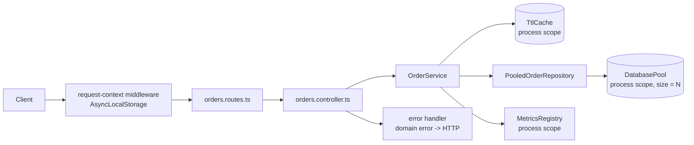
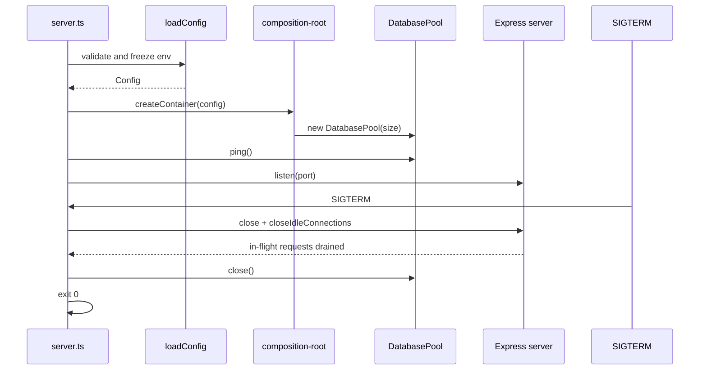

# Singleton Pattern — Runnable Demo

An Express + TypeScript API that makes the singleton lifecycle **visible**.

The demo runs with no PostgreSQL, Redis, or credentials. Two in-memory adapters
stand in for real infrastructure:

- `DatabasePool` — a bounded, process-wide connection pool with queueing,
  timeouts, and drain-on-close.
- `TtlCache` — a per-process TTL cache shared by every request.

Everything else is real: validated configuration, constructor injection, a
composition root, `AsyncLocalStorage` request scope, structured logs, Prometheus
metrics, readiness/liveness probes, and graceful shutdown.

> **Pattern 3 of 10** · TypeScript · Node.js · Express · zod · Vitest
> Chapter notes: [`../notes/README.md`](../notes/README.md) · Summary:
> [`../notes.md`](../notes.md)

## Quick start

```bash
cd 03-singleton/code
npm install
cp .env.example .env
npm run dev
```

The API listens on `http://localhost:3000`.

```bash
curl -s localhost:3000/health
curl -s localhost:3000/system/info
curl -s localhost:3000/orders
```

Production-style run:

```bash
npm run build
npm start
```

Requires Node.js 20+.

## What is actually a singleton

| Resource | Created in | Scope | How to observe it |
| --- | --- | --- | --- |
| Configuration | `config/env.ts` | Process | `/system/info` settings; frozen object |
| Database pool | `infrastructure/database.ts` | Process | `/system/pool` `id`, `size`, `maxObservedInUse` |
| TTL cache | `infrastructure/cache.ts` | Process | `/system/cache` `id`, `hits`, `entries` |
| Logger | `lib/logger.ts` | Process | JSON logs carry `instanceId` |
| Metrics registry | `lib/metrics.ts` | Process | `/metrics`, `/system/info` component id |
| Request context | `AsyncLocalStorage` | **Request** | `/system/context` |
| Request counter | `lib/runtime.ts` | Process | `/system/info` `requestsServed` |

There is **no `getInstance()`** in the codebase. One instance per process comes
from constructing the graph once in `composition-root.ts`; dependencies are
passed through constructors.

```bash
grep -R "getInstance" src/ || echo "no global accessors"
```

The guaranteed scope is **one instance per process**, not one per cluster. Start
two servers on different ports and compare their `/system/info` component ids.

## API

| Method | Path | Purpose |
| --- | --- | --- |
| `GET` | `/health` | Liveness; no dependency checks |
| `GET` | `/ready` | Readiness; fails while draining or when the pool is closed |
| `GET` | `/system/info` | Process identity, component ids, request count, settings |
| `GET` | `/system/context?delayMs=50` | Echo the request-scoped context |
| `GET` | `/system/pool` | Pool stats: size, in use, waiting, totals |
| `GET` | `/system/cache` | Cache stats: entries, hits, misses, expirations |
| `GET` | `/metrics` | Prometheus text exposition |
| `GET` | `/orders` | List orders for `x-tenant-id` |
| `POST` | `/orders` | Create an order |
| `GET` | `/orders/:id` | Read one order (tenant-scoped) |
| `POST` | `/orders/:id/cancel` | Cancel a pending order |

Identity for the demo comes from headers:

| Header | Default | Meaning |
| --- | --- | --- |
| `x-tenant-id` | `tenant_demo` | Tenant scope; every query is filtered by it |
| `x-user-id` | `usr_demo` | Actor stored on created orders |
| `x-request-id` | generated | Echoed in the response and every log line |

The response always includes `x-request-id` and `x-instance-id`; the latter is
the process that served the request.

## Walkthrough

### 1. Prove the singleton identity

```bash
curl -s localhost:3000/system/info | jq '.components'
curl -s localhost:3000/system/info | jq '.components'
```

`database.id`, `cache.id`, and `metrics.id` are identical across requests.
`requestsServed` increases. Restart the process and the ids change; start a
second replica and its ids are different.

### 2. Show tenant-scoped request data

```bash
# tenant_demo sees two seeded orders
curl -s localhost:3000/orders | jq '.meta'

# tenant_other sees one
curl -s localhost:3000/orders -H 'x-tenant-id: tenant_other' | jq '.meta'

# but cannot read tenant_demo's order
curl -s -o /dev/null -w '%{http_code}\n' \
  localhost:3000/orders/ord_demo_usd -H 'x-tenant-id: tenant_other'
# 404
```

### 3. Create an order from request scope

```bash
curl -s -X POST localhost:3000/orders \
  -H 'content-type: application/json' \
  -H 'x-tenant-id: tenant_a' \
  -H 'x-user-id: usr_a' \
  -H 'x-request-id: req_demo_1' \
  -d '{
    "currency": "USD",
    "items": [
      { "sku": "sku_keyboard", "quantity": 2, "unitPriceCents": 12999 }
    ]
  }' | jq
```

The service computes `totalCents`; the client cannot submit a total. The
response echoes `x-request-id: req_demo_1`.

### 4. Observe the cache

```bash
curl -s localhost:3000/orders/ord_demo_usd > /dev/null
curl -s localhost:3000/orders/ord_demo_usd > /dev/null
curl -s localhost:3000/system/cache | jq
```

The second read is a cache hit. Writes invalidate the tenant list and the
affected item. The cache is **per process**: another replica has its own copy
and may return stale data until its TTL expires.

### 5. Saturate the bounded pool

```bash
seq 1 20 | xargs -P 20 -I{} curl -s -o /dev/null -w '%{http_code}\n' \
  -X POST localhost:3000/orders \
  -H 'content-type: application/json' \
  -H 'x-tenant-id: tenant_a' \
  -d '{"currency":"USD","items":[{"sku":"sku_load","quantity":1,"unitPriceCents":1000}]}'

curl -s localhost:3000/system/pool | jq
```

`maxObservedInUse` never exceeds `DB_POOL_SIZE`, and `releasedTotal` equals
`acquiredTotal` once the load finishes. With `DB_QUERY_DELAY_MS=25`, the pool is
held long enough to see queueing.

To force a timeout and a `503 db_pool_timeout`, run one replica with a tiny
timeout:

```bash
DB_POOL_SIZE=1 DB_QUERY_DELAY_MS=200 DB_ACQUIRE_TIMEOUT_MS=20 npm start
```

### 6. Interleave two requests

```bash
(
  curl -s -H 'x-request-id: req-a' -H 'x-tenant-id: tenant_a' \
    'localhost:3000/system/context?delayMs=100' &
  curl -s -H 'x-request-id: req-b' -H 'x-tenant-id: tenant_b' \
    'localhost:3000/system/context?delayMs=20' &
  wait
) | jq
```

Each response contains its own id and tenant. The shared pool is used by both,
but **no request data lives on a process-wide object**.

### 7. Readiness versus liveness

```bash
curl -s localhost:3000/health | jq   # 200 while the process is alive
curl -s localhost:3000/ready  | jq   # 200 only when dependencies are usable
```

During `SIGTERM`, `/ready` returns `503 {"status":"draining"}` before the
listener closes. A liveness probe that checks PostgreSQL would restart every pod
during a database blip; this demo keeps liveness dependency-free.

### 8. Shut down in order

Press `Ctrl+C`, or:

```bash
kill -TERM "$(pgrep -f 'node dist/server.js' | head -1)"
```

The log order is:

```text
shutting down
resources closed        # poolClosed: true
```

In-flight requests finish before the pool closes. The internal timeout is
`SHUTDOWN_TIMEOUT_MS`; keep it below the orchestrator's grace period. Once
`shutdown` starts, a second signal is ignored.

The examples pipe through `jq`; drop the pipe if it is not installed.

## Folder map

```text
03-singleton/code/
├── src/
│   ├── config/
│   │   └── env.ts                     # zod -> frozen Config, once per boot
│   ├── infrastructure/
│   │   ├── database.ts                # bounded DatabasePool (process)
│   │   └── cache.ts                   # TtlCache (process, per replica)
│   ├── lib/
│   │   ├── logger.ts                  # base logger + child per request
│   │   ├── metrics.ts                 # counters, gauges, histograms
│   │   ├── request-context.ts         # AsyncLocalStorage + accessors
│   │   └── runtime.ts                 # instance id, uptime, request count
│   ├── middlewares/
│   │   ├── request-context.ts         # creates + enriches the request scope
│   │   ├── http-metrics.ts
│   │   ├── async-handler.ts
│   │   └── error-handler.ts
│   ├── models/order.model.ts
│   ├── repositories/
│   │   ├── order.repository.ts        # port
│   │   └── pooled-order.repository.ts # adapter using the shared pool
│   ├── services/order.service.ts      # business rules + cache policy
│   ├── controllers/
│   │   ├── orders.controller.ts
│   │   └── system.controller.ts       # singleton evidence endpoints
│   ├── routes/
│   │   ├── orders.routes.ts
│   │   └── system.routes.ts
│   ├── mappers/order.mapper.ts
│   ├── dtos/order.dto.ts
│   ├── errors/app.errors.ts
│   ├── seed.ts                        # two tenants of demo orders
│   ├── composition-root.ts            # the only wiring module
│   ├── app.ts                         # Express app, no listening
│   ├── server/shutdown.ts             # testable SIGTERM handler
│   └── server.ts                      # boot + signals
└── tests/
    ├── unit/                          # config, pool, cache, service, shutdown
    ├── integration/                   # HTTP flows + concurrency
    ├── fakes/                         # InMemoryOrderRepository
    └── support/                       # testConfig, createTestContainer
```

Only `composition-root.ts` constructs `DatabasePool`, `TtlCache`,
`MetricsRegistry`, and the repository. Routes and controllers never import them,
and services never read `process.env`.

## Request flow



The controller reads `tenantId`/`userId` from the request context and passes
them as arguments. The service logs with `requestId`, but stores nothing on
itself. The repository and pool are shared; the identity is not.

## Boot and shutdown



Readiness flips to `503 draining` at the start of shutdown. A force-exit timer
guarantees the process cannot hang past `SHUTDOWN_TIMEOUT_MS`.

## Design decisions

**One instance, no global accessor.** `createContainer()` constructs the graph
once. Node's module cache gives it one instance per process. Callers receive
dependencies through constructors, so tests can build a fresh graph.

**The composition root is the only edge.** It is the only module that reads
secrets/configuration and constructs concrete infrastructure. Everything below
it depends on the `OrderRepository` port or receives collaborators as arguments.

**Configuration is parsed once and frozen.** `loadConfig(env)` is pure and
validated; `server.ts` decides when boot happens. A missing or invalid variable
throws before `listen()`. `NODE_ENV=production` also rejects `SEED_DEMO=true`.

**The pool provides backpressure.** It has a fixed size, a bounded wait, and
per-query release in `finally`. Callers that wait too long receive
`503 db_pool_timeout` with `Retry-After` instead of hanging forever.

**Request data never touches a shared object.** `AsyncLocalStorage` carries
`requestId`, `tenantId`, and `userId`. The controller passes tenant/user to the
service explicitly; the service uses the context only for log correlation.

**Tenant isolation is enforced twice.** The service scopes cache keys by tenant,
and every repository method requires a tenant id and filters by it. A cross-tenant
read looks like a 404, not a 403, so existence is not leaked.

**The cache belongs to the service.** Keys are tenant-aware and versioned
(`orders:<tenant>:item:<id>:v1`). Writes invalidate the item and the tenant list.
The cache is intentionally local; see the replica warning below.

**Errors carry their HTTP mapping.** Domain errors extend `AppError` with `code`
and `httpStatus`. One middleware maps them; controllers stay free of status-code
branches. Malformed JSON is a `400 invalid_json`, not a `500`.

**Metrics are recorded at the service and HTTP edges.** Route labels are templates
(`/orders/:orderId`), not raw ids. Pool and cache gauges are refreshed when system
endpoints are read.

**Shutdown is testable.** `createShutdownHandler` receives the server, a
`closeResources` callback, a logger, and an injectable `exit`. Tests assert the
exact order and idempotency with fakes; the process never dies mid-test.

## Configuration

| Variable | Default | Controls |
| --- | --- | --- |
| `NODE_ENV` | `development` | Environment; production enables the seed guard |
| `PORT` | `3000` | HTTP port (`0` is allowed in tests) |
| `LOG_LEVEL` | `info` | `debug`, `info`, `warn`, or `error` |
| `INSTANCE_ID` | `local-1` | Identity shown in `/system/info` and logs |
| `DB_POOL_SIZE` | `4` | Maximum concurrent logical connections |
| `DB_QUERY_DELAY_MS` | `25` | Simulated query latency while holding a connection |
| `DB_ACQUIRE_TIMEOUT_MS` | `2000` | Max time a caller waits for a connection |
| `CACHE_TTL_MS` | `5000` | Default entry TTL (`0` disables caching) |
| `SHUTDOWN_TIMEOUT_MS` | `10000` | Force-exit deadline during drain |
| `SEED_DEMO` | `true` (dev/test) | Seed two tenants; must be `false` in production |
| `DEFAULT_TENANT_ID` | `tenant_demo` | Tenant when `x-tenant-id` is absent |
| `DEFAULT_USER_ID` | `usr_demo` | User when `x-user-id` is absent |

## Metrics

| Metric | Type | Labels |
| --- | --- | --- |
| `http_requests_total` | counter | `method`, `route`, `status` |
| `http_request_duration_seconds` | histogram | `method`, `route` |
| `db_pool_in_use` | gauge | `pool` |
| `db_pool_size` | gauge | `pool` |
| `db_pool_waiting` | gauge | `pool` |
| `cache_entries` | gauge | `cache` |
| `cache_events_total` | counter | `operation`, `result` |
| `cache_invalidations_total` | counter | `reason` |
| `orders_created_total` | counter | `tenant` |
| `orders_cancelled_total` | counter | `tenant` |

The `tenant` label is acceptable for a demo with two tenants. In a real
multi-tenant system it can explode cardinality; use a plan/tier label or drop it.

## Tests

```bash
npm test          # 61 tests, 8 files
npm run typecheck
npm run build
```

| Suite | Tests | What it proves |
| --- | ---: | --- |
| `unit/config` | 8 | Defaults, coercion, freeze, invalid values, production seed guard |
| `unit/cache` | 7 | TTL expiry, eviction, prefix invalidation, close semantics |
| `unit/database.pool` | 9 | Size bound, queueing, timeout, release-on-error, drain |
| `unit/order.service` | 9 | Server-side totals, tenant scoping, cache hits/invalidation, cancel rules |
| `unit/shutdown` | 6 | Order, idempotency, draining flag, failure paths, forced exit |
| `unit/composition-root` | 4 | Fresh graphs, shared pool, resource ownership on shutdown |
| `integration/orders.api` | 11 | CRUD, tenant isolation, validation, cache, unknown routes |
| `integration/system.api` | 7 | Stable ids, ALS isolation, pool bound, 503 timeout, probes, metrics |

Each test builds a fresh container with `createTestContainer()`. No test mutates
`process.env`, resets a static, or depends on execution order. The shutdown tests
inject `exit` and fake timers so Vitest is never interrupted.

## Production swaps

| Demo component | Production replacement | Keep the same |
| --- | --- | --- |
| `DatabasePool` | Prisma client or `pg.Pool`, sized per replica | One client, injected, closed on shutdown |
| `TtlCache` | Redis with TTL and pub/sub invalidation | Tenant-aware keys and write invalidation |
| Custom JSON logger | pino or winston, destination/transport | One base logger, child per request |
| Custom metrics registry | `prom-client` | Bounded labels and service-level counters |
| `x-tenant-id` / `x-user-id` | Verified JWT/session middleware | Context values and explicit service args |
| In-memory order map | PostgreSQL/MySQL table with `tenant_id` index | Repository port and tenant-filtered queries |
| `seedOrders()` | Migrations/fixtures | Seed only in development |

> A real Prisma client has its own pool. Do not wrap it in a second pool; pass the
> client into the repository exactly as `PooledOrderRepository` receives
> `DatabasePool` here.

## Per-replica warning

A singleton is **per process**. In a deployment with three replicas you have
three pools, three caches, three metric registries, and three request counters.

| Requirement | Not enough | Use instead |
| --- | --- | --- |
| Mutual exclusion | Process-local `Map`/boolean | Redis `SET NX PX` with an owner token, DB advisory lock |
| Rate limiting | In-memory counter | Redis `INCR` + TTL, or the API gateway |
| Cache invalidation | `cache.delete()` in one process | Redis pub/sub, versioned keys, short TTL |
| Global counters | `requestsServed` | Prometheus aggregation, DB/Redis counter |
| Job de-duplication | `Set` in memory | Unique constraint, queue dedupe |
| Sessions | In-memory store | Redis/DB-backed session store |

`/system/info` intentionally exposes `requestsServed` to make this concrete:
restart the process, or start a second replica, and the numbers diverge.

## Known simplifications

- The "database" is an in-memory `Map`; data is lost on restart.
- The client sends `unitPriceCents`. Real checkout prices come from a catalog and
  the request carries only SKU + quantity.
- `x-tenant-id` / `x-user-id` are trusted headers. Production must derive both
  from a verified token and enforce tenant membership.
- The cache is local; cross-replica consistency is not attempted.
- No authentication, rate limiting, idempotency keys, or currency conversion.
- Money is integer minor units; timestamps are ISO strings.
- The pool models logical connections, not real sockets or transactions.

These simplifications keep the demo focused on **ownership and scope** — the two
decisions that make a singleton safe or dangerous.

## Related notes

- [Chapter 1 — Why a shared instance needs an owner](../notes/01-why-singleton.md)
- [Chapter 2 — Scope: process, request, and replica](../notes/02-scope-and-composition.md)
- [Chapter 3 — Infrastructure singletons in Express](../notes/03-infrastructure-singletons.md)
- [Chapter 4 — Testing and lifecycle discipline](../notes/04-testing-and-lifecycle.md)
- [Chapter 5 — Decision guide and checklist](../notes/05-decision-guide.md)
- [Singleton summary](../notes.md)


