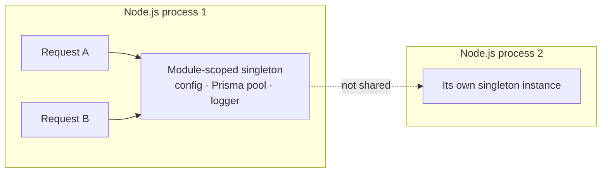

# Pattern 3 — Singleton

**Category:** Shared instance lifecycle
**Stack used in examples:** TypeScript · Node.js · Express

> 📚 **Deep dive:** [chapter-wise notes](notes/README.md) — five chapters on scope, composition roots, infrastructure clients, testing, and shutdown.

---

## 1. What problem does it solve?

Some objects are expensive to construct, or should have a consistent lifecycle inside one process:

- Application configuration.
- A logger.
- A database connection pool (e.g. one `PrismaClient`).
- A configured SDK client (Stripe, S3, Redis).
- A metrics registry.

Creating a new connection pool per request drains connections and destroys caching. The singleton pattern ensures a class exposes **one instance within its intended scope**.

> Crucial distinction: *one instance per process* is **not** *one instance across the distributed system*. If you run five containers, you have five “singletons”.

## 2. Basic (classic) implementation

```ts
export class AppConfig {
  private static instance: AppConfig | undefined;

  private constructor(
    public readonly environment: string,
    public readonly databaseUrl: string,
  ) {}

  static getInstance(): AppConfig {
    if (!AppConfig.instance) {
      AppConfig.instance = new AppConfig(
        process.env.NODE_ENV ?? "development",
        process.env.DATABASE_URL ?? "",
      );
    }
    return AppConfig.instance;
  }
}
```

```ts
const a = AppConfig.getInstance();
const b = AppConfig.getInstance();
console.log(a === b); // true
```

### Why this is a demonstration, not a production default

- Hidden global dependency — impossible to see from a constructor signature.
- Hard to replace in tests (module-level static state survives test cases).
- Initialization order is implicit; a misconfigured env var throws on first access, deep in a request.
- Holds mutable state globally, which is a foot-gun in concurrent servers.

## 3. The Express approach: explicit composition

Express does not manage service lifecycles. Lifecycle is decided by **where you construct the object**; a module-scoped instance is the usual singleton.

### 3.1 Configuration as a module singleton

```ts
// config.ts
function requireEnv(key: string): string {
  const value = process.env[key];
  if (!value) throw new Error(`Missing environment variable: ${key}`);
  return value;
}

export const appConfig = Object.freeze({
  environment: process.env.NODE_ENV ?? "development",
  databaseUrl: requireEnv("DATABASE_URL"),
  stripeKey: requireEnv("STRIPE_SECRET_KEY"),
});
```

### 3.2 Shared clients in a composition root

```ts
// composition-root.ts
import { PrismaClient } from "@prisma/client";
import { appConfig } from "./config";

export const prisma = new PrismaClient({
  datasources: { db: { url: appConfig.databaseUrl } },
});
```

```ts
// payments.service.ts
export class PaymentsService {
  constructor(
    private readonly config: typeof appConfig,
    private readonly prisma: PrismaClient,
  ) {}
}
```

```ts
// composition-root.ts (continued)
export const paymentsService = new PaymentsService(appConfig, prisma);
```

The Node module cache guarantees one instance per process, and dependencies are visible in constructors. For a large graph, an optional container (tsyringe, Awilix, typedi) can resolve constructors, but the composition root already covers most Express apps.

### 3.3 Scopes in Express



- **Application-level:** module-scoped constants or `app.locals` for shared clients/config.
- **Per-request:** `req` / `res.locals`, or `AsyncLocalStorage` for request context (user, tenant, trace id).
- **Never:** user data on a module-scoped object.

```ts
import { randomUUID } from "node:crypto";

app.use((req, res, next) => {
  res.locals.requestId = req.header("x-request-id") ?? randomUUID();
  next();
});
```

Request context passed explicitly (or via `AsyncLocalStorage`) is what prevents one customer’s data leaking into another customer’s response.

## 4. Scope table (the important production distinction)

| Resource | Typical approach |
| --- | --- |
| Configuration service | Module-scoped singleton (composition root) |
| Logger | Module-scoped singleton |
| Database connection pool | One pool per process |
| User-specific request data | `req` / `res.locals` or `AsyncLocalStorage` |
| Cross-server lock | Redis / database advisory lock / etcd — **not** a singleton |
| Global job de-duplication | DB unique constraint, Redis `SETNX`, queue dedupe |
| Rate limiting across pods | Redis-backed rate limiter |

### Consequences

- A singleton **cannot** provide distributed locking, global counters, or cross-server rate limiting.
- Never store mutable per-user state (current user, tenant, request id) on a singleton. One request will read another user’s data.
- Per-instance caches are fine for read-mostly data, but they are not consistent across replicas. Plan cache invalidation accordingly (TTL, pub/sub, versioned keys).

## 5. Practical rules

1. **Prefer explicit constructor injection over `getInstance()`.** Construct once in the composition root and pass the instance in.
2. **Make singleton dependencies stateless** where possible. Configuration and clients are safe; request context is not.
3. **Initialize eagerly at startup**, not lazily inside a request. Fail fast on missing env vars.
4. **Clean up on shutdown** (`SIGTERM` / `SIGINT`: stop accepting requests with `server.close()`, then close pools and flush telemetry).
5. **Do not use the singleton as a service locator** (`SomeService.getInstance()` called from everywhere). That is global mutable state with extra steps.
6. **In tests** build fresh instances (or call `jest.resetModules()`) instead of mutating shared statics by hand.

## 6. When to use / when not to

**Use it when**
- Construction is expensive and the object is safe to share.
- The resource is inherently process-wide (pool, metrics registry, config).
- A consistent lifecycle is required (single connection, single logger).

**Avoid it when**
- State is request/user-specific → use request scope or pass context explicitly.
- You need coordination across processes → use a distributed mechanism.
- The only goal is “easy global access” → that is a design smell; inject instead.

## 7. Common mistakes

1. Believing a singleton is global across containers or servers.
2. Caching per-user responses in a process-level cache keyed only by product id.
3. Relying on module-level state for tests, causing order-dependent failures.
4. Lazy initialization that throws during the first live request instead of at boot.
5. Forgetting to close pools and the HTTP server on shutdown, leaking DB/Redis connections during deploys.

## 8. Relationship to other patterns

- **Factory** — may return a shared (singleton) instance for expensive dependencies.
- **Repository / Adapter** — their instances are typically singletons wired once in the composition root.
- **Decorator** — decorators must remain stateless if they are singletons.
- **Circuit breaker** — each process holds its own breaker state; this is a singleton-scope consequence, not a distributed one.

## 9. Practice checklist

- [ ] List every process-wide resource and its lifecycle.
- [ ] Replace manual `getInstance()` calls with a composition root (or a DI container if the graph is large).
- [ ] Validate required configuration at startup.
- [ ] Confirm no per-request state lives on a shared service.
- [ ] Add graceful shutdown handling.
- [ ] Document which caches are per-process and how they expire.

## 10. One-line takeaway

> Use a singleton for *shared infrastructure*, never for *shared user state* or *distributed coordination*.

