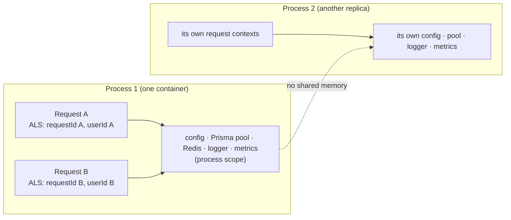

# Chapter 2 — Scope: Process, Request, and Replica

> Companion to [`../notes.md`](../notes.md) · Sections 3–4
> **Learning goals:** choose the right lifetime for each object, construct
> process-wide resources in a composition root, and keep request data out of
> shared memory.

## 2.1 The three scopes

| Scope | Lives for | Examples | Storage |
| --- | --- | --- | --- |
| **Process** | Until the process exits | Config, logger, Prisma pool, Redis client, metrics, SDK clients | Module-scoped value created once |
| **Request** | One HTTP request (and its async chain) | User id, tenant id, trace id, locale, request-scoped cache | `req`/`res.locals`, `AsyncLocalStorage` |
| **Transient** | One call/operation | DTOs, mappers, short-lived value objects, per-call clients | `new` inside a function |

A fourth scope is easy to forget: **cluster**. A process singleton exists once
per container. If you run five replicas, you have five of everything (section
2.6).

The design question is never "should this be a singleton?" but:

> **What is the narrowest scope that satisfies the requirement?**

## 2.2 Configuration: one immutable object

```ts
// config/env.ts
import { z } from "zod";

const envSchema = z.object({
  NODE_ENV: z.enum(["development", "test", "production"]).default("development"),
  PORT: z.coerce.number().int().positive().default(3000),
  DATABASE_URL: z.string().url(),
  REDIS_URL: z.string().url(),
  LOG_LEVEL: z.enum(["debug", "info", "warn", "error"]).default("info"),
});

export type AppConfig = Readonly<z.infer<typeof envSchema>>;

export function loadConfig(env: NodeJS.ProcessEnv = process.env): AppConfig {
  const parsed = envSchema.safeParse(env);

  if (!parsed.success) {
    const details = parsed.error.issues
      .map((issue) => `${issue.path.join(".")}: ${issue.message}`)
      .join("; ");
    throw new Error(`Invalid environment: ${details}`);
  }

  return Object.freeze(parsed.data);
}
```

Why a function instead of `export const config = loadConfig()`:

- Tests call `loadConfig({ ...baseEnv, PORT: "0" })` without mutating
  `process.env` or resetting module state.
- Importing a module should not throw because the machine lacks a variable.
- The process decides **when** boot happens: `server.ts`, not the module loader.

If you do export a module-level constant for convenience, keep it immutable and
derive it from the factory:

```ts
// server.ts (not config/env.ts)
const config = loadConfig();
```

`Object.freeze` is shallow. Treat nested objects as immutable by convention, or
use a deep-freeze helper for small configs.

## 2.3 The composition root: construct once

```ts
// composition-root.ts
import type { PrismaClient } from "@prisma/client";
import type { Redis } from "ioredis";
import { loadConfig, type AppConfig } from "./config/env";
import { createLogger, type Logger } from "./infrastructure/logger";
import { createPrismaClient } from "./infrastructure/prisma";
import { createRedisClient } from "./infrastructure/redis";
import { PrismaOrderRepository } from "./repositories/prisma-order.repository";
import { OrderService } from "./services/order.service";

export type Container = {
  config: AppConfig;
  logger: Logger;
  prisma: PrismaClient;
  redis: Redis;
  orderService: OrderService;
  shutdown: () => Promise<void>;
};

export function createContainer(config: AppConfig = loadConfig()): Container {
  const logger = createLogger(config.logLevel);
  const prisma = createPrismaClient(config.databaseUrl);
  const redis = createRedisClient(config.redisUrl);

  const orders = new PrismaOrderRepository(prisma);
  const orderService = new OrderService(orders, logger);

  return {
    config,
    logger,
    prisma,
    redis,
    orderService,
    shutdown: async () => {
      await Promise.allSettled([prisma.$disconnect(), redis.quit()]);
    },
  };
}
```

```ts
// server.ts
const container = createContainer();

const app = createApp(container);
const server = app.listen(container.config.port, () => {
  container.logger.info("listening", { port: container.config.port });
});
```

Properties worth noticing:

- Construction happens in dependency order: config → clients → repositories →
  services.
- No service calls `getInstance()` or imports a client module.
- The factory takes `config` as a parameter, so tests can pass an isolated one.
- `shutdown` is owned by the same object that created the resources.
- The exported `container` is optional; exporting only `createContainer()` and
  calling it once in `server.ts` is even easier to test.

For graphs beyond roughly 20 constructors, a DI container can resolve
dependencies automatically. It still builds one graph at boot; the scope rules do
not change. Introduce it to remove wiring noise, not to hide dependencies.

## 2.4 Request scope in Express

Express has two built-in request-scoped stores, plus one Node primitive for
context that must travel deeper than `req`:

| Mechanism | Scope | Best for |
| --- | --- | --- |
| `app.locals` | Process | App-wide read-only values (start time, build SHA) |
| `req` / `res.locals` | Request | Values used by middleware and controllers |
| `AsyncLocalStorage` | Request's async chain | Trace id, user id, tenant id used by services |

### `app.locals` is process-wide

```ts
app.locals.startedAt = Date.now();
app.locals.buildSha = config.buildSha;
```

Treat it as read-only. Writing per-user data to `app.locals` recreates the classic
singleton bug with extra steps.

### `res.locals` is request-wide

```ts
app.use((req, res, next) => {
  res.locals.requestId = req.header("x-request-id") ?? randomUUID();
  next();
});
```

This works for controllers, but services do not receive `res`. Passing
`requestId` through every function signature is noisy, which is why
`AsyncLocalStorage` exists.

### `AsyncLocalStorage` for context that travels

```ts
// lib/request-context.ts
import { AsyncLocalStorage } from "node:async_hooks";

export type RequestContext = {
  requestId: string;
  userId?: string;
  tenantId?: string;
};

const storage = new AsyncLocalStorage<RequestContext>();

export function runWithRequestContext<T>(context: RequestContext, fn: () => T): T {
  return storage.run(context, fn);
}

export function currentRequestContext(): RequestContext {
  const context = storage.getStore();

  if (!context) {
    throw new Error(
      "No request context. Is the requestContext middleware installed?",
    );
  }

  return context;
}
```

```ts
// middlewares/request-context.ts
import { randomUUID } from "node:crypto";
import type { RequestHandler } from "express";
import { runWithRequestContext } from "../lib/request-context";

export const requestContext: RequestHandler = (req, res, next) => {
  const requestId = req.header("x-request-id") ?? randomUUID();

  res.setHeader("x-request-id", requestId);

  runWithRequestContext({ requestId }, () => next());
};
```

```ts
// middlewares/authenticate.ts
import type { RequestHandler } from "express";
import { currentRequestContext } from "../lib/request-context";

export const authenticate: RequestHandler = (req, _res, next) => {
  const token = req.header("authorization")?.replace(/^Bearer\s+/i, "");
  const principal = verifyToken(token); // throws 401 when invalid

  currentRequestContext().userId = principal.userId;
  next();
};
```

```ts
// app.ts
app.use(requestContext);   // 1. create the scope
app.use(authenticate);     // 2. enrich it with identity
app.use("/orders", ordersRouter);
```

Any service or repository called inside the request can read the same store:

```ts
// services/audit.service.ts
import { currentRequestContext } from "../lib/request-context";

export class AuditService {
  constructor(private readonly logger: Logger) {}

  record(action: string): void {
    const { requestId, userId } = currentRequestContext();
    this.logger.info({ requestId, userId, action }, "audit");
  }
}
```

### `AsyncLocalStorage` rules

- Use `storage.run(...)`, **not** `storage.enterWith(...)`. `enterWith` mutates the
  current async resource and can bleed one request's context into the next.
- Context follows promises, timers, and I/O created inside the scope. It does
  **not** follow `worker_threads`; pass ids explicitly across threads.
- Register long-lived listeners carefully. A listener registered at boot and
  invoked later does not run in the request's context; a listener registered
  inside a request can retain that context and its memory.
- Use ALS for **cross-cutting metadata**, not for business data or dependency
  lookup. Services should still receive collaborators via constructors.
- Never make an authorization decision from ALS alone; it is plumbing, not a
  security boundary.

## 2.5 Scope picture



Requests share the infrastructure; they never share context. Replicas share
nothing except the external systems they connect to.

## 2.6 The cluster is a separate scope

| Need | Wrong (process singleton) | Right (shared system) |
| --- | --- | --- |
| Mutual exclusion | `let locked = false` | Redis `SET key token NX PX`, DB advisory lock |
| Rate limiting | In-memory counter | Redis `INCR` + TTL (Lua for atomicity), API gateway |
| Cache consistency | Per-process `Map` | Redis + TTL/pub-sub, or versioned keys |
| Global counters | In-memory number | DB/Redis aggregate; per-pod metrics + Prometheus |
| Sessions | In-memory session store | Redis/DB-backed store |
| Job de-duplication | `Set` in one process | DB unique constraint, queue dedupe, Redis `SETNX` |
| Pub/sub | `EventEmitter` | Redis pub/sub, message queue |

The moment a requirement contains "across requests **or pods**", a singleton is
the wrong tool.

## 2.7 The decision rule

- Keyed by user, tenant, request, or trace → **request scope**.
- Must agree across replicas → **external shared system**.
- Expensive/stateful and safe to share → **process scope, built once**.
- Cheap and stateless → **transient**.

## Exercise

1. Add `requestContext` and `authenticate` middleware to a small Express app and
   log `{ requestId, userId }` from a service without passing them as arguments.
2. Send two concurrent requests with different `x-request-id` headers and confirm
   the logs never cross.
3. Replace one in-memory counter with a Redis-backed one and explain why the
   result differs when two replicas run.
4. List every field currently on a module-scoped object. Move each field to
   process, request, or external scope.

---

**Previous:** [Chapter 1 ←](01-why-singleton.md)
**Next:** [Chapter 3 — Infrastructure singletons in Express →](03-infrastructure-singletons.md)
**Index:** [Singleton notes](README.md) · **Source:** [`../notes.md`](../notes.md)


