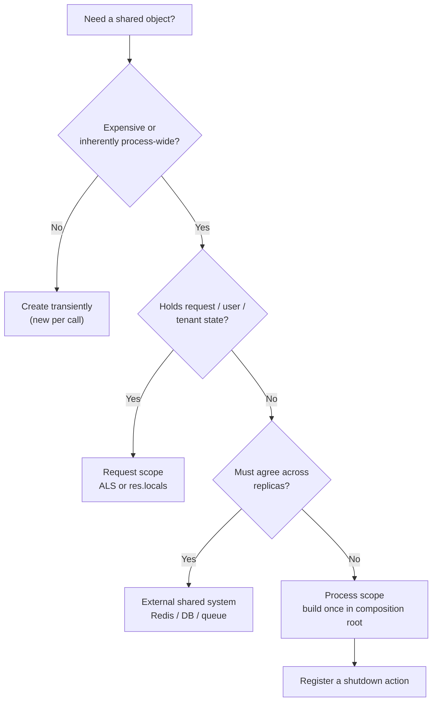

# Chapter 5 — Decision Guide, Anti-Patterns, and Checklist

> Companion to [`../notes.md`](../notes.md) · Sections 5–10
> **Learning goals:** decide when sharing is justified, recognise the common
> failure modes, refactor a `getInstance()` service safely, and ship with a
> lifecycle checklist.

## 5.1 Six rules that prevent most incidents

### 1. Prefer constructor injection over `getInstance()`

```ts
// Avoid: hidden dependency, untestable
class OrderService {
  async create(input: CreateOrderInput) {
    const db = Database.getInstance();
    return db.orders.create(input);
  }
}

// Prefer: explicit, substitutable
class OrderService {
  constructor(private readonly orders: OrderRepository) {}

  create(input: CreateOrderInput) {
    return this.orders.create(input);
  }
}
```

The instance can still be one per process. The difference is that the dependency
is visible and replaceable.

### 2. Share infrastructure, never request state

Safe to share: config, logger, pool, Redis client, metrics, SDK clients.
Unsafe to share: current user, tenant, request id, locale, per-request cache.
Use `AsyncLocalStorage` or explicit parameters for the second group.

### 3. Initialize eagerly at boot

```ts
// server.ts
const config = loadConfig();          // throws before listen()
const container = createContainer(config);
await container.redis.ping();         // fail fast if Redis is unreachable

const server = app.listen(config.port);
```

A missing env var or unreachable dependency should fail the deploy, not the first
customer request.

### 4. Own the shutdown

Every shared resource needs a close action and an order:

```text
SIGTERM -> readiness=false -> server.close() -> drain -> close pools -> flush -> exit
```

The handler must be idempotent, bounded by a timeout, and shorter than the
orchestrator's grace period.

### 5. Do not turn the container into a service locator

```ts
// Avoid: any service can reach anything; dependencies are invisible
class PaymentService {
  charge() {
    const db = container.resolve("db");
    const logger = container.resolve("logger");
  }
}
```

Pass dependencies into constructors. A container is a **build-time** tool, not a
runtime lookup service.

### 6. Build a fresh graph in tests

```ts
const { orderService } = createTestContainer();
```

No static resets, no order dependence, no real sockets. The production container
is for production.

## 5.2 When to share, when not to

| Situation | Share? | Better option |
| --- | --- | --- |
| Config, logger, metrics | Yes | Frozen object / module instance |
| Database or Redis pool | Yes | One client per process, injected |
| Vendor SDK client | Yes | One client with timeouts |
| Read-mostly reference data | Sometimes | Bounded cache with TTL; accept staleness |
| Current user, tenant, request id | **No** | `AsyncLocalStorage` / `res.locals` |
| Idempotency key or cart contents | **No** | Request body / database |
| Distributed lock | **No** | Redis `SET NX PX`, DB advisory lock |
| Rate limit across pods | **No** | Redis-backed limiter / gateway |
| Job de-duplication | **No** | Unique constraint / queue |
| "It is convenient to access globally" | **No** | Inject it |

A useful test: if the object must give the same answer in two different
containers, it cannot live only in process memory.

## 5.3 Ten anti-patterns

| # | Anti-pattern | Symptom | Fix |
| --- | --- | --- | --- |
| 1 | `getInstance()` inside business code | Hidden deps, impossible unit tests | Constructor injection |
| 2 | `new PrismaClient()` per request | `too many clients`, latency spikes | One client, injected |
| 3 | Request state on a singleton | User A sees User B's data | ALS / `res.locals` |
| 4 | In-memory rate limiter with replicas | Limits bypassed by load balancing | Redis-backed limiter |
| 5 | In-memory lock | Two workers process the same job | Redis/DB lock with lease |
| 6 | Lazy init during a request | First request after deploy fails | Eager validation at boot |
| 7 | Unbounded module-level cache | Memory grows until OOM | TTL, max size, metrics |
| 8 | No shutdown handler | Connection leaks, 502s during deploys | Drain + close + timeout |
| 9 | `process.env` read across modules | Different defaults, missing vars | One validated config object |
| 10 | `globalThis` as architecture | Invisible coupling, duplicate copies | Composition root |

One more worth calling out: a process-local `EventEmitter` used as a cross-service
event bus. Events published in one replica are invisible to the others, and they
are lost on restart. Use a queue or Redis pub/sub when delivery matters.

## 5.4 Refactoring `getInstance()` to a composition root

Start with the anti-pattern:

```ts
export class OrderService {
  // `Database` is a local wrapper around PrismaClient with a static accessor.
  private readonly prisma = Database.getInstance();
  private readonly logger = Logger.getInstance();

  async create(input: CreateOrderInput) {
    this.logger.info("creating order");
    return this.prisma.order.create({ data: input });
  }
}
```

**Step 1 — Inventory.** List every `getInstance()` and `new Client()` call. For
each, write the lifetime and close action (or "none", which is a finding).

**Step 2 — Define the seam.** Extract an interface if the dependency is not
already one (repository port, provider contract, clock).

**Step 3 — Add factories.** Convert hidden constructors into functions that take
configuration:

```ts
// infrastructure/prisma.ts
export function createPrismaClient(databaseUrl: string): PrismaClient {
  return new PrismaClient({ datasources: { db: { url: databaseUrl } } });
}
```

**Step 4 — Build the graph once.**

```ts
// composition-root.ts
export function createContainer(config: AppConfig) {
  const logger = createLogger(config.logLevel);
  const prisma = createPrismaClient(config.databaseUrl);
  const orders = new PrismaOrderRepository(prisma);
  const orderService = new OrderService(orders, logger);

  return {
    config,
    logger,
    prisma,
    orders,
    orderService,
    shutdown: () => prisma.$disconnect(),
  };
}
```

**Step 5 — Inject.** Change constructors; delete the static fields and import of
the singleton module from services.

```ts
export class OrderService {
  constructor(
    private readonly orders: OrderRepository,
    private readonly logger: Logger,
  ) {}

  create(input: CreateOrderInput) {
    this.logger.info("creating order");
    return this.orders.create(input);
  }
}
```

**Step 6 — Bootstrap at the edge.**

```ts
// server.ts
const config = loadConfig();
const container = createContainer(config);
const app = createApp(container);
const server = app.listen(config.port);
```

**Step 7 — Test the seams.** Unit tests build `OrderService` with a fake
repository and a no-op logger. Integration tests build the container once per
file. Shutdown gets its own test (chapter 4).

**Step 8 — Delete the static.** If anything still calls `getInstance()`, the
refactor is incomplete. A temporary deprecated wrapper is acceptable only with a
removal date.

## 5.5 Decision flowchart



Read it top to bottom. Most mistakes come from answering "No" at the last
question when the requirement was actually cluster-wide.

## 5.6 Production checklist

**Lifecycle**

- [ ] Every process-wide resource appears in the lifecycle table with an owner.
- [ ] Construction happens in `composition-root.ts`, not in request handlers.
- [ ] Resources are created eagerly and validated before `listen()`.
- [ ] Shutdown is idempotent, ordered, and bounded by a timeout.
- [ ] Readiness fails before the listener closes; liveness stays dependency-free.
- [ ] The orchestrator's grace period exceeds the shutdown timeout.

**Isolation and safety**

- [ ] No user, tenant, request id, or cart data on a shared object.
- [ ] `AsyncLocalStorage` is used with `run`, never `enterWith`.
- [ ] Caches have TTL, a size bound, and tenant-aware keys.
- [ ] Cross-replica requirements use Redis/DB/queue, not process memory.
- [ ] Secrets are redacted from logs and never stored in caches.

**Configuration**

- [ ] One typed, frozen config object; no `process.env` below the composition root.
- [ ] Missing/invalid values fail at boot with a message naming the variable.
- [ ] Production forbids development-only components (sandbox providers, debug
      endpoints, permissive CORS).

**Observability**

- [ ] Pool and Redis saturation, error rate, and latency are measured.
- [ ] Logs carry `requestId`, `userId` (when appropriate), and `durationMs`.
- [ ] Metric labels are bounded; no user/order ids.
- [ ] Alerts distinguish liveness, readiness, and dependency degradation.

**Testing**

- [ ] Tests build a fresh graph; no manual static resets.
- [ ] A concurrent test proves request-context isolation.
- [ ] Shutdown order and idempotency are covered.
- [ ] Integration tests own their clients and never touch the app database.

## 5.7 Relationship to other patterns

| Pattern | How it interacts with singleton |
| --- | --- |
| **Factory** (pattern 2) | A factory may return a shared instance, but lifetime belongs to the composition root. The factory itself is stateless. |
| **Repository** (pattern 1) | Usually constructed once, but must remain stateless; the shared DB client is injected into the adapter. |
| **Decorator** (pattern 2/8) | Safe to share only if stateless. Retry/breaker decorators hold configuration, not request data. |
| **Circuit breaker** (pattern 10) | State is per process. Each replica opens independently; aggregate metrics if you need a global view. |
| **Adapter** | Stateless wrapper around an SDK client; both are process-scoped and injected. |
| **Observer** (pattern 5) | An in-process emitter is a singleton with per-process delivery. Use a broker when events must cross replicas. |
| **CQRS** (pattern 9) | Read models and caches are per-process unless backed by a shared store; projections need idempotent handlers. |

## 5.8 One-line takeaway

> Use a singleton for **shared infrastructure**, never for **shared user state**
> or **distributed coordination**.

## Final exercise

Draw your service's process-wide resources as a table:

| Resource | Created in | Scope | Close action | Cross-replica? |
| --- | --- | --- | --- | --- |

Then answer:

1. Which rows have no close action?
2. Which rows contain data that differs per user or request?
3. Which rows are being used to coordinate across pods?
4. Which rows could be constructed per call without measurable cost?

Every "yes" to 2 or 3 is a production incident waiting for traffic.

---

**Previous:** [Chapter 4 ←](04-testing-and-lifecycle.md)
**Index:** [Singleton notes](README.md) · **Source:** [`../notes.md`](../notes.md)


