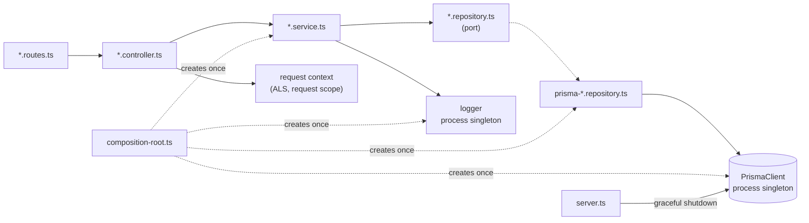

# Singleton Pattern — Chapter Notes

Companion deep-dive to [`../notes.md`](../notes.md). The main notes are the
one-page reference; these chapters expand every section with reasoning,
copy-ready TypeScript/Express code, failure cases, and production guidance.

**Pattern 3 of 10** · TypeScript · Node.js · Express · Prisma · Redis

## Chapters

| # | Chapter | Focus | Source |
| --- | --- | --- | --- |
| 1 | [Why a shared instance needs an owner](01-why-singleton.md) | Expensive resources, the classic `getInstance()`, hidden state, symptoms | §1–2 |
| 2 | [Scope: process, request, and replica](02-scope-and-composition.md) | Module singletons, the composition root, `AsyncLocalStorage`, per-container reality | §3–4 |
| 3 | [Infrastructure singletons in Express](03-infrastructure-singletons.md) | Prisma, Redis, logger, metrics, SDK clients, shutdown, readiness | §3.2, §4, §8 |
| 4 | [Testing and lifecycle discipline](04-testing-and-lifecycle.md) | Fresh graphs per test, config validation, ALS isolation, shutdown order | §2, §5, §9 |
| 5 | [Decision guide, anti-patterns, and checklist](05-decision-guide.md) | When to share, ten failure modes, refactor recipe, production checklist | §5–10 |

## Suggested reading paths

- **New to the pattern:** 1 → 2. Stop after the scope table and answer "what is
  shared, and for how long?" for your own service.
- **Wiring an existing Express app:** 2 → 3 → 4. Focus on the composition root,
  request context, and shutdown.
- **Reviewing a design:** 1 → 5. Use the anti-pattern table and scope table as a
  checklist.
- **Interview preparation:** 2 → 5, then explain why a singleton is not a
  distributed lock.

## Prerequisites

- Node.js 20+ and TypeScript 5+
- Express 4.19+ (Express 5 forwards rejected promises natively)
- `zod` for configuration validation; `vitest` + `supertest` for tests
- Familiarity with constructor injection, the repository pattern
  ([`../../01-repository/notes`](../../01-repository/notes/README.md)), and the
  factory pattern ([`../../02-factory/notes`](../../02-factory/notes/README.md))
- Optional: PostgreSQL/Prisma and Redis for the infrastructure examples

## Folder structure

Singleton is a **lifecycle** pattern, not a feature. There is no `singletons/`
folder; there are three boundaries that make the lifetime explicit:

1. **`config/`** turns `process.env` into one immutable, validated object.
2. **`infrastructure/`** owns process-wide clients: Prisma, Redis, logger,
   metrics, vendor SDKs.
3. **`composition-root.ts`** constructs each of them exactly once and injects
   them into services.

Everything else — routes, controllers, services, repositories — receives its
dependencies and stays ignorant of how many instances exist.

The pattern's code folder is reserved for a future runnable demo. The trees below
are the contract for where each file belongs.

### Feature-first (recommended once there are several domains)

```text
03-singleton/
├── notes.md
├── notes/
│   ├── README.md
│   └── 01-...05-....md
└── code/
    ├── prisma/
    │   └── schema.prisma
    ├── src/
    │   ├── config/
    │   │   └── env.ts                  # zod schema -> frozen AppConfig
    │   ├── infrastructure/
    │   │   ├── prisma.ts               # one PrismaClient per process
    │   │   ├── redis.ts                # one Redis client per process
    │   │   ├── logger.ts               # one base logger, child per request
    │   │   └── metrics.ts              # one registry per process
    │   ├── lib/
    │   │   └── request-context.ts      # AsyncLocalStorage<RequestContext>
    │   ├── modules/
    │   │   ├── orders/
    │   │   │   ├── order.routes.ts
    │   │   │   ├── order.controller.ts
    │   │   │   ├── order.service.ts
    │   │   │   ├── order.repository.ts        # port
    │   │   │   ├── prisma-order.repository.ts # adapter
    │   │   │   ├── order.dto.ts
    │   │   │   └── order.errors.ts
    │   │   └── payments/
    │   │       ├── payment.routes.ts
    │   │       ├── payment.controller.ts
    │   │       └── payment.service.ts
    │   ├── middlewares/
    │   │   ├── request-context.ts      # runs ALS for each request
    │   │   ├── async-handler.ts
    │   │   ├── authenticate.ts
    │   │   └── error-handler.ts
    │   ├── composition-root.ts         # constructs clients + wires services
    │   ├── app.ts                      # express app, no listening
    │   └── server.ts                   # boot, signals, graceful shutdown
    └── tests/
        ├── unit/                       # services with fakes
        ├── integration/                # HTTP + real infrastructure
        ├── contract/                   # repository/provider suites
        └── support/                    # createTestContainer(...)
```

### Layer-first (used in the chapter snippets)

```text
src/
├── routes/
│   ├── orders.routes.ts                # URL + method -> controller
│   └── payments.routes.ts
├── controllers/
│   ├── orders.controller.ts            # parse input, one service call
│   └── payments.controller.ts
├── services/
│   ├── order.service.ts                # business rules; stateless
│   └── payment.service.ts
├── repositories/
│   ├── order.repository.ts             # port (pattern 1)
│   └── prisma-order.repository.ts      # adapter, receives the shared client
├── models/
│   └── order.model.ts
├── mappers/
│   └── order.mapper.ts
├── dtos/
│   └── order.dto.ts
├── middlewares/
│   ├── request-context.ts              # AsyncLocalStorage.run per request
│   ├── authenticate.ts                 # writes userId into the context
│   ├── async-handler.ts
│   └── error-handler.ts
├── infrastructure/
│   ├── prisma.ts                       # process-wide PrismaClient
│   ├── redis.ts                        # process-wide Redis client
│   ├── logger.ts                       # process-wide base logger
│   └── metrics.ts                      # process-wide metrics registry
├── config/
│   └── env.ts                          # validated, frozen configuration
├── lib/
│   └── request-context.ts              # ALS + accessors
├── composition-root.ts                 # the only wiring module
├── app.ts
└── server.ts
```

Both layouts are valid. The important part is not nesting — it is that
**construction happens at the edge** (`infrastructure/` + `composition-root.ts`)
and **behaviour stays in services**.

### What lives where

| Path | Responsibility | Lifetime | May import |
| --- | --- | --- | --- |
| `config/env.ts` | Parse and validate env once; export a frozen typed config | Process | zod, domain constants |
| `infrastructure/prisma.ts` | Create/reuse one `PrismaClient`; pool configuration | Process | `@prisma/client`, config |
| `infrastructure/redis.ts` | Create one Redis client; connect at boot | Process | Redis driver, config, logger |
| `infrastructure/logger.ts` | Base logger + child-logger factory | Process | logging library |
| `infrastructure/metrics.ts` | One registry; counters/histograms | Process | metrics library |
| `lib/request-context.ts` | `AsyncLocalStorage<RequestContext>` + accessors | Machinery process-wide, **values per request** | `node:async_hooks` |
| `middlewares/request-context.ts` | Generate request id, run the ALS scope | Request | ALS, logger |
| `middlewares/authenticate.ts` | Verify token, put identity in the request context | Request | auth lib, request context |
| `*.routes.ts` | Map URL + method to controller/middleware | Stateless | controller, middleware |
| `*.controller.ts` | Parse HTTP input, call one service method, shape the response | Stateless | service, DTO, mapper |
| `*.service.ts` | Business rules; receives all dependencies via constructor | Process, **must be stateless** | repository port, domain, errors |
| `*.repository.ts` | Persistence port in domain language | Stateless | domain only |
| `prisma-*.repository.ts` | Queries via the injected client; row mapping | Process, stateless | Prisma, mapper, port |
| `composition-root.ts` | Construct clients once and wire the graph | Boot only | everything |
| `server.ts` | `listen`, signal handling, shutdown order | Boot/exit only | app, container |
| `tests/support/test-container.ts` | Build a fresh graph with fakes | Per test | src |

### Lifecycle map

"Singleton" is not one decision; each resource has an owner and a shutdown
action. Copy this table into a design review.

| Resource | Created in | Scope | Shutdown | Safe to share? |
| --- | --- | --- | --- | --- |
| App config | `config/env.ts` | Process | — | Yes, freeze it |
| Logger | `infrastructure/logger.ts` | Process; child per request | Flush buffers | Yes, with request fields on children |
| `PrismaClient` | `infrastructure/prisma.ts` | Process (one pool) | `$disconnect()` | Yes |
| Redis client | `infrastructure/redis.ts` | Process | `quit()` | Yes |
| Metrics registry | `infrastructure/metrics.ts` | Process (scraped per pod) | — | Yes, label values only |
| Vendor SDK (Stripe, S3) | `composition-root.ts` | Process | SDK-specific | Yes |
| Services / repositories | `composition-root.ts` | Process | — | Only while **stateless** |
| Request context | ALS middleware | Request | Discarded with the scope | **No** |
| Current user / tenant / trace | `res.locals` or ALS | Request | — | **No** |
| In-memory cache | Module-scoped `Map` | Process **per replica** | — | Read-mostly only, with TTL |
| Distributed lock | Redis/DB | Cluster | TTL/lease | Not a singleton |

Two placement rules prevent most production incidents:

1. **Only `infrastructure/` and `composition-root.ts` import concrete clients.**
   Services receive them through constructors.
2. **Nothing below the composition root reads `process.env`.** Configuration is
   parsed once at boot, so a missing variable fails the deploy — not a request.

### Dependency rule



- Routes never import Prisma, Redis, or a concrete repository.
- Controllers never construct clients; they read request scope and call a service.
- Services receive collaborators as constructor arguments and hold no request
  state.
- The repository adapter receives the shared `PrismaClient`; it does not create
  one.
- `composition-root.ts` is the only module that constructs infrastructure.
- `server.ts` owns process lifecycle and the shutdown order.

### Naming rules

| File | Convention | Example |
| --- | --- | --- |
| Config | `env.ts` | `config/env.ts` |
| Infrastructure client | `<resource>.ts` | `prisma.ts`, `redis.ts` |
| Logger / metrics | `<concern>.ts` | `logger.ts`, `metrics.ts` |
| Request context | `request-context.ts` | `lib/request-context.ts` |
| Context middleware | `request-context.ts` | `middlewares/request-context.ts` |
| Composition root | `composition-root.ts` | `src/composition-root.ts` |
| Process lifecycle | `server.ts` | `src/server.ts` |
| Test graph builder | `test-container.ts` | `tests/support/test-container.ts` |

One exported instance per infrastructure file. Export the **instance**, not a
`getInstance()` accessor; tests call the `create...` factory instead.

### How the chapter snippets map

The chapters use the layer-first paths. The same files in a feature-first app:

| Chapter snippet | Feature-first | Layer-first |
| --- | --- | --- |
| `config/env.ts` | `config/env.ts` | `config/env.ts` |
| `infrastructure/prisma.ts` | `infrastructure/prisma.ts` | `infrastructure/prisma.ts` |
| `infrastructure/redis.ts` | `infrastructure/redis.ts` | `infrastructure/redis.ts` |
| `infrastructure/logger.ts` | `infrastructure/logger.ts` | `infrastructure/logger.ts` |
| `lib/request-context.ts` | `lib/request-context.ts` | `lib/request-context.ts` |
| `middlewares/request-context.ts` | `middlewares/request-context.ts` | `middlewares/request-context.ts` |
| `services/order.service.ts` | `modules/orders/order.service.ts` | `services/order.service.ts` |
| `repositories/prisma-order.repository.ts` | `modules/orders/prisma-order.repository.ts` | `repositories/prisma-order.repository.ts` |
| `routes/orders.routes.ts` | `modules/orders/order.routes.ts` | `routes/orders.routes.ts` |
| `controllers/orders.controller.ts` | `modules/orders/order.controller.ts` | `controllers/orders.controller.ts` |
| `composition-root.ts` | `src/composition-root.ts` | `src/composition-root.ts` |
| `server.ts` | `src/server.ts` | `src/server.ts` |

### Conventions in these chapters

- "Singleton" always means **one instance per process**, never one per cluster.
- Configuration is validated with zod and frozen; no module reads env lazily.
- Examples use constructor injection; `getInstance()` appears only as the
  anti-pattern being replaced.
- Every diagram is Mermaid and renders on GitHub, GitLab, and VS Code.
- Each chapter ends with an exercise and links to the next chapter.

### Source mapping

[`../notes.md`](../notes.md) remains the canonical one-page summary. Chapters 1–5
expand sections §1–§10; if a chapter and the summary disagree, treat the chapter
as the detailed explanation and update both.

