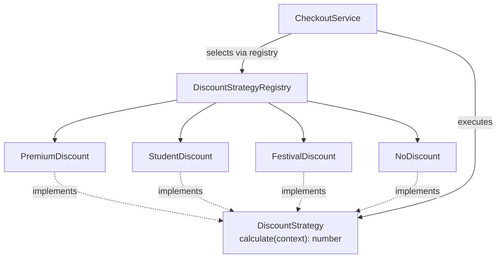

# Pattern 4 — Strategy

**Category:** Business logic and extensibility
**Stack used in examples:** TypeScript · Node.js · Express

---

## 1. What problem does it solve?

The e-commerce platform supports several discount rules:

- Premium customers: 15%.
- Students: 10%.
- Festival promotion: fixed amount.
- Some products excluded from promotions.

The beginner implementation puts every rule in one function:

```ts
function calculateDiscount(type: string, amount: number): number {
  if (type === "premium") return amount * 0.15;
  if (type === "student") return amount * 0.1;
  if (type === "festival") return 100;
  return 0;
}
```

This works initially. It becomes painful when:

- Rules gain conditions (excluded categories, minimum cart value, stacking rules).
- Every new rule touches the same function (merge conflicts, regression risk).
- The function needs a database or config lookup per branch.
- Testing one rule requires constructing all inputs for the branchy function.

The strategy pattern gives **each algorithm its own class behind a shared interface**, so rules change independently.

## 2. Structure



Two separate responsibilities:

1. **Selection** — decide which strategy applies.
2. **Execution** — run the chosen strategy.

Keeping them separate is the whole point.

## 3. Practical TypeScript implementation

### 3.1 Context and contract

```ts
export type DiscountContext = {
  amount: number;              // cart subtotal in smallest unit
  customerType: "guest" | "student" | "premium";
  productIds: string[];
  now: Date;
};

export interface DiscountStrategy {
  readonly key: string;
  calculate(context: DiscountContext): number; // discount amount, never negative
}
```

Passing a **context object** rather than loose arguments lets strategies evolve without breaking every signature.

### 3.2 Concrete strategies

```ts
export class PremiumDiscount implements DiscountStrategy {
  readonly key = "premium";

  calculate({ amount }: DiscountContext): number {
    return Math.round(amount * 0.15);
  }
}

export class StudentDiscount implements DiscountStrategy {
  readonly key = "student";

  calculate({ amount }: DiscountContext): number {
    return Math.round(amount * 0.1);
  }
}

export class FestivalDiscount implements DiscountStrategy {
  readonly key = "festival";

  constructor(
    private readonly fixedAmount: number,
    private readonly excludedProductIds: Set<string> = new Set(),
  ) {}

  calculate({ amount, productIds }: DiscountContext): number {
    if (productIds.some((id) => this.excludedProductIds.has(id))) return 0;
    return Math.min(this.fixedAmount, amount);
  }
}

export class NoDiscount implements DiscountStrategy {
  readonly key = "none";

  calculate(): number {
    return 0;
  }
}
```

Each class is small, focused, and independently unit-testable.

### 3.3 Using a strategy

```ts
export class DiscountCalculator {
  calculateDiscount(context: DiscountContext, strategy: DiscountStrategy) {
    const discount = strategy.calculate(context);

    if (discount < 0 || discount > context.amount) {
      throw new Error("Invalid discount result");
    }

    return discount;
  }
}
```

```ts
const calculator = new DiscountCalculator();
const discount = calculator.calculateDiscount(
  { amount: 1000, customerType: "premium", productIds: [], now: new Date() },
  new PremiumDiscount(),
);

console.log(discount); // 150
```

### 3.4 Strategy registry (selection, separate from execution)

With more than a couple of rules, a registry removes `if/else` from the service:

```ts
export type DiscountPolicy =
  | { kind: "none" }
  | { kind: "premium" }
  | { kind: "student" }
  | { kind: "festival"; fixedAmount: number };

export class DiscountStrategyRegistry {
  constructor(
    private readonly premium: PremiumDiscount,
    private readonly student: StudentDiscount,
    private readonly none: NoDiscount,
  ) {}

  resolve(policy: DiscountPolicy): DiscountStrategy {
    switch (policy.kind) {
      case "premium": return this.premium;
      case "student": return this.student;
      case "festival": return new FestivalDiscount(policy.fixedAmount);
      case "none": return this.none;
    }
  }
}
```

The policy itself comes from a trusted source (customer profile + promotion config), not from a raw request string.

### 3.5 Express usage

```ts
// checkout.service.ts
export class CheckoutService {
  constructor(
    private readonly registry: DiscountStrategyRegistry,
    private readonly pricing: PricingService,
  ) {}

  async total(userId: string, cart: Cart) {
    const policy = await this.pricing.resolvePolicy(userId, cart);
    const strategy = this.registry.resolve(policy);

    const discount = strategy.calculate({
      amount: cart.subtotal,
      customerType: policy.kind === "premium" ? "premium" : "guest",
      productIds: cart.productIds,
      now: new Date(),
    });

    return { subtotal: cart.subtotal, discount, total: cart.subtotal - discount };
  }
}
```

`PricingService` is an application service exposing `resolvePolicy(userId, cart): Promise<DiscountPolicy>`. It loads the authoritative policy from the customer profile and promotion configuration — never from a raw request field such as `customerType`.

Build the registry once in the composition root:

```ts
// composition-root.ts
export const discountRegistry = new DiscountStrategyRegistry(
  new PremiumDiscount(),
  new StudentDiscount(),
  new NoDiscount(),
);

export const checkoutService = new CheckoutService(
  discountRegistry,
  new PricingService(),
);
```

```ts
// checkout.routes.ts
checkoutRouter.post(
  "/total",
  asyncHandler(async (req, res) => {
    const { userId, cart } = req.body;
    const total = await checkoutService.total(userId, cart);
    res.json(total);
  }),
);
```

The route only translates HTTP into a service call. Selection stays in the registry; rule computation stays in the strategy. Neither needs to know it is running behind Express.

## 4. Strategy vs. related ideas

| Concept | Difference |
| --- | --- |
| **Strategy** | Interchangeable algorithm behind one interface, chosen at runtime |
| **Factory** | Decides *which object to create*, may create a strategy |
| **Template method** | Fixed algorithm skeleton with overridable steps (inheritance) |
| **Policy object** | Data describing a rule; often *input* to a strategy |
| **Chain of responsibility** | Each handler may handle or pass along; strategies usually compute independently |
| **State** | Behaviour changes with an object's internal state machine |

Prefer composition (strategy objects) over inheritance when rules vary independently.

## 5. Production considerations

1. **Validate inputs.** Reject negative amounts, unknown customer categories, and invalid currency. A strategy should not be the place where malformed input first surfaces.
2. **Keep selection separate.** The checkout service (or registry) chooses; the strategy computes. Do not let a strategy fetch config it should have received.
3. **Avoid needless classes.** Three trivial conditions do not justify a full architecture. Start with a function map, extract classes when rules grow.
4. **Test boundaries.** Zero amounts, discounts larger than the cart, excluded products, rounding, currency precision, and maximum discount caps.
5. **Beware rule conflicts.** If multiple promotions can apply, define precedence (best-for-customer, priority order, stacking allowed) explicitly and test it.
6. **Make strategies pure where possible.** Deterministic input → output is easier to cache, test, and reason about. Pass `now` in rather than calling `Date.now()` inside.
7. **Observability.** Emit the chosen strategy key and the computed discount to logs/metrics; disputes about “why was my discount X?” are common.

## 6. When to use / when not to

**Use it when**
- Multiple interchangeable algorithms exist.
- Rules are expected to change independently.
- Behaviour varies by context (auth method, shipping zone, pricing region, file type, AI model).

Real examples:
- Authentication: password, OTP, external IdP.
- Shipping: standard, express, international.
- Pricing: customer- or region-specific.
- AI: different providers or retrieval strategies.
- File processing: PDF, CSV, image pipelines.
- Tax calculation per jurisdiction.

**Avoid it when**
- A single condition is clear and stable (`if (isAdmin)`).
- The variants never change independently.
- The abstraction would force every caller to know about strategy objects for no benefit.

## 7. Common mistakes

1. A `switch` inside the strategy base class — the conditional just moved.
2. Strategies with side effects (writing to the DB, sending email) that make them non-composable and hard to test.
3. Selection logic duplicated in controllers and services.
4. No validation of the computed result (negative discount, over-discount).
5. Using user-supplied labels as strategy keys without an allow-list.
6. Forgetting rounding rules and currency minor units.

## 8. Relationship to other patterns

- **Factory** — selects/creates the strategy implementation.
- **Decorator** — can wrap a strategy with caching or metrics while keeping the interface.
- **Adapter** — wraps vendor APIs that strategies call.
- **CQRS** — pricing policy is command-side logic; reporting may use a different read model.
- **Singleton / DI** — stateless strategies are constructed once in the composition root.

## 9. Practice checklist

- [ ] Extract a `DiscountStrategy` interface with a context object.
- [ ] Implement one strategy per rule; keep them pure.
- [ ] Move selection into a registry or policy resolver.
- [ ] Clamp and validate results.
- [ ] Test precedence when multiple promotions apply.
- [ ] Log the selected strategy key with each checkout.

## 10. One-line takeaway

> Strategy turns a growing `if/else` into a set of small, independently testable rules — as long as selection stays separate from execution.
