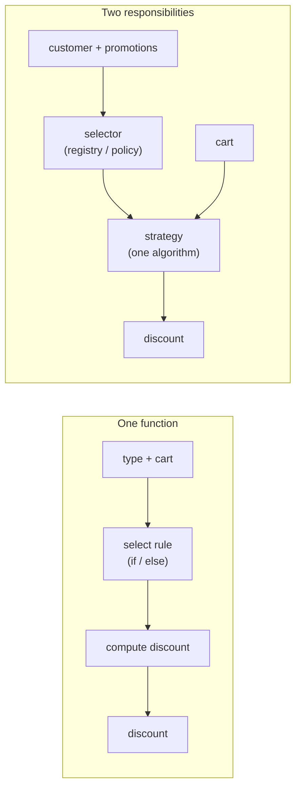

# Chapter 1 — Why a Growing Conditional Needs a Boundary

> Companion to [`../notes.md`](../notes.md) · Sections 1–2
> **Learning goals:** watch a harmless discount function turn into a rule engine,
> name the four costs that appear, understand why inheritance makes them worse,
> and decide when a conditional is still the right answer.

## 1.1 The function that starts it all

Every strategy refactor begins with code that is genuinely fine:

```ts
function calculateDiscount(customerType: string, amount: number): number {
  if (customerType === "premium") return amount * 0.15;
  if (customerType === "student") return amount * 0.1;
  return 0;
}
```

Three lines of behaviour, one file, one test per branch. Nothing here needs a
pattern. The problem is not the `if`; it is what the next six months add to it.

## 1.2 The fourth rule changes the shape

The business asks for a festival promotion: a fixed ₹100 off, except on products
that are already discounted. Then a minimum cart value. Then "premium customers
should not also get the festival discount". The function grows:

```ts
function calculateDiscount(
  type: string,
  amount: number,
  productIds: string[],
  isFirstOrder: boolean,
  now: Date,
): number {
  if (type === "premium") {
    if (isFirstOrder) return Math.round(amount * 0.2);
    return Math.round(amount * 0.15);
  }

  if (type === "student") {
    if (amount < 5_000) return 0;              // ₹50 minimum cart
    return Math.round(amount * 0.1);
  }

  if (type === "festival") {
    const excluded = ["prod_sale_1", "prod_sale_2"];
    if (productIds.some((id) => excluded.includes(id))) return 0;
    if (amount < 10_000) return 0;             // ₹100 minimum cart
    return Math.min(10_000, amount);           // never exceed the cart
  }

  if (type === "premium_festival") {
    // premium customers do not stack promotions
    return Math.round(amount * 0.15);
  }

  return 0;
}
```

It still passes its tests. It is also now:

- **Incomplete:** every new rule edits this function.
- **Unsafe to change:** a fix for students can change the premium path through a
  shared variable or an early return.
- **Untestable in isolation:** testing the festival exclusion requires knowing
  that `type` must be `"festival"` and that the minimum-cart check comes first.
- **Carrying hidden policy:** the excluded product IDs are hard-coded, the
  minimums are magic numbers, and `now` is accepted but never used — a hint that
  the next rule ("weekend only") is already being planned.

Notice what is *not* wrong: the arithmetic. Percentage and cap logic are simple.
The difficulty is **structure** — several independent decisions compressed into
one control-flow graph.

## 1.3 Four costs, one cause

| Cost | What it looks like | Why it compounds |
| --- | --- | --- |
| **Cyclomatic complexity** | One function with 10+ branches and early returns | Every added branch multiplies the paths a reviewer must hold in their head |
| **Regression surface** | A student-rule fix breaks a festival test | Branches share scope, helpers, and fall-through behaviour |
| **Merge conflicts** | Two developers edit the same function in one sprint | Rules that change for different reasons share one edit point |
| **Test scaffolding** | Each test constructs inputs for unrelated branches | You cannot test a rule without satisfying the function's other preconditions |

The single cause is that **selection** (which rule applies) and **execution**
(what the rule computes) live in the same place. Selection depends on customer
type, promotions, product data, and time. Execution depends only on the cart.
Mixing them couples the cheap, stable part to the expensive, changing part.



The pattern does not remove the conditional from the system; it moves it to one
small, replaceable place and keeps it out of the algorithms.

## 1.4 The second responsibility is the real problem

Selection is rarely a pure function of a request field. In a real service it
needs:

- the customer profile (premium, student, first order),
- the active promotion configuration,
- product eligibility and exclusions,
- the current time and, sometimes, the region,
- an experiment assignment from a feature flag.

Once selection needs I/O, the combined function needs a database, a cache, or an
HTTP call *in the middle of arithmetic*. That is what makes the codebase slow to
test and awkward to reuse from a background job or CLI command.

A strategy refactor has one non-negotiable outcome: **the algorithm receives
everything it needs as data, and the selector is the only code that knows how to
find that data.**

## 1.5 Why inheritance makes it worse

The first instinct is often a class hierarchy:

```ts
abstract class Discount {
  abstract calculate(amount: number): number;
}

class PremiumDiscount extends Discount {
  calculate(amount: number) { return Math.round(amount * 0.15); }
}

class StudentDiscount extends Discount {
  calculate(amount: number) { return Math.round(amount * 0.1); }
}
```

This is better than the `if` chain — until the dimensions multiply:

- customer type: guest, student, premium
- promotion: none, festival, first-order
- region: domestic, international
- channel: web, app, partner

A class per combination is `3 × 3 × 2 × 2 = 36` classes, most of them empty
overrides. Behaviour is now locked to a type hierarchy, and a rule that spans two
dimensions ("premium + festival") has no natural home.

Composition fixes the multiplication: strategies implement *one* algorithm, and
the selector composes the applicable policy from data. Inheritance is still
useful when the **skeleton** is fixed and only steps vary (that is the template
method), not when independent rules vary on different schedules.

## 1.6 Symptoms that you need the boundary

Use this as a review checklist, not a rulebook:

- [ ] The function or file name includes several verbs (`calculateAndApplyDiscount`).
- [ ] Every new business rule lands in the same file, and reviewers recognise it.
- [ ] Tests are named after inputs (`it("returns 15% when premium")`) instead of
      behaviour, because the branch is the only way to reach the rule.
- [ ] The rule table exists in a document, a spreadsheet, or a ticket — and the
      code is a second, drifting copy of it.
- [ ] A change requires running the regression suite for unrelated rules.
- [ ] Two product managers can describe conflicting changes to "the discount".
- [ ] A feature flag or an environment check appears inside the calculation.

Two of these are a smell. Four are a refactor.

## 1.7 When an `if` is still the right answer

The pattern has a cost: more files, an extra indirection, and a selector that
must be maintained. It is the wrong tool when:

1. **There is one condition and it is stable.** `if (order.isGift) skipInvoice()`
   does not need a strategy.
2. **The variants are data, not algorithms.** A price list or a tax-rate table
   should be a lookup, not a class hierarchy.
3. **There are exactly two branches and no third is planned.** An honest `if` is
   cheaper than two classes and a registry.
4. **The variation is per call, not per rule set.** Passing a boolean or an
   options object can be clearer than selecting an object.

A useful distinction:

| Question | If the answer is "data" | If the answer is "behaviour" |
| --- | --- | --- |
| What changes? | Rates, thresholds, exclusions | The computation itself |
| Where does it live? | Config, table, JSON, database | A strategy implementation |
| How is it tested? | Table-driven test of one function | One test file per strategy |
| Example | Tax rate by region | Tax calculation for inclusive vs exclusive pricing |

"Student gets 10%" is data if the percentage is configurable; it is behaviour if
students also get free shipping and a different return window. Do not create a
class for every row in a configuration table.

## 1.8 The boundary in one sentence

> **Strategy separates "which algorithm applies" from "how the algorithm works",
> so each can change without the other.**

That sentence implies three roles, which chapter 2 makes explicit: the **context**
(the data), the **strategy** (the algorithm), and the **selector** (the decision).
Most failed strategy implementations collapse two of the three.

A preview of the destination, using the discount domain:

```ts
// selection: one place, one responsibility
const policy = await pricing.resolvePolicy(userId, cart);
const strategy = registry.resolve(policy);

// execution: pure, testable without a database
const discount = strategy.calculate({
  amount: cart.subtotal,
  customerType: profile.type,
  productIds: cart.productIds,
  now: clock.now(),
});
```

Nothing in that snippet mentions Express, Prisma, or a customer. Chapter 3 builds
it fully.

## Exercise

1. Find a function in your codebase with three or more business-rule branches.
   Write down each rule as a sentence, separately from the code.
2. For every rule, mark whether it changes because of **data** (a rate, a limit)
   or **behaviour** (a different computation). Only the second group is a
   strategy candidate.
3. Count the dimensions in your rules (customer type × region × channel). Multiply
   them. If the product is larger than the number of rules you actually have,
   inheritance is the wrong model.
4. Write one property the strategies must preserve — for example,
   `0 <= discount <= amount`. Chapter 4 turns it into a test.

---

**Next:** [Chapter 2 — The strategy concept and its boundaries →](02-concept-and-boundaries.md)
**Index:** [Strategy notes](README.md) · **Source:** [`../notes.md`](../notes.md)
