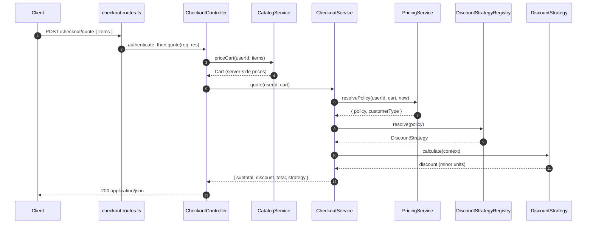

# Chapter 3 — Discount Strategies, End to End

> Companion to [`../notes.md`](../notes.md) · Sections 3.1–3.5
> **Learning goals:** build the discount example from domain types to HTTP, keep
> money exact, separate policy from algorithm, and wire the whole graph in one
> composition root.

## 3.1 The requirements, stated as rules

Write the rules down before writing a single class. These are the version this
chapter implements:

| Rule key | Who qualifies | Discount | Notes |
| --- | --- | --- | --- |
| `premium` | Customer profile type `premium` | 15% of subtotal | Rounded half-up |
| `student` | Profile type `student` | 10% of subtotal | Rounded half-up |
| `festival` | An active promotion covers the cart | Fixed ₹100 (10 000 paise) | Zero if any cart product is excluded |
| `none` | Everyone else | 0 | Explicit null object |

Global invariants, true for every rule and every implementation:

1. The discount is an integer in **minor units**.
2. `0 <= discount <= subtotal`.
3. The same context always produces the same discount.
4. Only one rule applies per checkout in v1 — stacking is a separate decision
   (section 3.10).
5. The policy is chosen from **trusted data**, never from a request field.

The last point is the one most implementations get wrong. A client that can send
`{ "customerType": "premium" }` has been handed the discount.

## 3.2 Money and domain types

Money helpers first, because every strategy depends on them:

```ts
// domain/money.ts
import { InvalidDiscountError } from "../errors/discount.errors";

export type Currency = "INR" | "USD" | "EUR";

/** All monetary values are integers in the smallest currency unit. */
export function assertAmount(amount: number, label = "amount"): number {
  if (!Number.isInteger(amount) || amount < 0) {
    throw new InvalidDiscountError(`${label} must be a non-negative integer`);
  }
  return amount;
}

/**
 * Percentage discounts round half-up. This is a business decision, not a
 * language default: document it and test the boundary (amount=10, rate=0.15).
 */
export function percentage(amount: number, rate: number): number {
  assertAmount(amount);
  return Math.round(amount * rate);
}

/** Guarantees the contract invariant: 0 <= discount <= amount. */
export function clampDiscount(discount: number, amount: number): number {
  assertAmount(amount);
  if (!Number.isInteger(discount) || discount < 0) {
    throw new InvalidDiscountError(`discount must be a non-negative integer`);
  }
  return Math.min(discount, amount);
}
```

The cart uses the same units:

```ts
// domain/cart.ts
import type { Currency } from "./money";

export type CartLine = {
  readonly productId: string;
  readonly quantity: number;
  readonly unitAmount: number; // minor units, from the catalog — not the client
};

export type Cart = {
  readonly id: string;
  readonly userId: string;
  readonly currency: Currency;
  readonly lines: readonly CartLine[];
};

export function subtotal(cart: Cart): number {
  return cart.lines.reduce(
    (total, line) => total + line.unitAmount * line.quantity,
    0,
  );
}

export function productIds(cart: Cart): string[] {
  return cart.lines.map((line) => line.productId);
}
```

Two deliberate choices:

- **`subtotal()` is a function, not a stored field.** A stored subtotal can drift
  from the lines; recomputing is cheap and always correct.
- **Prices come from the catalog service**, not from the request. The HTTP layer
  accepts `productId` and `quantity` only (section 3.8).

## 3.3 The contract

```ts
// strategies/discount-strategy.ts
import type { Currency } from "../domain/money";

export const DISCOUNT_KEYS = ["none", "premium", "student", "festival"] as const;
export type DiscountKey = (typeof DISCOUNT_KEYS)[number];

export type CustomerType = "guest" | "student" | "premium";

export type DiscountContext = {
  /** Cart subtotal in minor units. */
  readonly amount: number;
  readonly currency: Currency;
  readonly customerType: CustomerType;
  readonly productIds: readonly string[];
  /** Injected: strategies never call `new Date()`. */
  readonly now: Date;
};

export interface DiscountStrategy {
  readonly key: DiscountKey;
  /** Discount in minor units; 0 <= result <= context.amount. */
  calculate(context: DiscountContext): number;
}
```

`DISCOUNT_KEYS` is exported for two reasons: the HTTP layer can validate
configuration against it, and a test can assert that every key has a registered
implementation.

The shared errors are plain classes so the transport layer can map them once:

```ts
// errors/discount.errors.ts
export class InvalidDiscountError extends Error {
  constructor(message: string) {
    super(message);
    this.name = "InvalidDiscountError";
  }
}

export class UnknownCustomerError extends Error {
  constructor(userId: string) {
    super(`No customer profile for ${userId}`);
    this.name = "UnknownCustomerError";
  }
}

export class UnknownStrategyError extends Error {
  constructor(key: string) {
    super(`No strategy registered for "${key}"`);
    this.name = "UnknownStrategyError";
  }
}
```

## 3.4 The four implementations

```ts
// strategies/premium-discount.strategy.ts
import type { DiscountContext, DiscountStrategy } from "./discount-strategy";
import { clampDiscount, percentage } from "../domain/money";

export class PremiumDiscount implements DiscountStrategy {
  readonly key = "premium" as const;

  calculate({ amount }: DiscountContext): number {
    return clampDiscount(percentage(amount, 0.15), amount);
  }
}
```

```ts
// strategies/student-discount.strategy.ts
import type { DiscountContext, DiscountStrategy } from "./discount-strategy";
import { clampDiscount, percentage } from "../domain/money";

export class StudentDiscount implements DiscountStrategy {
  readonly key = "student" as const;

  calculate({ amount }: DiscountContext): number {
    return clampDiscount(percentage(amount, 0.1), amount);
  }
}
```

```ts
// strategies/festival-discount.strategy.ts
import type { DiscountContext, DiscountStrategy } from "./discount-strategy";
import { clampDiscount } from "../domain/money";

export class FestivalDiscount implements DiscountStrategy {
  readonly key = "festival" as const;

  constructor(
    private readonly fixedAmount: number,
    private readonly excludedProductIds: ReadonlySet<string>,
  ) {}

  calculate({ amount, productIds }: DiscountContext): number {
    const excluded = productIds.some((id) => this.excludedProductIds.has(id));
    if (excluded) return 0;
    return clampDiscount(this.fixedAmount, amount);
  }
}
```

```ts
// strategies/no-discount.strategy.ts
import type { DiscountContext, DiscountStrategy } from "./discount-strategy";

export class NoDiscount implements DiscountStrategy {
  readonly key = "none" as const;

  calculate(_context: DiscountContext): number {
    return 0;
  }
}
```

Each class is small enough to read in one screen, and none imports Express,
Prisma, or configuration. The festival rule receives its parameters through the
constructor because a promotion is data that changes per campaign.

Note the division of labour: the **algorithm** applies the fixed amount and
exclusions; the **selector** decides whether the promotion is active at all
(3.5). If the minimum-cart requirement arrives later, it belongs in the selector —
it is eligibility, not arithmetic.

## 3.5 Policy as data, resolved from trusted sources

The policy is a small discriminated union. It carries the parameters a campaign
needs, and nothing else:

```ts
// domain/discount-policy.ts
export type DiscountPolicy =
  | { kind: "none" }
  | { kind: "premium" }
  | { kind: "student" }
  | { kind: "festival"; fixedAmount: number; excludedProductIds: string[] };
```

The data comes through ports, so the pricing service is testable without a
database:

```ts
// ports/customer.repository.ts
import type { CustomerType } from "../strategies/discount-strategy";

export type CustomerProfile = {
  readonly id: string;
  readonly type: CustomerType;
};

export interface CustomerRepository {
  findById(id: string): Promise<CustomerProfile | null>;
}
```

```ts
// ports/promotion.repository.ts
export type FestivalPromotion = {
  readonly id: string;
  readonly fixedAmount: number;
  readonly excludedProductIds: string[];
  readonly startsAt: Date;
  readonly endsAt: Date;
};

export interface PromotionRepository {
  findActive(now: Date): Promise<FestivalPromotion | null>;
}
```

The service loads the profile and promotion, applies the **precedence rule**, and
returns both the policy and the customer type the context needs:

```ts
// services/pricing.service.ts
import type { Cart } from "../domain/cart";
import type { DiscountPolicy } from "../domain/discount-policy";
import type { CustomerRepository } from "../ports/customer.repository";
import type { PromotionRepository } from "../ports/promotion.repository";
import type { CustomerType } from "../strategies/discount-strategy";
import { UnknownCustomerError } from "../errors/discount.errors";

export type PricingDecision = {
  readonly policy: DiscountPolicy;
  readonly customerType: CustomerType;
};

export class PricingService {
  constructor(
    private readonly customers: CustomerRepository,
    private readonly promotions: PromotionRepository,
  ) {}

  async resolvePolicy(
    userId: string,
    cart: Cart,
    now: Date,
  ): Promise<PricingDecision> {
    const profile = await this.customers.findById(userId);
    if (!profile) throw new UnknownCustomerError(userId);

    if (cart.lines.length === 0) {
      return { policy: { kind: "none" }, customerType: profile.type };
    }

    const promotion = await this.promotions.findActive(now);
    const festivalIsLive =
      promotion !== null &&
      promotion.startsAt <= now &&
      now < promotion.endsAt;

    // Precedence is a business rule: premium benefit wins over a campaign,
    // a campaign wins over the student rate. Documented and tested in chapter 4.
    if (profile.type === "premium") {
      return { policy: { kind: "premium" }, customerType: profile.type };
    }

    if (festivalIsLive && promotion) {
      return {
        policy: {
          kind: "festival",
          fixedAmount: promotion.fixedAmount,
          excludedProductIds: promotion.excludedProductIds,
        },
        customerType: profile.type,
      };
    }

    if (profile.type === "student") {
      return { policy: { kind: "student" }, customerType: profile.type };
    }

    return { policy: { kind: "none" }, customerType: profile.type };
  }
}
```

Why this shape works:

- The request never appears here. `userId` comes from authentication; the cart
  comes from the catalog service.
- The precedence rule is one readable block, not scattered across strategies.
- A new promotion becomes a new branch *here* and a new implementation — never an
  edit to `PremiumDiscount`.
- The service is testable with two in-memory ports; no HTTP, no database.

## 3.6 The registry and the composition root

```ts
// services/discount-strategy.registry.ts
import type { DiscountPolicy } from "../domain/discount-policy";
import type { DiscountStrategy } from "../strategies/discount-strategy";
import { FestivalDiscount } from "../strategies/festival-discount.strategy";
import { UnknownStrategyError } from "../errors/discount.errors";

function assertNever(value: never): never {
  const key = (value as { kind?: string }).kind ?? "unknown";
  throw new UnknownStrategyError(key);
}

export class DiscountStrategyRegistry {
  constructor(
    private readonly premium: DiscountStrategy,
    private readonly student: DiscountStrategy,
    private readonly none: DiscountStrategy,
  ) {}

  resolve(policy: DiscountPolicy): DiscountStrategy {
    switch (policy.kind) {
      case "premium":
        return this.premium;
      case "student":
        return this.student;
      case "festival":
        return new FestivalDiscount(
          policy.fixedAmount,
          new Set(policy.excludedProductIds),
        );
      case "none":
        return this.none;
      default:
        return assertNever(policy);
    }
  }
}
```

`FestivalDiscount` is constructed per resolution because its parameters are part
of the policy. The stateless strategies are constructed once — they are safe to
share across requests because they hold no mutable state.

Everything is assembled in one place:

```ts
// composition-root.ts
import { NoDiscount } from "./strategies/no-discount.strategy";
import { PremiumDiscount } from "./strategies/premium-discount.strategy";
import { StudentDiscount } from "./strategies/student-discount.strategy";
import { DiscountStrategyRegistry } from "./services/discount-strategy.registry";
import { PricingService } from "./services/pricing.service";
import { CheckoutService } from "./services/checkout.service";
import { CatalogService } from "./services/catalog.service";
import { PostgresCustomerRepository } from "./repositories/postgres-customer.repository";
import { PostgresPromotionRepository } from "./repositories/postgres-promotion.repository";
import { createPrismaClient } from "./lib/prisma";
import { loadConfig } from "./config/env";
import { systemClock } from "./lib/clock";

const config = loadConfig();
const db = createPrismaClient(config.DATABASE_URL);

const registry = new DiscountStrategyRegistry(
  new PremiumDiscount(),
  new StudentDiscount(),
  new NoDiscount(),
);

const pricing = new PricingService(
  new PostgresCustomerRepository(db),
  new PostgresPromotionRepository(db),
);

const checkout = new CheckoutService(pricing, registry, systemClock);

export const container = {
  catalog: new CatalogService(db),
  checkout,
};
```

The registry is the only module that knows all implementations; the composition
root is the only module that constructs them.

## 3.7 The checkout service

```ts
// lib/clock.ts
export interface Clock {
  now(): Date;
}

export const systemClock: Clock = { now: () => new Date() };
```

```ts
// services/checkout.service.ts
import type { Cart } from "../domain/cart";
import { productIds, subtotal } from "../domain/cart";
import { clampDiscount } from "../domain/money";
import type { Clock } from "../lib/clock";
import type { DiscountStrategyRegistry } from "./discount-strategy.registry";
import type { PricingService } from "./pricing.service";
import type { DiscountKey } from "../strategies/discount-strategy";

export type CheckoutQuote = {
  readonly subtotal: number;
  readonly discount: number;
  readonly total: number;
  readonly strategy: DiscountKey;
};

export class CheckoutService {
  constructor(
    private readonly pricing: PricingService,
    private readonly registry: DiscountStrategyRegistry,
    private readonly clock: Clock,
  ) {}

  async quote(userId: string, cart: Cart): Promise<CheckoutQuote> {
    // One timestamp per checkout: the quote must not depend on clock drift
    // between policy resolution and calculation.
    const now = this.clock.now();

    const { policy, customerType } = await this.pricing.resolvePolicy(
      userId,
      cart,
      now,
    );

    const strategy = this.registry.resolve(policy);
    const amount = subtotal(cart);

    const discount = strategy.calculate({
      amount,
      currency: cart.currency,
      customerType,
      productIds: productIds(cart),
      now,
    });

    const safeDiscount = clampDiscount(discount, amount);

    return {
      subtotal: amount,
      discount: safeDiscount,
      total: amount - safeDiscount,
      strategy: strategy.key,
    };
  }
}
```

Notice what the service does **not** do: it does not know which strategy was
selected, how the discount is computed, or where the customer profile came from.
It orchestrates three collaborators and enforces the final invariant.

The full request, in order:



The route only translates HTTP. The controller validates and delegates once. The
service owns the workflow. The pricing service owns selection data. The strategy
owns arithmetic. Each layer can be replaced without editing the one below it.

## 3.8 The HTTP layer

The request carries product references, never prices:

```ts
// dtos/checkout.dto.ts
import { z } from "zod";

export const quoteRequestSchema = z.object({
  items: z
    .array(
      z.object({
        productId: z.string().min(1).max(64),
        quantity: z.number().int().min(1).max(99),
      }),
    )
    .min(1)
    .max(100),
});

export type QuoteRequest = z.infer<typeof quoteRequestSchema>;
```

The catalog service turns references into a cart with server-side prices:

```ts
// services/catalog.service.ts
import type { Cart } from "../domain/cart";
import type { QuoteRequest } from "../dtos/checkout.dto";

export class CatalogService {
  async priceCart(
    userId: string,
    items: QuoteRequest["items"],
  ): Promise<Cart> {
    // Load products, prices, and currency from the database. Reject missing or
    // unavailable products here rather than pricing an incomplete cart.
    // ...
    return cart;
  }
}
```

The controller has one job:

```ts
// controllers/checkout.controller.ts
import type { Request, Response } from "express";
import { quoteRequestSchema } from "../dtos/checkout.dto";
import type { CatalogService } from "../services/catalog.service";
import type { CheckoutService } from "../services/checkout.service";

export class CheckoutController {
  constructor(
    private readonly catalog: CatalogService,
    private readonly checkout: CheckoutService,
  ) {}

  quote = async (req: Request, res: Response): Promise<void> => {
    const { items } = quoteRequestSchema.parse(req.body);
    const userId = req.user!.id; // set by the authenticate middleware

    const cart = await this.catalog.priceCart(userId, items);
    const quote = await this.checkout.quote(userId, cart);

    res.status(200).json(quote);
  };
}
```

`req.user` is declared once, where the auth middleware is defined:

```ts
// types/express.d.ts
declare global {
  namespace Express {
    interface Request {
      user?: { id: string; roles: string[] };
    }
  }
}
```

The router stays declarative:

```ts
// routes/checkout.routes.ts
import { Router } from "express";
import type { CheckoutController } from "../controllers/checkout.controller";
import { authenticate } from "../middlewares/authenticate";
import { asyncHandler } from "../middlewares/async-handler";

export function createCheckoutRouter(controller: CheckoutController): Router {
  const router = Router();
  router.post("/quote", authenticate, asyncHandler(controller.quote));
  return router;
}
```

`asyncHandler` is required with Express 4: a rejected promise otherwise becomes an
unhandled rejection instead of reaching the error middleware.

The error mapping is written once:

| Thrown | Status | Body |
| --- | --- | --- |
| `ZodError` | 400 | `invalid_request` + field issues |
| `UnknownCustomerError` | 404 | `customer_not_found` |
| `InvalidDiscountError` | 422 | `invalid_discount` |
| `UnknownStrategyError` | 500 | `pricing_unavailable` (alert; a configuration bug) |
| anything else | 500 | `internal_error` (log with the request id) |

```ts
// middlewares/error-handler.ts
import type { ErrorRequestHandler } from "express";
import { ZodError } from "zod";
import {
  InvalidDiscountError,
  UnknownCustomerError,
  UnknownStrategyError,
} from "../errors/discount.errors";

export const errorHandler: ErrorRequestHandler = (err, req, res, _next) => {
  if (err instanceof ZodError) {
    res.status(400).json({ error: "invalid_request", issues: err.issues });
    return;
  }

  if (err instanceof UnknownCustomerError) {
    res.status(404).json({ error: "customer_not_found" });
    return;
  }

  if (err instanceof InvalidDiscountError) {
    res.status(422).json({ error: "invalid_discount" });
    return;
  }

  if (err instanceof UnknownStrategyError) {
    req.log.error({ err }, "pricing configuration is inconsistent");
    res.status(500).json({ error: "pricing_unavailable" });
    return;
  }

  req.log.error({ err }, "unhandled checkout error");
  res.status(500).json({ error: "internal_error" });
};
```

```bash
curl -s -X POST http://localhost:3000/checkout/quote \
  -H "authorization: Bearer $TOKEN" \
  -H "content-type: application/json" \
  -d '{"items":[{"productId":"prod_1","quantity":2}]}'
```

```json
{
  "subtotal": 50000,
  "discount": 7500,
  "total": 42500,
  "strategy": "premium"
}
```

Everything in that response is in minor units. `strategy` is included for support
and analytics — it is not used by the client to compute anything.

## 3.9 Precedence, best-of, and stacking

The version above applies **one** rule, chosen by an explicit precedence chain in
`PricingService`. That is a deliberate product decision, and it must be written
down and tested. Two variations appear as soon as marketing gets involved.

### Best-of (choose the largest eligible discount)

```ts
export type DiscountCandidate = {
  readonly policy: DiscountPolicy;
  readonly context: DiscountContext;
};

export class BestDiscountSelector {
  constructor(private readonly registry: DiscountStrategyRegistry) {}

  select(candidates: readonly DiscountCandidate[]): {
    strategy: DiscountStrategy;
    discount: number;
  } {
    if (candidates.length === 0) {
      throw new InvalidDiscountError("at least one candidate is required");
    }

    let best = {
      strategy: this.registry.resolve(candidates[0].policy),
      discount: 0,
    };

    for (const { policy, context } of candidates) {
      const strategy = this.registry.resolve(policy);
      const discount = strategy.calculate(context);

      // Strictly greater: ties keep the first candidate, so order the list by
      // business priority (premium before festival before student).
      if (discount > best.discount) best = { strategy, discount };
    }

    return best;
  }
}
```

Best-of needs the resolver to produce *eligible* candidates without applying them.
Keep eligibility in `PricingService`; do not let every strategy answer "do I
apply?" or eligibility logic will duplicate.

### Stacking (apply several rules in order)

```ts
export type AppliedDiscount = { key: DiscountKey; discount: number };

export function applyStacked(
  amount: number,
  strategies: readonly DiscountStrategy[],
  context: DiscountContext,
): { discount: number; total: number; applied: AppliedDiscount[] } {
  let remaining = amount;
  const applied: AppliedDiscount[] = [];

  for (const strategy of strategies) {
    // Each rule sees the already-discounted amount.
    const discount = clampDiscount(
      strategy.calculate({ ...context, amount: remaining }),
      remaining,
    );

    if (discount > 0) applied.push({ key: strategy.key, discount });
    remaining -= discount;
  }

  return { discount: amount - remaining, total: remaining, applied };
}
```

Stacking is a different product promise, not a small code change:

- **Order matters.** 20% then ₹100 off is not the same as ₹100 off then 20%.
- **Percentages compound** on a reduced base. Confirm that is intended.
- **Audit needs the breakdown.** Persist `applied`, not just the final total.
- **Invariants still hold.** Clamp at every step; total never goes below zero.

Do not introduce stacking silently by letting the service loop over every
strategy. The checkout contract (`discount`, `total`) and the customer-facing
receipt both change.

## 3.10 What changed compared with the `if/else`

| Concern | Original function | Strategy version |
| --- | --- | --- |
| Adding a rule | Edit the function, risk every branch | Add one class + one policy branch + one registry case |
| Testing a rule | Construct inputs for unrelated branches | Instantiate one strategy, pass a context |
| Policy source | Hard-coded strings and constants | `PricingService` + ports (profile, promotion) |
| Selection | Interleaved with arithmetic | Registry + precedence in one service |
| Money safety | Implicit | `clampDiscount` invariant in every implementation |
| Determinism | `new Date()` inside | One `now` passed through the context |
| Observability | Ad-hoc logs | `strategy` key returned and logged |
| Reuse | Copy the function | Same strategies callable from jobs and admin tooling |

The measurable outcome: adding a "first order 20%" rule should touch one new
strategy file, one policy variant, one registry case, and tests — **not**
`checkout.service.ts`, `checkout.controller.ts`, or `checkout.routes.ts`.

## Exercise

1. Add a `first_order` policy: 20% for a customer's first order, eligible only
   when the profile says so. Decide whether it outranks `premium` and document
   the precedence.
2. Add a minimum-cart condition to the festival promotion. Where does it belong —
   `PricingService`, `FestivalDiscount`, or the controller? Justify with the
   eligibility/arithmetic distinction from 3.4.
3. Implement `BestDiscountSelector` and change `CheckoutService` to use it. What
   happens to the `strategy` field in the response? What do you log for the
   losing candidates?
4. Introduce stacking behind a config flag. Write the invariants that must hold
   for every sequence of two rules.

---

**Previous:** [Chapter 2 ←](02-concept-and-boundaries.md)
**Next:** [Chapter 4 — Wiring, testing, and failure modes →](04-wiring-and-testing.md)
**Index:** [Strategy notes](README.md) · **Source:** [`../notes.md`](../notes.md)
