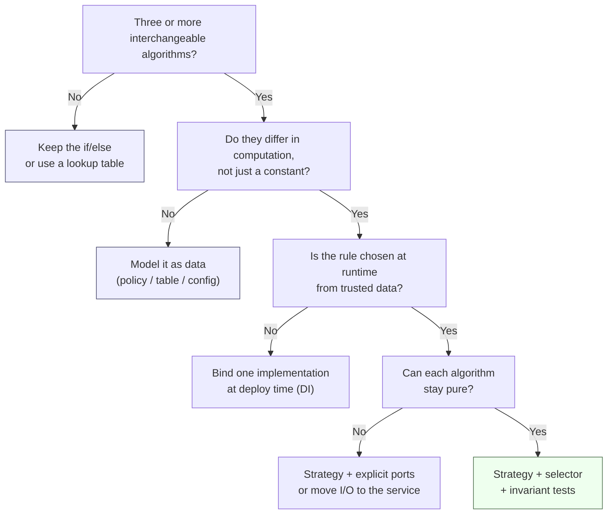

# Chapter 5 — Production Checklist, Anti-Patterns, and Decision Guide

> Companion to [`../notes.md`](../notes.md) · Sections 5–10
> **Learning goals:** review a strategy implementation against a concrete
> checklist, recognise the ten failure shapes, refactor an existing conditional
> safely, and decide when *not* to use the pattern.

## 5.1 Ship checklist

Copy this into the pull request. Every unchecked box is a question for the author.

**Contract**

- [ ] One narrow interface with a domain verb (`calculate`, `price`, `authorize`).
- [ ] Context object is `readonly` and contains data only — no services.
- [ ] `key` is a union or enum, not a free-form string.
- [ ] The contract states units, return range, and error behaviour.
- [ ] No strategy imports Express, Prisma, Redis, or `process.env`.

**Selection**

- [ ] Exactly one selector: registry, policy resolver, or DI — not several.
- [ ] The policy comes from a trusted source (profile, promotion table, flags).
- [ ] No request field can choose a rule.
- [ ] Precedence (or best-of / stacking) is written down and tested.
- [ ] An unknown policy fails loudly (`assertNever`), not silently with `0`.

**Money and determinism**

- [ ] All amounts are integers in minor units; rounding policy is documented.
- [ ] Every strategy guarantees `0 <= discount <= amount`.
- [ ] The service also clamps as a final defence.
- [ ] `now` (and any randomness) is injected; strategies are pure.
- [ ] The same context produces the same result, proven by a test.

**Operations**

- [ ] Configuration is validated at boot; unknown strategy names are rejected.
- [ ] The selected key is logged and metered.
- [ ] Metrics labels are low-cardinality (no user or order ids).
- [ ] The quote decision is persisted so the charge cannot disagree with it.
- [ ] Adding a rule does not modify the service, controller, or route.

## 5.2 Ten anti-patterns

| # | Anti-pattern | Why it hurts | Fix |
| --- | --- | --- | --- |
| 1 | `switch` inside a base class | The conditional moved, not disappeared; every rule edits one file | One class per rule; selector in a registry |
| 2 | Selection in the controller | Client-supplied data chooses money rules; no reuse from jobs | Resolve policy in a service from trusted sources |
| 3 | Strategy performs I/O | No longer pure; slow, flaky, hard to test; transaction leaks | Pass data in the context; keep I/O in the service/adapters |
| 4 | Raw request value as the key | User grants themselves a discount | Narrow key union + allow-list from trusted data |
| 5 | `default: return 0` | A missing case silently underprices; nobody notices | `assertNever` + boot-time registry check |
| 6 | No result validation | Negative totals, over-discounts, `NaN` | `assertAmount`, `clampDiscount`, invariant test |
| 7 | Float money | `0.1 + 0.2` cents drift; totals disagree with receipts | Integer minor units, explicit rounding |
| 8 | `Date.now()` or `Math.random()` inside | Non-deterministic quotes; untestable boundaries | Inject `now`/randomness; test twice with the same context |
| 9 | Mutable shared strategy | Request order changes totals; races | Stateless strategies; per-policy instances for parameters |
| 10 | A class per constant | More files than rules; indirection with no payoff | Keep data in a table/config |

Two more that appear in review comments:

- **Eligibility duplicated in every strategy.** Every rule implements "do I
  apply?" differently, and the selector also checks it. Keep eligibility in the
  selector; strategies compute.
- **The strategy returns a boolean or a status.** If the caller needs to know
  *whether* to apply, that is a selection decision. Strategies return a value.

## 5.3 Refactoring an `if/else` into strategies

Do it in small, reversible steps. The goal is not "use a pattern"; it is to make
the next rule cheap and safe.

```text
0. Characterize  -> lock current behaviour with tests at the service/HTTP level
1. Extract data  -> build the context object; pass it to the existing function
2. Extract one   -> move the most complex rule into a class, keep the if/else
3. Add selector  -> introduce the registry; route only that rule through it
4. Migrate       -> move remaining rules one at a time, deleting branches
5. Delete        -> remove the old function and dead configuration
6. Harden        -> invariants, property test, observability, docs
```

Step 0 is the one people skip. Before moving code, capture the current rule table
as tests:

```ts
it.each([
  { type: "premium", amount: 10_000, expected: 1_500 },
  { type: "student", amount: 10_000, expected: 1_000 },
  { type: "festival", amount: 10_000, expected: 10_000 },
  { type: "guest", amount: 10_000, expected: 0 },
])("legacy: %o", ({ type, amount, expected }) => {
  expect(calculateDiscount(type, amount)).toBe(expected);
});
```

If the legacy function has a bug, write the test for the behaviour you *want*,
mark it `it.fails`, and decide with the product owner whether the refactor fixes
it. Do not silently change prices during a refactor.

Step 1 produces the context:

```ts
type DiscountContext = {
  amount: number;
  currency: Currency;
  customerType: CustomerType;
  productIds: string[];
  now: Date;
};
```

Step 2 extracts the festival rule because it has the most edge cases. Step 3 adds
the registry and changes exactly one call site. Step 4 repeats until the `if/else`
has no branches left, then deletes the function. Step 6 is where the pattern
starts paying rent: the invariant test and the metrics from chapter 4.

## 5.4 Decision flow



The flow deliberately sends two answers away from the pattern. Most
"we need a strategy" requests are really "we need a table" or "we need one
implementation per deployment".

## 5.5 When to use it, when to avoid it

**Use it when**

| Situation | Example | Strategy key |
| --- | --- | --- |
| Several interchangeable computations | Pricing, tax, fees, interest | `premium`, `student`, `festival` |
| Behaviour varies by trusted context | Auth method, shipping zone, region | `password`, `otp`, `idp` |
| Rules change on different schedules | Promotions owned by marketing, fees by finance | One class per campaign |
| The same rule is needed in several entry points | HTTP, job, admin, CLI | Shared strategies, different callers |
| Behaviour must be swapped at runtime | Model routing by task/plan/budget | `cheap`, `balanced`, `frontier` |

**Avoid it when**

| Situation | Better tool |
| --- | --- |
| One stable condition | A plain `if` |
| Only a constant changes | A configuration table |
| Two branches with no third planned | Two functions, or one `if` |
| The caller must know which rule ran | A policy result with a reason, or separate methods |
| The variation is per deployment | Bind one implementation at startup (DI) |
| The rule needs a repository per call | Reconsider the boundary; pass data in |

The failure mode of over-application is real: a folder of eleven strategy files
for a rule that is "5% off for members" is harder to read than one line. The
pattern is justified by **independent change**, not by the word "algorithm".

## 5.6 Relationship to the other patterns

| Pattern | How it interacts | Read |
| --- | --- | --- |
| **Factory** | Creates the selected implementation; a factory may build a strategy from config | [Factory](../../02-factory/notes.md) |
| **Adapter** | Wraps the vendor API a strategy talks to; keeps SDK types outside | [Adapter](../../07-adapter/notes.md) |
| **Decorator** | Wraps a strategy with caching, metrics, or a budget guard while keeping the contract | [Decorator](../../08-decorator/notes.md) |
| **Singleton / DI** | Stateless strategies are constructed once in the composition root | [Singleton](../../03-singleton/notes.md) |
| **Observer** | Publishes `DiscountApplied` after commit; the strategy does not send events | [Observer](../../05-observer/notes.md) |
| **CQRS** | Pricing is command-side; read models may precompute quotes | [CQRS](../../09-cqrs/notes.md) |
| **Circuit Breaker** | Protects calls made *by* a strategy that must reach a remote service | [Circuit Breaker](../../10-circuit-breaker/notes.md) |
| **Builder** | Assembles a complex context (prompt, rule set, policy) before selection | [Builder](../../06-builder/notes.md) |

Two combinations are worth calling out:

- **Factory + strategy** is the standard pair. The factory answers "which object
  for this provider?", the strategy answers "which algorithm for this context?".
  Keeping them separate is what prevents a provider registry from becoming a
  pricing engine.
- **Decorator + strategy** lets you add cross-cutting behaviour without touching
  rules: `CachedDiscount(PremiumDiscount)` or
  `MeteredDiscount(FestivalDiscount)`. The decorator must preserve the contract,
  including the invariant.

## 5.7 Strategy in an AI subsystem

Model routing is the same shape one layer up. The "algorithm" is *how to choose a
model*, and the selection inputs are task, plan, latency target, and budget:

```ts
export type RouteContext = {
  readonly task: "classify" | "summarize" | "reason";
  readonly plan: "free" | "pro" | "enterprise";
  readonly inputTokens: number;
  readonly remainingBudgetUsd: number;
  readonly latencyBudgetMs: number;
};

export type ModelChoice = {
  readonly provider: string;
  readonly model: string;
  readonly maxOutputTokens: number;
};

export interface ModelRouter {
  readonly key: string;
  choose(context: RouteContext): ModelChoice;
}
```

```ts
export class TaskTierRouter implements ModelRouter {
  readonly key = "task-tier";

  choose({ task, plan }: RouteContext): ModelChoice {
    if (task === "classify") {
      return { provider: "any", model: "small", maxOutputTokens: 256 };
    }

    if (task === "reason" && plan !== "free") {
      return { provider: "primary", model: "frontier", maxOutputTokens: 4_096 };
    }

    return { provider: "primary", model: "mid", maxOutputTokens: 1_024 };
  }
}
```

```ts
export class BudgetGuardRouter implements ModelRouter {
  readonly key = "budget-guard";

  constructor(private readonly inner: ModelRouter) {}

  choose(context: RouteContext): ModelChoice {
    if (context.remainingBudgetUsd <= 0) {
      return { provider: "any", model: "small", maxOutputTokens: 256 };
    }
    return this.inner.choose(context);
  }
}
```

The pattern lessons carry over unchanged:

- The router returns a **decision**, not a provider SDK client.
- Budget and latency are **context**, injected by the caller.
- A registry keyed by task or tenant selects the router; the composition root
  constructs it once.
- The provider call itself is an **Adapter**, wrapped by timeout, retry, and
  circuit breaker — not the router's job.

See the [AI-ready blueprint](../../11-ai-ready-blueprint/notes.md) for the full
composition.

## 5.8 Interview questions

| Question | What a strong answer includes |
| --- | --- |
| **Strategy vs factory?** | Strategy is about interchangeable behaviour; factory is about creation. A factory may return a strategy, but it never computes. |
| **Why not subclass?** | Inheritance multiplies combinations and locks behaviour to a hierarchy. Strategy composes one algorithm per class and selects externally. |
| **Where does selection live?** | One place: a registry for a resolved key, a policy service when data is needed, DI when the choice is per deployment. Never the controller. |
| **How do you test it?** | Pure unit tests per rule plus an invariant test, a table test for selection, and a thin HTTP test for transport. No branch scaffolding. |
| **How do you handle stacking promotions?** | Decide explicitly: precedence, best-of, or ordered stacking. Persist the breakdown, clamp at each step, and test order sensitivity. |
| **Is a function a strategy?** | Yes, when the interface has one operation and no state. Classes appear when constructor parameters or multiple methods are needed. |

A useful trap question: *"The strategy pattern is just `if/else` in different
files — when is that true?"* It is true when the selector is a `switch` over
hard-coded keys, eligibility is duplicated, or the strategies are never used
independently. The pattern earns its keep only when selection and execution
change for different reasons.

## 5.9 Practice checklist

- [ ] Extract a `DiscountStrategy` interface with a readonly context object.
- [ ] Implement one class per rule; keep them pure and stateless.
- [ ] Move selection into a registry or policy service — one home only.
- [ ] Resolve the policy from the profile and promotion data, never the request.
- [ ] Clamp and validate every result; document the rounding rule.
- [ ] Inject `now`; assert determinism with a second call.
- [ ] Test precedence, exclusions, caps, and the invariant.
- [ ] Log and meter the chosen key; keep labels low-cardinality.
- [ ] Persist the quote decision so the charge cannot disagree.
- [ ] Prove that adding a rule does not touch the service, controller, or route.

## 5.10 Takeaways

> **Strategy turns a growing `if/else` into a set of small, independently
> testable rules — as long as selection stays separate from execution.**

Three sentences worth remembering:

1. **Selection is the pattern.** One class per rule is easy; putting the decision
   in one trusted, testable place is the actual design work.
2. **Data is not behaviour.** If only a number changes, use a table. If the
   computation changes, use a strategy.
3. **The invariant is the contract.** `0 <= discount <= amount`, integer minor
   units, injected time — these are what make runtime-selected money code safe.

## Where next

- [Pattern 5 — Observer](../../05-observer/notes.md): what to do *after* a
  discount is applied, without dual writes.
- [Pattern 7 — Adapter](../../07-adapter/notes.md): wrap the vendor APIs that
  pricing and payments call.
- [Pattern 8 — Decorator](../../08-decorator/notes.md): add caching, metrics, and
  budget guards around a strategy without editing it.
- [AI-ready blueprint](../../11-ai-ready-blueprint/notes.md): the same strategy
  shape applied to model routing inside a full architecture.

---

**Previous:** [Chapter 4 ←](04-wiring-and-testing.md)
**Index:** [Strategy notes](README.md) · **Source:** [`../notes.md`](../notes.md)
