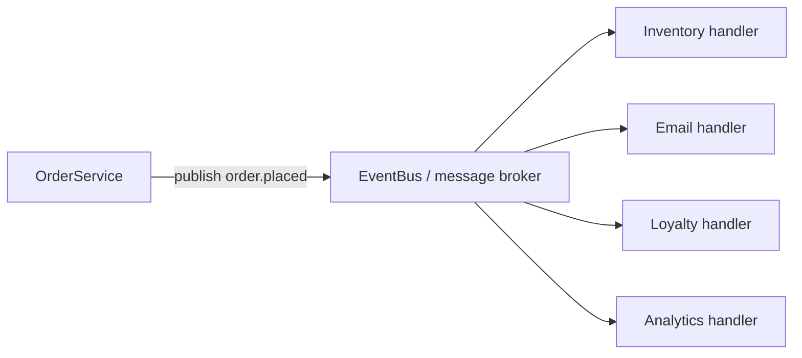
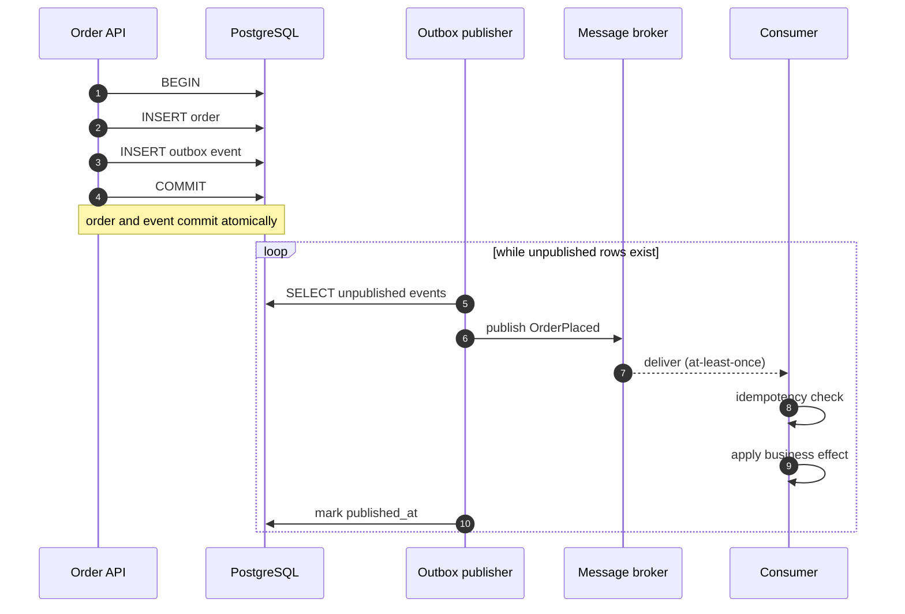

# Pattern 5 — Observer

**Category:** Events and notifications
**Stack used in examples:** TypeScript · Node.js · Express · PostgreSQL · message brokers

---

## Theory — why this pattern exists

Observer is a **behavioural** pattern that defines a one-to-many dependency:
*"when one object changes state, all its dependents are notified and updated
automatically"* (GoF). In a backend system the "object" is usually a domain
event and the dependents are handlers.

The deeper principle is **inversion of control** — often called the Hollywood
principle: *don't call us, we'll call you*. The order service does not know who
cares about `order.placed`; it publishes a fact and returns. Subscribers register
interest. This decouples the publisher from the number, identity, and
implementation of its consumers.

Two kinds of decoupling follow:

- **In space** — the publisher has no compile-time dependency on subscribers.
- **In time** — with a durable broker, publisher and subscriber do not need to
  run simultaneously.

That second form is where the hard theory lives. Once delivery is asynchronous,
you inherit **eventual consistency**, **at-least-once delivery**, duplicate
handling, ordering questions, and schema evolution. The in-process event bus in
section 3 is the teaching shape; production systems add an outbox and idempotent
consumers.

## Why you need it

You need observer when one business fact triggers several independent reactions:

- Placing an order must update inventory, send email, award points, record
  analytics, and notify the warehouse.
- The synchronous version makes checkout latency the sum of every downstream
  call, so a slow email provider delays orders.
- One downstream exception aborts the rest, leaving inconsistent state.
- Every new reaction requires editing the order service and redeploying it.
- Different teams own different reactions and cannot ship independently.

Without the pattern, the core flow becomes a fragile orchestration script that
grows with every feature and fails as a unit.

## Benefits

| Benefit | What it gives you |
| --- | --- |
| **Loose coupling** | The publisher knows only the event name and payload contract. |
| **Extensibility** | New reactions are new subscribers; the publisher does not change. |
| **Latency isolation** | Slow work moves off the request path when async is acceptable. |
| **Failure isolation** | A failing subscriber does not abort the publisher or its siblings. |
| **Fan-out** | One event serves any number of consumers, including future services. |
| **Replay and audit** | A durable log lets you rebuild projections or investigate history. |
| **Team autonomy** | Consumers can be owned, deployed, and scaled independently. |

The costs are eventual consistency, duplicate delivery, ordering and debugging
complexity, and real operational work (DLQs, lag monitoring, contracts). An event
bus is not "free decoupling"; it trades a compile-time dependency for a runtime
contract.

## When this pattern applies

Use it when one event has multiple independent consumers, when work can be
asynchronous (email, analytics, indexing, webhooks), or when you need decoupling
across services. If the caller needs the result synchronously, a direct call is
simpler. If an event must never be lost, pair the pattern with a transactional
outbox and idempotent consumers. Section 7 has the full decision list.

## 1. What problem does it solve?

When a customer places an order, several things should happen:

1. Save the order.
2. Update inventory.
3. Send a confirmation email.
4. Award loyalty points.
5. Record analytics.
6. Notify the warehouse.

A tightly coupled implementation:

```ts
async function placeOrder() {
  await saveOrder();
  await updateInventory();
  await sendEmail();
  await awardPoints();
  await recordAnalytics();
  await notifyWarehouse();
}
```

Problems:

- The order service depends on every downstream system.
- A slow or failing email provider delays or breaks checkout.
- Adding a new reaction requires editing the checkout code.
- Failures are hard to isolate: one exception aborts the rest.
- Everything must run in one request/response cycle.

The observer pattern inverts this: the order service **publishes an event**; interested components **subscribe** and react independently.

## 2. Structure



The publisher knows only the event name and payload shape. It has **zero knowledge** of subscribers.

## 3. In-process implementation (TypeScript)

### 3.1 Event catalogue

```ts
export type OrderPlaced = {
  orderId: string;
  userId: string;
  total: number;
  occurredAt: string;
};

export type Events = {
  "order.placed": OrderPlaced;
  "order.cancelled": { orderId: string; reason: string };
};

export type Handler<K extends keyof Events> = (
  event: Events[K],
) => Promise<void>;
```

Typing the catalogue prevents “stringly typed” events and gives subscribers payload type-safety.

### 3.2 A small event bus

```ts
export class EventBus {
  private readonly handlers = new Map<
    keyof Events,
    Array<Handler<keyof Events>>
  >();

  on<K extends keyof Events>(name: K, handler: Handler<K>): () => void {
    const list = this.handlers.get(name) ?? [];
    list.push(handler as Handler<keyof Events>);
    this.handlers.set(name, list);

    // Return an unsubscribe function so long-lived subscriptions can be removed.
    return () => {
      const current = this.handlers.get(name) ?? [];
      this.handlers.set(
        name,
        current.filter((h) => h !== (handler as Handler<keyof Events>)),
      );
    };
  }

  async publish<K extends keyof Events>(name: K, event: Events[K]) {
    const list = this.handlers.get(name) ?? [];
    await Promise.allSettled(list.map((handler) => handler(event)));
  }
}
```

Two deliberate choices versus the teaching example:

- `allSettled` instead of `all` — one failing subscriber does not prevent the others from running.
- `on()` returns an unsubscribe function — otherwise subscriptions leak in long-running tests.

> The original example also used `any` for handler storage and `Promise.all`. Fine for a lesson; not for production.

### 3.3 Subscribers and usage

```ts
eventBus.on("order.placed", async (event) => {
  await emailService.sendConfirmation(event.userId, event.orderId);
});

eventBus.on("order.placed", async (event) => {
  await loyaltyService.awardPoints(event.userId, event.total);
});

await eventBus.publish("order.placed", {
  orderId: "order_123",
  userId: "user_456",
  total: 499,
  occurredAt: new Date().toISOString(),
});
```

### 3.4 Wiring the bus in Express

Create one bus per process in the composition root and publish **after** the state change is committed:

```ts
// composition-root.ts
export const eventBus = new EventBus();

eventBus.on("order.placed", async (event) => {
  await emailService.sendConfirmation(event.userId, event.orderId);
});

eventBus.on("order.placed", async (event) => {
  await loyaltyService.awardPoints(event.userId, event.total);
});
```

```ts
// orders.routes.ts
ordersRouter.post(
  "/",
  asyncHandler(async (req, res) => {
    const order = await orderService.placeOrder(req.body); // commit first
    await eventBus.publish("order.placed", toOrderPlaced(order));
    res.status(201).json({ id: order.id });
  }),
);
```

Publishing in the request handler is fine for local, best-effort reactions. For anything that must survive a crash, use the transactional outbox in section 5 instead of awaiting the bus here.

`asyncHandler` forwards rejected promises to Express error middleware, so a failed handler returns a response instead of hanging.

Express has no event system of its own; Node’s `EventEmitter` or the typed bus above is enough for in-process events. Remember that `EventEmitter` is synchronous by default and has no durability.

## 4. In-process vs broker-based events

| In-process events | Broker-based events |
| --- | --- |
| Communicate within one process | Communicate across processes/services |
| Simple to implement | Requires broker infrastructure |
| Lost on process crash | Durable delivery can be configured |
| Handlers share memory | Consumers communicate by message |
| Good for local application events | Good for asynchronous distributed workflows |

Common broker choices: RabbitMQ, Kafka, Amazon SNS/SQS, Google Pub/Sub. Each has a different delivery model (at-most-once, at-least-once, ordering, retention) — pick based on requirements, not popularity.

## 5. The critical production issue: dual writes

```text
1. Save order to PostgreSQL.        ✅ committed
2. Publish OrderPlaced to broker.   ❌ process crashes before this
```

The order exists, but inventory and notifications never learn about it. This is the **dual-write problem**: two systems must change atomically, and they cannot without coordination.

### Transactional outbox

```
BEGIN;
  INSERT INTO orders (...);
  INSERT INTO outbox (id, type, payload, published_at)
    VALUES (..., 'OrderPlaced', '{...}', NULL);
COMMIT;

-- separate publisher loop
SELECT * FROM outbox WHERE published_at IS NULL ORDER BY id LIMIT 100;
publish to broker; mark published_at = now();
```

The order **and** its event are committed in one database transaction. A separate publisher delivers events and marks them as sent. If publishing fails, it is retried; the event is never lost.



Even so:

- Delivery can happen **more than once** (at-least-once).
- Ordering across partitions is not guaranteed unless you design for it.

### Idempotent consumers

Processing the same event twice must not produce the business effect twice.

```ts
async function handleOrderPlaced(event: OrderPlaced) {
  await db.transaction(async (tx) => {
    const inserted = await tx.processedEvent.createMany({
      data: [{ eventId: event.orderId, handler: "inventory" }],
      skipDuplicates: true,
    });
    if (inserted.count === 0) return; // already handled

    await tx.inventory.update({
      where: { orderId: event.orderId },
      data: { reserved: true },
    });
  });
}
```

Alternatives: unique constraints on a business key, conditional updates (`UPDATE ... WHERE not_processed`), provider idempotency keys for payments.

## 6. Production considerations

- **Handler isolation.** A failing subscriber must not break the publisher or sibling subscribers. Collect and report failures.
- **Timeouts & retries.** Bound each handler; use a retry policy with backoff; route poison messages to a dead-letter queue.
- **Observability.** Correlate events with a trace/order id; track publish latency, consumer lag, retries, and DLQ depth.
- **Schema evolution.** Events are contracts. Add fields compatibly, version event types (`order.placed.v2`), and tolerate unknown fields.
- **Payload size.** Publish identifiers plus a thin snapshot, not entire object graphs. Consumers can fetch details if needed.
- **Transactional boundaries.** Publish only **after** the transaction commits (or via outbox), never inside a transaction that might roll back.
- **Ordering.** If order matters, key messages by aggregate id and use a single partition/queue or sequence numbers.
- **Do not put business invariants only in async handlers.** Inventory reservation that must be guaranteed needs a synchronous check or compensating workflow.

## 7. When to use / when not to

**Use it when**
- One business event triggers several independent reactions.
- Work can be asynchronous (emails, analytics, search indexing, webhooks).
- You need decoupling in time or across services.
- Losing an event would violate business requirements → use durable messaging + outbox.

**Avoid it when**
- The caller genuinely needs the result synchronously to proceed.
- A direct method call is simpler and failure handling is easier.
- You would introduce a broker for a single subscriber with no durability requirement.

## 8. Common mistakes

1. Publishing **before** the database commit, so subscribers read stale/missing data.
2. Fire-and-forget publishes with no durability → silent event loss.
3. Non-idempotent consumers → duplicate charges, double loyalty points.
4. Swallowing handler errors so failures are invisible.
5. Using events to hide poor boundaries (events as a substitute for API design).
6. One giant event containing everything, forcing every consumer to depend on it.
7. No dead-letter handling → a single poison message blocks a queue forever.

## 9. Relationship to other patterns

- **Repository** — persists aggregates and (often) outbox rows transactionally.
- **Factory / Strategy** — used to choose a broker publisher or handler implementation.
- **CQRS** — events feed read-model projections on the query side.
- **Adapter** — wraps each broker/email/SMS vendor behind a common interface.
- **Decorator** — adds logging, metrics, retries around handlers.
- **Circuit breaker** — protects handlers calling unreliable downstreams.

## 10. Practice checklist

- [ ] Define a typed event catalogue with versioning strategy.
- [ ] Write events in the same transaction as the state change (outbox).
- [ ] Make every consumer idempotent and test a duplicate delivery.
- [ ] Add retries, a DLQ, and alerting on DLQ depth.
- [ ] Propagate a correlation id through every event.
- [ ] Ensure a subscriber failure cannot break checkout.

## 11. One-line takeaway

> Observer decouples *what happened* from *who reacts* — but in production the hard parts are durability (outbox) and duplication (idempotency), not the event bus.

