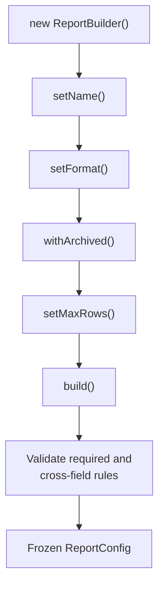

# Pattern 6 — Builder

**Category:** Complex object construction
**Stack used in examples:** TypeScript · Node.js · Express

---

## Theory — why this pattern exists

Builder is a **creational** pattern: *"Separate the construction of a complex
object from its representation so that the same construction process can create
different representations"* (GoF). In backend code its most common use is more
specific: replace a **telescoping constructor** with a named, staged, validated
construction sequence.

The theory connects to several design ideas:

- **Named intent over positional arguments.** `new Report("sales", "monthly",
  true, false, 100, "csv")` is unreadable and silently breakable when two
  arguments share a type.
- **Centralized defaults and invariants.** "Unset" should mean one thing, and
  cross-field rules should be checked before the object escapes.
- **Immutability and illegal states.** `build()` returns a frozen value, so no
  caller can mutate shared configuration after validation.
- **Parse, don't validate.** Convert untrusted input into a well-typed object
  once, at the boundary, instead of re-checking fields everywhere.

Builder is often confused with factory. The distinction is stable: **factory
chooses which type to create; builder configures one type step by step.** A
step builder can even encode required fields in the type system, so `build()`
does not exist until they are set.

## Why you need it

You need a builder when construction itself is the source of bugs:

- A constructor takes many optional parameters, most of them booleans.
- Call sites pass six positional arguments and reviewers cannot tell what they mean.
- Invalid combinations (format plus options, min greater than max) reach the
  database because nothing validates the whole object.
- Defaults are duplicated across DTOs, services, and schema definitions.
- Tests need readable fixtures instead of a wall of object literals.
- Configuration is assembled in stages: parse request → apply policy → validate.

Without it, construction knowledge spreads across call sites, defaults disagree,
and invalid objects circulate until something fails far from the cause.

## Benefits

| Benefit | What it gives you |
| --- | --- |
| **Readable call sites** | Every option is named where it is set. |
| **One source of defaults** | Defaults are defined once instead of per caller. |
| **Whole-object validation** | Cross-field rules run in `build()`, before use. |
| **Immutable result** | A frozen copy prevents accidental mutation after construction. |
| **Staged construction** | Parsing, policy, and validation can happen in a deliberate order. |
| **Test fixtures** | A test-data builder removes brittle literal duplication. |
| **Compile-time guidance** | A step builder makes required fields impossible to skip. |

The costs are boilerplate and another type to maintain. In TypeScript a typed
object literal is often enough; a builder earns its place when construction has
**rules**, not merely fields. Never share one mutable builder instance across
requests.

## When this pattern applies

Use it when an object has many optional settings, when validation spans multiple
fields, when construction happens in stages, or when you need reliable test
fixtures. Avoid it for two or three stable fields where an object literal is
clear. Section 6 has the full decision list.

## 1. What problem does it solve?

Consider creating a report configuration with many optional properties:

```ts
const report = new Report("sales", "monthly", true, false, 100, "csv");
```

What do `true`, `false`, `100`, and `"csv"` mean? The call does not communicate intent, and a future developer can silently swap two arguments of the same type.

The builder pattern constructs an object **incrementally with named operations**, applies defaults, and validates before the object is used.

## 2. What it gives you

```
new ReportBuilder()
  .setName("Monthly Sales")
  .setFormat("csv")
  .includeArchived(false)
  .setMaxRows(5000)
  .build();          ← validated, immutable result
```

- Every setting is named at the call site.
- Defaults live in one place.
- Cross-field validation happens before the object escapes.
- Optional settings do not force null-filled constructors.
- The built object can be frozen, so consumers cannot mutate shared state.



## 3. Practical TypeScript implementation

### 3.1 Result type

```ts
export type ReportFormat = "csv" | "json";

export type ReportConfig = {
  readonly name: string;
  readonly format: ReportFormat;
  readonly includeArchived: boolean;
  readonly maxRows: number;
  readonly dateRange?: { readonly from: string; readonly to: string };
};
```

`readonly` documents that configuration is not meant to change after construction.

### 3.2 Builder

```ts
export class ReportBuilder {
  private name = "default";
  private format: ReportFormat = "json";
  private includeArchived = false;
  private maxRows = 1000;
  private dateRange?: { from: string; to: string };

  setName(name: string): this {
    this.name = name.trim();
    return this;
  }

  setFormat(format: ReportFormat): this {
    this.format = format;
    return this;
  }

  withArchived(value: boolean): this {
    this.includeArchived = value;
    return this;
  }

  setMaxRows(value: number): this {
    if (!Number.isInteger(value) || value < 1 || value > 100_000) {
      throw new Error("maxRows must be an integer between 1 and 100000");
    }
    this.maxRows = value;
    return this;
  }

  inRange(from: string, to: string): this {
    const f = new Date(from);
    const t = new Date(to);
    if (Number.isNaN(f.getTime()) || Number.isNaN(t.getTime())) {
      throw new Error("dateRange must contain valid ISO dates");
    }
    if (f > t) throw new Error("dateRange.from must be before .to");
    this.dateRange = { from: f.toISOString(), to: t.toISOString() };
    return this;
  }

  build(): ReportConfig {
    if (!this.name) throw new Error("Report name is required");
    if (this.format === "csv" && this.dateRange) {
      // Example of a cross-field rule.
      throw new Error("CSV reports do not support date ranges yet");
    }

    // Copy, then freeze: the caller cannot mutate builder internals.
    return Object.freeze({
      name: this.name,
      format: this.format,
      includeArchived: this.includeArchived,
      maxRows: this.maxRows,
      ...(this.dateRange ? { dateRange: { ...this.dateRange } } : {}),
    });
  }
}
```

### 3.3 Usage

```ts
const report = new ReportBuilder()
  .setName("Monthly Sales")
  .setFormat("csv")
  .withArchived(false)
  .setMaxRows(5000)
  .build();
```

### 3.4 Reusable builder for tests

```ts
export const aReport = () =>
  new ReportBuilder().setName("test-report").setFormat("json");
```

Test data builders keep tests readable and shield them from new required fields.

## 4. Builder vs. plain object literal vs. constructor

| Approach | Use when |
| --- | --- |
| Object literal + type | Few fields, no validation, clear names |
| Constructor | Small number of required fields, invariants enforced |
| **Builder** | Many optional fields, validation steps, staged construction |
| Factory | Object *variant* selection rather than stepwise configuration |
| Config schema (Zod/Joi) | Runtime validation of untrusted input |

In TypeScript, a typed literal is often enough:

```ts
const config: ReportConfig = {
  name: "Monthly Sales",
  format: "csv",
  includeArchived: false,
  maxRows: 5000,
};
```

The builder earns its place when construction has **rules**, not merely fields.

## 5. Production considerations

- **Apply defaults in one place.** Scattering defaults across DTOs, builders, and DB schemas creates disagreement about what “unset” means.
- **Validate required fields and cross-field relationships** in `build()`, not only per setter. Example: `format = "csv"` may be incompatible with `includeArchived`.
- **Do not expose mutable internal state.** Return a copy (and freeze it) so later calls to the builder cannot mutate an object already in use.
- **Reject unknown/invalid values early** — enums, ranges, pagination limits, token limits.
- **Keep the builder dumb.** No I/O, no database calls, no side effects; construction should be cheap and testable.
- **Do not build from untrusted input directly.** Parse/validate request payloads with a schema (Zod, class-validator) and then construct.
- **Avoid a universal builder** with 40 setters. If the object has that many options, it likely has several responsibilities.
- **Document the defaults** — silent defaults are a common source of production surprises (e.g. `maxRows = 1000` truncating a report).

## 6. When to use / when not to

**Use it when**
- Construction has many optional settings.
- Validation spans multiple fields.
- Construction happens in stages (parse → configure → validate).
- You want readable, self-documenting call sites.
- You need reliable test data factories.

Real examples:
- Report/export configuration.
- AI inference options (model, temperature, token limits, tools).
- Query builders (filters, sorting, pagination).
- Cloud SDK / client configuration.
- HTTP request builders in integration tests.

**Avoid it when**
- A typed object literal is clear enough.
- The object has two or three fields and stable invariants.
- A schema validator already gives you the guarantees you need.

## 7. Common mistakes

1. Setters that silently accept invalid values, leaving `build()` to guess.
2. Returning the internal object by reference, so callers mutate builder state.
3. Duplicating defaults between the builder and the database schema.
4. Builders that perform network/database calls.
5. A builder with no required-field check — `name: ""` reaching production.
6. Reusing one builder instance across requests (mutable shared state).
7. Confusing builder (stepwise configuration) with factory (variant selection).

## 8. Relationship to other patterns

- **Factory** — creates an object of a selected type; builder configures one object step by step.
- **Singleton / DI** — builders are usually short-lived and must **not** be singletons.
- **Repository** — query builders can feed repository methods.
- **Strategy** — strategies often receive a validated configuration object produced by a builder.
- **Adapter** — adapters translate vendor request objects that may themselves be built fluently.

## 9. Practice checklist

- [ ] List required vs. optional fields and defaults.
- [ ] Implement named setters returning `this`.
- [ ] Validate ranges in setters and cross-field rules in `build()`.
- [ ] Return a frozen copy from `build()`.
- [ ] Add a test-data builder for unit tests.
- [ ] Confirm no I/O inside the builder.
- [ ] Compare with a typed literal — is the builder still justified?

## 10. One-line takeaway

> A builder replaces a cryptic argument list with a readable, validated construction sequence — but in TypeScript a typed literal is often the better answer.

