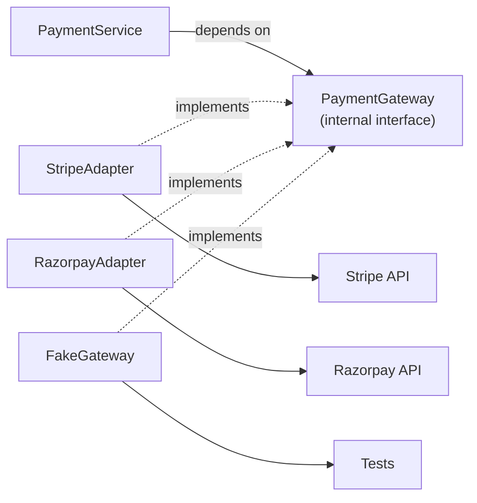

# Pattern 7 — Adapter

**Category:** Data and object creation · External integrations
**Stack used in examples:** TypeScript · Node.js · Express · Stripe · Razorpay

---

## Theory — why this pattern exists

Adapter is a **structural** pattern: *"Convert the interface of a class into
another interface clients expect. Adapter lets classes work together that
couldn't otherwise because of incompatible interfaces"* (GoF).

In backend architecture the same idea appears under two stronger names:

- **Ports and adapters (hexagonal architecture).** The application defines a port
  in its own language; an adapter connects that port to a technology.
- **Anti-corruption layer (domain-driven design).** The boundary protects the
  domain model from foreign concepts, field names, statuses, and error shapes.

The theory is **translation without leakage**. The adapter may know everything
about the vendor; the domain must know nothing about the vendor. That keeps the
domain vocabulary stable while the outside world changes. It also applies
**dependency inversion**: the domain owns the interface, and the vendor SDK sits
at the edge.

An adapter translates. It does not decide policy. Discounts, authorization,
retry strategy, and refund rules belong elsewhere — otherwise changing providers
changes business behaviour.

## Why you need it

You need an adapter when a third party's contract does not match yours:

- Provider A returns `payment_id` / `payment_status`; provider B returns
  `id` / `status`. Without translation, that vocabulary spreads everywhere.
- Vendor DTOs and enums leak into services, so a vendor field rename breaks
  business logic.
- Adding a second provider means duplicating conditionals in every caller.
- Each vendor reports errors differently, so retry and support logic is ad hoc.
- Tests need real SDK objects or recorded HTTP fixtures to exercise services.

Without an adapter, the vendor's design becomes your design. Every external
change becomes an internal migration, and provider lock-in grows silently.

## Benefits

| Benefit | What it gives you |
| --- | --- |
| **Stable internal contract** | One domain vocabulary regardless of provider quirks. |
| **Provider independence** | Swap or add vendors behind the same interface. |
| **Normalized statuses** | Every provider maps into the same state machine. |
| **Normalized errors** | Callers decide on `retryable` without knowing the vendor. |
| **Testability** | A fake adapter replaces the SDK in unit tests. |
| **One home for quirks** | Timeouts, retries, auth, and field mapping live at the boundary. |
| **Explicit capabilities** | Unsupported features are documented instead of silently failing. |

The costs are mapping code to maintain, an extra layer, and the temptation to
build a lowest-common-denominator interface that hides real provider differences.
Unknown statuses must fail loudly, not be guessed.

## When this pattern applies

Use it when an external API differs from your internal contract, when more than
one provider exists or is planned, when a vendor SDK is heavy or unstable, or
when a legacy protocol must be isolated. Skip it when there is no meaningful
mismatch — an adapter that only forwards calls adds indirection with no value.
Section 7 has the full decision list.

## 1. What problem does it solve?

Your application expects a consistent interface, but external providers implement different APIs.

Provider A returns:

```json
{ "payment_id": "pay_123", "payment_status": "captured" }
```

Provider B returns:

```json
{ "id": "txn_456", "status": "success" }
```

If controllers, services, and analytics all depend on provider-specific field names, then:

- Changing providers means touching the whole codebase.
- Adding a second provider doubles the conditional logic.
- Tests must fake vendor response shapes.
- Vendor field changes create ripple effects.
- Business code becomes unreadable (`result.payment_status === "captured"`).

An adapter **translates an external API into an interface your application understands**.

## 2. Structure



The adapter's job is translation, not business policy:

- Request shape → vendor request.
- Vendor response → internal result.
- Vendor errors → normalized errors.
- Vendor status values → internal status enum.

## 3. Practical TypeScript implementation

### 3.1 Internal contract

```ts
export type PaymentResult = {
  transactionId: string;
  status: "succeeded" | "pending" | "failed";
};

export interface PaymentGateway {
  createPayment(input: {
    orderId: string;
    amount: number;
    currency: string;
    idempotencyKey: string;
  }): Promise<PaymentResult>;
}
```

This is the **only** payment vocabulary the rest of the application should see.

### 3.2 Stripe adapter

```ts
type StripeLikeClient = {
  paymentIntents: {
    create(input: {
      amount: number;
      currency: string;
      metadata: Record<string, string>;
    }): Promise<{ id: string; status: string }>;
  };
};

export class StripeAdapter implements PaymentGateway {
  constructor(private readonly stripe: StripeLikeClient) {}

  async createPayment(input: {
    orderId: string;
    amount: number;
    currency: string;
    idempotencyKey: string;
  }): Promise<PaymentResult> {
    const result = await this.stripe.paymentIntents.create({
      amount: input.amount,
      currency: input.currency.toLowerCase(),
      metadata: { orderId: input.orderId },
    });

    return {
      transactionId: result.id,
      status: this.mapStatus(result.status),
    };
  }

  private mapStatus(status: string): PaymentResult["status"] {
    switch (status) {
      case "succeeded":
        return "succeeded";
      case "processing":
      case "requires_action":
        return "pending";
      case "requires_payment_method":
        return "failed";
      default:
        // Do NOT silently map unknown statuses to "failed".
        throw new Error(`Unmapped Stripe status: ${status}`);
    }
  }
}
```

### 3.3 Razorpay adapter

```ts
type RazorpayLikeClient = {
  orders: {
    create(input: {
      amount: number;
      currency: string;
      receipt: string;
    }): Promise<{ id: string; status: string }>;
  };
};

export class RazorpayAdapter implements PaymentGateway {
  constructor(private readonly razorpay: RazorpayLikeClient) {}

  async createPayment(input: {
    orderId: string;
    amount: number;
    currency: string;
    idempotencyKey: string;
  }): Promise<PaymentResult> {
    const order = await this.razorpay.orders.create({
      amount: input.amount,
      currency: input.currency,
      receipt: input.orderId,
    });

    return {
      transactionId: order.id,
      status: order.status === "created" ? "pending" : "failed",
    };
  }
}
```

### 3.4 Business code depends on the interface

```ts
export class PaymentService {
  constructor(
    private readonly gateway: PaymentGateway,
    private readonly orders: OrderRepository,
    private readonly payments: PaymentRepository,
  ) {}

  async pay(orderId: string) {
    const order = await this.orders.findById(orderId);
    if (!order) throw new Error("Order not found");
    if (order.status === "paid") return; // idempotent at the service level too

    const result = await this.gateway.createPayment({
      orderId,
      amount: Math.round(order.total * 100),
      currency: "INR",
      idempotencyKey: `order:${orderId}`,
    });

    await this.payments.save({ orderId, ...result });
    return result;
  }
}
```

No Stripe or Razorpay identifiers appear here — only `PaymentResult`.

### 3.5 Choosing an adapter

Use a **Factory** to select the adapter, and wire the chosen implementation once in the Express composition root:

```ts
// composition-root.ts
const gateway: PaymentGateway =
  process.env.NODE_ENV === "production"
    ? new StripeAdapter(stripeClient)
    : new SandboxGateway();

export const paymentService = new PaymentService(
  gateway,
  orderRepository,
  paymentRepository,
);
```

Environment-specific wiring: sandbox adapter in staging, real adapter in production. Swapping providers means changing one line here, not the routes or the business service.

## 4. Two directions of adaptation

| Direction | Example |
| --- | --- |
| **Outbound (driven)** | Application calls Stripe/Razorpay/S3 through an internal interface |
| **Inbound (driving)** | HTTP controller or CLI adapts transport input into an application command |
| **Legacy** | A SOAP/XML service wrapped behind a modern typed interface |
| **Compatibility** | A new module exposed through an old interface during migration |

Repositories are adapters too — they adapt database APIs to domain language.

## 5. Where adapters are valuable

- Payment gateways (Stripe, Razorpay, PayPal).
- Shipping providers (Delhivery, FedEx, DHL).
- SMS and email vendors (Twilio, SES, Resend).
- Cloud storage (S3, GCS, Azure Blob).
- Legacy SOAP/XML APIs.
- Third-party AI model APIs (OpenAI, Anthropic, local models).
- Identity providers (Auth0, Cognito, Keycloak).

## 6. Production considerations

1. **Do not map unknown statuses to failure.** Providers add statuses (e.g. `requires_capture`, `on_hold`). Handle unknown values explicitly — log + alert + map to a conservative internal state.
2. **Validate external responses.** Treat them as untrusted input even with an SDK: check presence, types, and ranges. A `total: null` from a vendor should not become `0`.
3. **Preserve error information.** Normalize into your own error type but keep the provider code/message/request id for debugging.
4. **Keep provider capabilities visible.** Not every provider supports partial refunds, 3DS, or certain currencies. Hiding real differences behind a lowest-common-denominator interface causes surprises.
5. **Timeouts and retries.** Configure them in the adapter/client. Never let a vendor call hang indefinitely.
6. **Idempotency.** Forward an idempotency key for anything that creates money movement.
7. **Contract tests.** Test adapters against the vendor sandbox or recorded fixtures, and re-run when SDKs upgrade.
8. **No business rules in the adapter.** It translates; it does not decide discounts, authorization, or refund policy.

### Normalized errors

```ts
export class GatewayError extends Error {
  constructor(
    message: string,
    readonly code: string,
    readonly retryable: boolean,
    readonly provider: string,
    readonly cause?: unknown,
  ) {
    super(message);
    this.name = "GatewayError";
  }
}
```

The caller can decide whether to retry based on `retryable` without knowing the vendor.

## 7. When to use / when not to

**Use it when**
- An external API differs from your internal contract.
- More than one provider may be used, now or later.
- You want tests without vendor SDKs.
- A vendor SDK is unstable, heavy, or awkward.
- You need to isolate a legacy protocol.

**Avoid it when**
- There is no meaningful interface mismatch (an adapter would just forward calls).
- The vendor already exposes exactly the shape you need and you will never change it.
- It becomes an excuse to hide important semantics — sometimes callers *must* know a capability is unsupported.

## 8. Common mistakes

1. Letting vendor DTOs leak into the domain (“just this once”).
2. Mapping every unknown status to `failed`, causing false failure reports.
3. Losing provider error codes, making support tickets impossible to debug.
4. Putting retries in three layers (adapter + service + queue) and multiplying traffic.
5. Assuming all providers behave identically for refunds, webhooks, and settlement timing.
6. An adapter that talks to the database or sends emails — it should only translate a call.

## 9. Relationship to other patterns

- **Factory** — selects which adapter to use.
- **Repository** — an adapter for persistence.
- **Strategy** — adapters often implement strategy interfaces.
- **Decorator** — adds caching/logging/circuit breaking around an adapter.
- **Circuit breaker** — wraps the adapter call to protect against a sick vendor.
- **Observer** — vendor webhooks are translated by an inbound adapter and published as internal events.

## 10. Practice checklist

- [ ] Define the internal interface first, in your own language.
- [ ] Map request, response, statuses, and errors explicitly.
- [ ] Fail loudly on unmapped values; add a metric.
- [ ] Add contract tests with sandbox or fixtures.
- [ ] Configure timeouts and a single retry policy.
- [ ] Pass idempotency keys for every charge.
- [ ] Document provider capability differences.

## 11. One-line takeaway

> An adapter is the anti-corruption layer for a third-party API: vendors change, your domain vocabulary does not.

