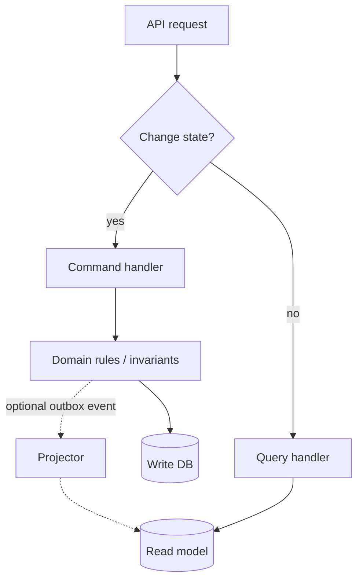
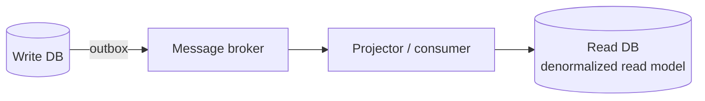

# Pattern 9 — CQRS (Command Query Responsibility Segregation)

**Category:** Scaling and resilience · Read/write architecture
**Stack used in examples:** TypeScript · Node.js · Express · PostgreSQL

---

## 1. What problem does it solve?

Most CRUD applications use one model for reading and changing data. That works until read and write needs diverge:

- Reads need filtering, sorting, pagination, joins, and aggregation.
- Writes need validation, invariants, transactions, and locking.
- Read traffic can be 10–100× write traffic.
- Different screens need different projections of the same data.
- Reporting queries slow down checkout because they hit the same tables/model.

CQRS separates **the responsibility for changing data** from **the responsibility for retrieving data**.

## 2. Commands vs. queries

A **command** expresses an intention to change state:

- `CreateOrder`
- `UpdateProfile`
- `CancelSubscription`

A **query** requests information without changing state:

- `GetOrderDetails`
- `SearchProducts`
- `GetCustomerDashboard`

Rules of thumb:

- A command may return an id (or nothing), not a full read model.
- A query must be side-effect free (no writes, no counters, no emails).
- Name commands in the imperative, queries as questions.

## 3. Structure



Key point: **CQRS does not require two databases, a broker, or event sourcing.** Level 1 (separate handlers in one codebase, one database) already delivers most of the maintainability benefit.

## 4. Practical TypeScript implementation

### 4.1 Command + handler

```ts
export type UpdateProfileCommand = {
  userId: string;
  displayName: string;
};

export class UpdateProfileHandler {
  constructor(
    private readonly users: {
      updateDisplayName(id: string, name: string): Promise<void>;
    },
  ) {}

  async execute(command: UpdateProfileCommand): Promise<void> {
    const name = command.displayName.trim();

    if (name.length < 2 || name.length > 80) {
      throw new Error("Invalid display name");
    }

    await this.users.updateDisplayName(command.userId, name);
  }
}
```

The handler enforces business rules and owns the transaction boundary.

### 4.2 Query + handler

```ts
export type ProfileView = {
  id: string;
  displayName: string;
  orderCount: number;
  lastOrderAt: string | null;
};

export class GetProfileHandler {
  constructor(
    private readonly readRepository: {
      getProfileView(id: string): Promise<ProfileView | null>;
    },
  ) {}

  async execute(userId: string): Promise<ProfileView> {
    const profile = await this.readRepository.getProfileView(userId);
    if (!profile) throw new Error("Profile not found");
    return profile;
  }
}
```

The query handler returns a **purpose-built view** — exactly the fields the screen needs, in one query.

### 4.3 Command bus / registry (optional)

```ts
type CommandHandler<T> = { execute(command: T): Promise<void> };

export class CommandBus {
  private readonly handlers = new Map<string, CommandHandler<unknown>>();

  register<T>(name: string, handler: CommandHandler<T>) {
    this.handlers.set(name, handler as CommandHandler<unknown>);
  }

  async dispatch<T>(name: string, command: T): Promise<void> {
    const handler = this.handlers.get(name);
    if (!handler) throw new Error(`No handler for ${name}`);
    return handler.execute(command);
  }
}
```

A bus adds indirection and middleware (validation, logging, transactions). Introduce it when you have many commands, not for two.

### 4.4 Express wiring

```ts
// composition-root.ts
export const updateProfileHandler = new UpdateProfileHandler(userRepository);
export const getProfileHandler = new GetProfileHandler(profileReadRepository);
```

```ts
// profile.routes.ts
export const profileRouter = Router();

profileRouter.patch(
  "/",
  requireAuth,
  asyncHandler(async (req, res) => {
    await updateProfileHandler.execute({
      userId: req.user.id,
      displayName: req.body.displayName,
    });

    res.status(204).end();
  }),
);

profileRouter.get(
  "/",
  requireAuth,
  asyncHandler(async (req, res) => {
    res.json(await getProfileHandler.execute(req.user.id));
  }),
);
```

`requireAuth` populates `req.user` (declare it via Express type augmentation). `asyncHandler` forwards rejected promises to the central Express error handler.

Note that **both** paths enforce authorization. A separate read path is not automatically safe.

## 5. Levels of CQRS

| Level | Architecture | When it makes sense |
| --- | --- | --- |
| **Level 1** | Separate command and query handlers, same database | Most growing applications; low risk, immediate clarity |
| **Level 2** | Different write and read **models** (SQL views, materialized views, denormalized tables) | Complex reporting or read optimization |
| **Level 3** | Separate read/write storage + asynchronous projections | High-scale workloads with acceptable consistency lag |

Start at the lowest level that solves the problem. Moving up adds real operational cost.

### Level 2 example: a read model

```sql
CREATE MATERIALIZED VIEW profile_summary AS
SELECT u.id,
       u.display_name,
       COUNT(o.id)          AS order_count,
       MAX(o.created_at)    AS last_order_at
FROM users u
LEFT JOIN orders o ON o.user_id = u.id
GROUP BY u.id, u.display_name;
```

Refresh on a schedule or after relevant commands; the write model stays normalized and invariant-safe.

### Level 3: projections



The projector is an observer/consumer that builds the read model. It must be idempotent and lag-aware.

## 6. Production trade-offs

**Eventual consistency.** With asynchronous projections, a user may create an order and immediately see an older list. Decide explicitly:

- Read-after-write expectations per screen.
- Return the newly created entity in the command response.
- Serve “your recent writes” from the write model for a short window.
- Show a “processing” state instead of stale data.

**Operational complexity.** Two stores mean replication/projection logic, monitoring, replay tooling, schema migration, and disaster recovery planning.

**Transaction boundaries.** Commands that enforce invariants must be safe under concurrency: use transactions, unique constraints, and conditional updates.

**Security.** Query handlers need the same authorization and tenancy scoping as commands. A read model can accidentally expose fields the write model restricted.

**Testing.** Test command invariants and query correctness separately; add projection-lag tests for Level 3.

**Duplication.** Commands and queries may share small pieces (types, repositories). Share infrastructure, not business rules — the point is separate responsibilities, not zero reuse.

## 7. When to use / when not to

**Use it when**
- Read and write workloads differ materially (traffic or shape).
- Reporting queries hurt transactional performance.
- Multiple screens need different read shapes.
- Business rules for writes are complex and deserve a dedicated home.
- You can tolerate (and design for) eventual consistency at the read side.

**Avoid it when**
- A straightforward CRUD model works and the team is small.
- You would add two databases and a broker just because CQRS “sounds scalable”.
- Consistency requirements make async projections impractical and Level 1 adds no clarity.
- There is no read/write asymmetry to exploit.

## 8. Common mistakes

1. Jumping straight to Level 3 (separate DB + broker) for a CRUD app.
2. Letting a query handler mutate state (“just a small counter”).
3. Returning write entities from commands and forcing the client to re-query anyway.
4. Forgetting authorization on the read path.
5. No strategy for read-after-write, leading to “my order disappeared” bugs.
6. Non-idempotent projections; rebuilding a read model produces duplicates.
7. Sharing one bloated “service” that both writes and reads, which is CQRS in name only.
8. Ignoring projection lag metrics and alerting.

## 9. Relationship to other patterns

- **Repository** — command side uses invariant-focused repositories; query side returns read models.
- **Observer** — events/projections keep the read model up to date.
- **Mediator / command bus** — often used to dispatch commands and queries.
- **Strategy** — different query/optimization strategies per view.
- **Decorator** — caching/authorization around query handlers.
- **Circuit breaker** — protects projections and cross-service reads.

## 10. Practice checklist

- [ ] Identify the read/write asymmetry you actually have.
- [ ] Split handlers first (Level 1), keep one database.
- [ ] Write commands with validation and explicit transactions.
- [ ] Design each query around a screen/view, not around tables.
- [ ] Enforce authorization and tenant scoping on both sides.
- [ ] Define read-after-write behaviour before adding async projections.
- [ ] If projecting: make it idempotent, replayable, and monitored.

## 11. One-line takeaway

> CQRS is about separating *responsibilities*, not about doubling your infrastructure — start at Level 1 and only escalate when requirements demand it.

