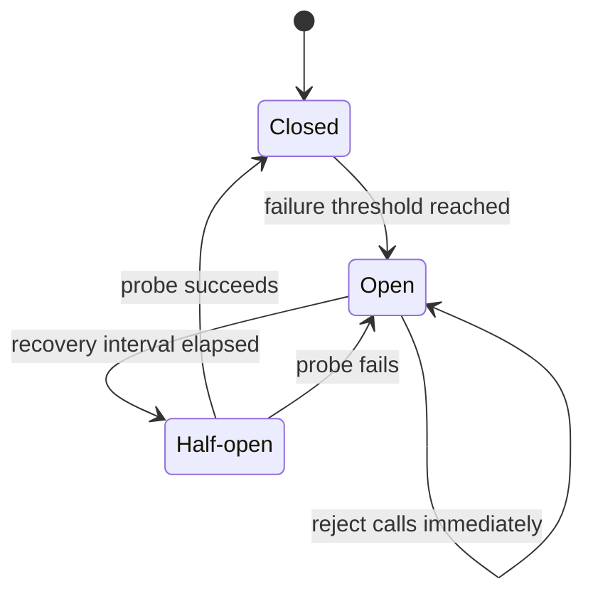

# Pattern 10 — Circuit Breaker

**Category:** Scaling and resilience · Reliability and fault tolerance
**Stack used in examples:** TypeScript · Node.js · Express · `opossum` · Stripe/Razorpay

---

## 1. What problem does it solve?

Your backend depends on an external payment API.

Normally requests finish in ~200 ms. One day the provider starts timing out and each call hangs for 20 seconds.

Without safeguards:

1. Requests keep waiting.
2. Connections, sockets, and request handlers stay occupied.
3. Retries multiply traffic to the already-failing provider.
4. Queues and thread/event-loop pressure grow; unrelated endpoints slow down.
5. Your own service becomes unhealthy — the failure **cascades**.

A circuit breaker **stops calling a dependency after repeated failures**, gives it time to recover, and fails fast with a controlled error or safe fallback.

## 2. The three states

| State | Behaviour |
| --- | --- |
| **Closed** | Requests flow normally. Failures are counted. When the threshold is reached, the circuit opens. |
| **Open** | Calls are rejected immediately without contacting the dependency. Return a controlled error or fallback. |
| **Half-open** | After a recovery interval, a limited number of probe calls are allowed. Success → closed; failure → open again. |



## 3. Practical implementation with `opossum`

Do not hand-roll concurrency-sensitive breaker logic in production; use a maintained library. For Node.js, `opossum` is a common choice (Resilience4j is typical in Java).

```ts
import CircuitBreaker from "opossum";

const options = {
  timeout: 3000,                 // per-call timeout (ms)
  errorThresholdPercentage: 50,  // open when ≥50% fail...
  volumeThreshold: 10,           // ...within at least 10 calls
  resetTimeout: 30_000,          // stay open for 30s, then half-open
  rollingCountTimeout: 10_000,   // rolling window (ms)
  rollingCountBuckets: 10,
};

const paymentBreaker = new CircuitBreaker(
  async (input: PaymentRequest) => stripeAdapter.createPayment(input),
  options,
);

paymentBreaker.on("open", () => logger.warn("payment breaker opened"));
paymentBreaker.on("halfOpen", () => logger.info("payment breaker half-open"));
paymentBreaker.on("close", () => logger.info("payment breaker closed"));
paymentBreaker.on("timeout", () => metrics.increment("payment.breaker.timeout"));
paymentBreaker.on("failure", (err) => metrics.increment("payment.breaker.failure"));
paymentBreaker.on("success", () => metrics.increment("payment.breaker.success"));

export async function createPayment(input: PaymentRequest) {
  return paymentBreaker.fire(input);
}
```

The wrapped function is the **only** way to reach the provider, so every call is measured.

### 3.1 Fallback

Only use a fallback when it is semantically safe:

```ts
paymentBreaker.fallback(() => ({
  transactionId: "unknown",
  status: "pending" as const,   // "we are confirming", not "failed"
}));
```

A fallback that silently pretends success is worse than an error.

### 3.2 Express integration

```ts
// payment-gateway.service.ts
export class PaymentGatewayService {
  private readonly breaker: CircuitBreaker;

  constructor(
    private readonly adapter: PaymentGateway,
    private readonly logger: Logger,
  ) {
    this.breaker = new CircuitBreaker(
      (input: PaymentRequest) => this.adapter.createPayment(input),
      { timeout: 3000, errorThresholdPercentage: 50, resetTimeout: 30_000 },
    );
  }

  async charge(input: PaymentRequest) {
    return this.breaker.fire(input);
  }
}
```

```ts
// composition-root.ts — one breaker per process, shared by every request
export const paymentGateway = new PaymentGatewayService(stripeAdapter, logger);
```

```ts
// payments.routes.ts
paymentsRouter.post(
  "/:orderId/pay",
  asyncHandler(async (req, res) => {
    const result = await paymentGateway.charge({
      orderId: req.params.orderId,
      amount: req.body.amount,
      currency: req.body.currency,
    });

    res.status(202).json(result);
  }),
);
```

Map breaker rejections (`EOPENBREAKER`) to `503 Service Unavailable` — or to a “payment pending confirmation” response — in centralized Express error middleware instead of repeating `try/catch` in every route. Wrap routes in `asyncHandler` so rejected promises reach that middleware.

## 4. What to count as a failure

Classify errors before feeding the breaker:

| Error | Counts as failure? |
| --- | --- |
| Connection reset / DNS failure / 5xx | ✅ Yes |
| Timeout | ✅ Yes |
| 429 rate limited | ⚠️ Often yes, but may need a different policy |
| 400 invalid request (your bug) | ❌ No — do not open the breaker |
| Card declined / insufficient funds | ❌ No — a business outcome |
| Authentication misconfigured (401) | ⚠️ Yes, but also alert: your deployment is broken |

Counting every business error opens the circuit during normal operations.

```ts
paymentBreaker.on("failure", (error) => {
  // Library options differ; opossum supports an errorFilter.
});

const breaker = new CircuitBreaker(fn, {
  ...options,
  errorFilter: (error) =>
    error.name !== "CardDeclinedError" && error.name !== "ValidationError",
});
```

## 5. Circuit breaker vs. retries vs. timeouts

These are **complementary**, not substitutes.

| Technique | What it does |
| --- | --- |
| **Timeout** | Stops waiting indefinitely for one operation |
| **Retry** | Attempts a failed operation again (bounded, with backoff) |
| **Circuit breaker** | Stops repeated calls to an unhealthy dependency |
| **Bulkhead** | Limits how many resources one dependency can consume |
| **Rate limiter** | Limits request frequency |

A payment call might use all of: a timeout, at most two retries for transient errors with exponential backoff + jitter, a breaker to stop hammering a dead provider, and a bulkhead to cap concurrent provider calls.

Order matters: `timeout → retry → breaker` (or breaker outside the retry, depending on semantics). Document it, and never stack retries in multiple layers — queue + adapter + service retries multiply traffic.

## 6. Payment-specific warning

A timeout does **not** prove that a payment failed. The provider may have charged the card and failed to return the response.

Therefore:

- Do **not** blindly retry a charge.
- Do **not** treat an open circuit as proof that no charge occurred.
- Use provider **idempotency keys** on every charge attempt.
- Persist payment state (`pending`, `authorized`, `captured`, `unknown`).
- Reconcile uncertain outcomes with the provider (status API, webhooks, settlement report).
- Tell the customer the payment is **being confirmed** rather than falsely reporting success or failure.

```ts
type PaymentState =
  | { kind: "pending"; idempotencyKey: string }
  | { kind: "succeeded"; transactionId: string }
  | { kind: "failed"; code: string }
  | { kind: "unknown"; lastAttemptAt: string }; // reconcile, do not retry blindly
```

## 7. Production considerations

- **Count relevant failures only** (see table above). Business errors must not open the circuit.
- **Bound retries.** Infinite retries turn an outage into a self-inflicted DDoS.
- **Fallbacks must be semantically safe.** Cached/static data or a “pending” state, not a fake success.
- **Per-instance state.** Each pod has its own breaker; five pods may disagree. That is usually acceptable, but for global throttling use a shared mechanism (Redis-based limiter).
- **Warm-up / minimum volume.** Do not open after one failure at low traffic (`volumeThreshold`).
- **Jitter** timeouts and retries to avoid synchronized retry storms.
- **Observe** state transitions, failure rate, latency, rejected calls, and fallback usage. A breaker without metrics makes outages harder to diagnose, not easier.
- **Test recovery**, not just failure: force the dependency down, verify open, then bring it back and verify half-open → closed.
- **Health checks & bulkheads.** A breaker protects one dependency; bulkheads and timeouts protect the whole service.

### Metrics that matter

```
payment_breaker_state{state="open"}            1
payment_breaker_calls_total{result="rejected"} 42
payment_provider_duration_ms (p50/p95/p99)
payment_breaker_fallbacks_total               3
```

## 8. When to use / when not to

**Use it when**
- A remote dependency can fail or become slow.
- Continued calls would threaten your own service's health.
- You can define a safe failure mode or fallback.
- Traffic volume is enough for thresholds to be meaningful.

**Avoid it when**
- The dependency is local and reliable (in-process, same DB with proper timeouts).
- There is no meaningful fallback and failing fast adds no value.
- Traffic is so low that thresholds behave erratically (use simple timeouts + alerts instead).

## 9. Common mistakes

1. Counting 400s and card declines as provider failures.
2. No timeout — the breaker never trips because calls never “fail”, they hang.
3. Retrying inside the breaker **and** outside it.
4. Falling back to a fake success for payments.
5. Forgetting to log state transitions, so nobody knows why traffic dropped.
6. Assuming breaker state is global across pods.
7. Never testing the half-open path; the service gets stuck open (or flaps).
8. Using a breaker to hide a dependency that is simply misconfigured.

## 10. Relationship to other patterns

- **Adapter** — the breaker wraps the adapter's remote call.
- **Decorator** — often implemented as a decorator around a gateway.
- **Singleton / DI** — one breaker instance per dependency per process.
- **Factory** — creates a configured breaker per provider.
- **Observer** — breaker state changes emit events/metrics.
- **CQRS / Observer** — projections and consumers need the same protection when they call remote systems.

## 11. Practice checklist

- [ ] Wrap every remote call with a timeout.
- [ ] Classify retryable vs. business errors.
- [ ] Configure threshold, volume, and reset window deliberately.
- [ ] Add idempotency keys before enabling retries.
- [ ] Define and test a safe fallback.
- [ ] Emit metrics for state, failures, rejections, and latency.
- [ ] Run a failure drill: dependency down → open → recover → closed.

## 12. One-line takeaway

> A circuit breaker trades a fast, controlled failure for a slow, cascading one — pair it with timeouts, bounded retries, idempotency, and observability.
